## Exercise 1: Assess the SQL Server 2016 database with Azure Arc

### Estimated Duration: 30 Minutes

## Lab Scenario

In this exercise, you connect to the on-premises SQL Server 2016 database, prepare it for migration, optionally capture a Query Store performance baseline, and assess its readiness for Azure SQL Managed Instance using **Azure Arc**. The Azure Arc migration assessment is used in place of the retired Data Migration Assistant workflow. It runs from the Arc-enabled SQL Server resource in the Azure portal and gives you compatibility findings and a SKU recommendation.

## Lab Objectives

In this exercise, you will complete the following tasks:

- Task 1: Connect to the SQL Server 2016 VM and prepare the WideWorldImporters database
- Task 2: Capture a Query Store performance baseline (optional)
- Task 3: Review the Azure Arc-enabled SQL Server
- Task 4: Run the Azure Arc migration assessment

## Task 1: Connect to the SQL Server 2016 VM and prepare the database

In this task, you connect to the **<inject key="SQLVM Name" enableCopy="false"/>** VM, confirm the SQL Server build, and configure the `WideWorldImporters` database for migration.

1. Click on the Azure portal icon in the lab VM.

    

1. On the **Azure portal**, in the **Search resources** box at the top, search for **Resource groups (1)** and then select **Resource groups (2)** from the results.

   

1. On the **Resource groups** page, select the resource group **<inject key="Resource Group Name" enableCopy="false"/>** from the list.

    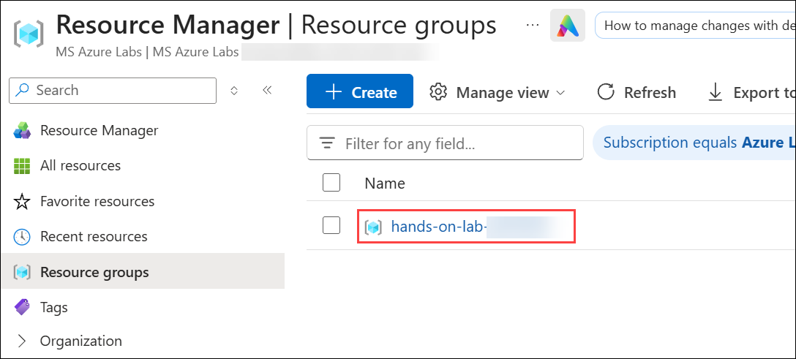

1. In the list of resources for your resource group, select the **sql2016-<inject key="Suffix" enableCopy="false"/>** Virtual Machine.

    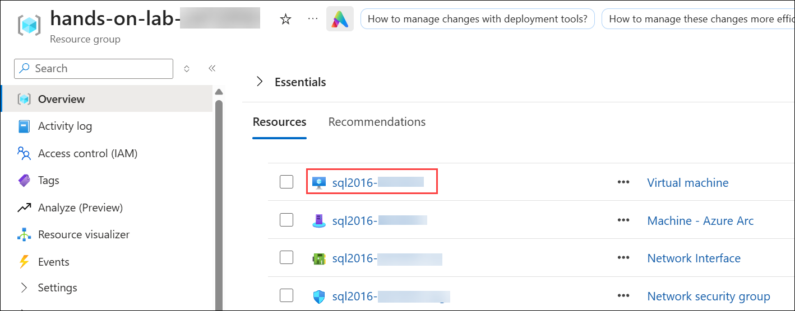

1. On the **sql2016-<inject key="Suffix" enableCopy="false"/>** virtual machine **Overview** page, click **Connect (1)** and then select **Connect (2)** from the drop-down menu.

    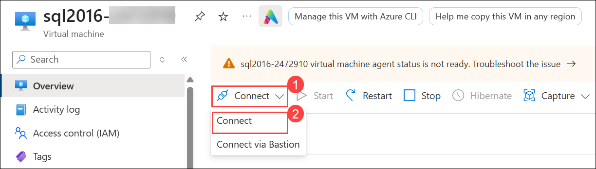

1. On the **sql2016-<inject key="Suffix" enableCopy="false"/> | Connect** page, click on **Download RDP file** under **Native RDP**. 
  
    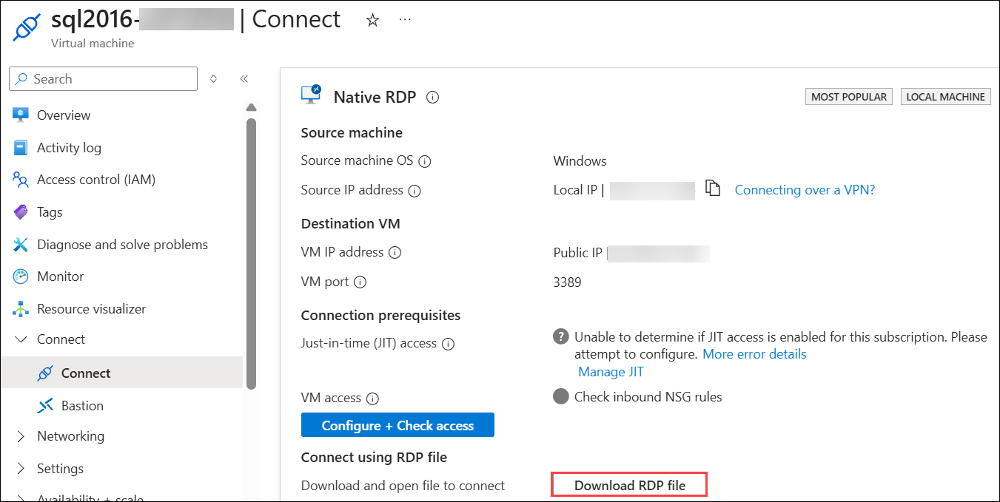

1. Click on **Keep**, on the Downloads pop-up. 

1. Click on **Open file** to open the RDP session.

1. On the RDP pop-up, **check (1)** "I understand and want to allow RDP files to open on this device for my account" and then click **OK (2)**.

    

1. Next, on RDP tab, ensure that the **Clipboard** option is enabled, and then select **Connect**.

   

1. Enter the following credentials when prompted, and then select **OK**:

   - **Username**: `sqlmiuser`
   - **Password**: `Password.1234567890`

      

1. On **The identity of the remote computer cannot be verified** pop-up window, click **Yes** to confirm and proceed with connecting to your virtual machine.

    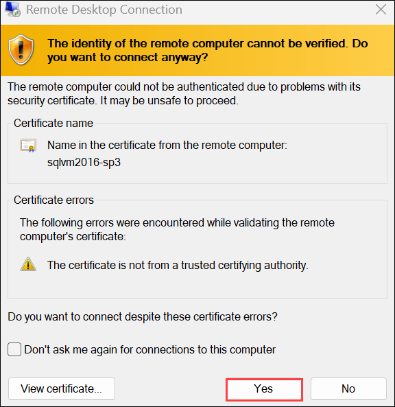

1. On the VM, open **SQL Server Management Studio (SSMS)** from the Start menu.

    
   
1. In the **Connect to Server** dialog, enter `sqlvm2016-sp3` **(1)** into the **Server name** box, ensure **Windows Authentication (2)** is selected, check **Trust server certificate (3)**, and then select **Connect (4)**.

   
   
1. Expand **Databases (1)** in Object Explorer and verify that the **WideWorldImporters<inject key="deploymentID" enableCopy="false"></inject> (2)** database is listed.

    

1. In SQL Server Management Studio (SSMS), right-click the **SQL Server instance (1)** in Object Explorer and select **New Query (2)**.

   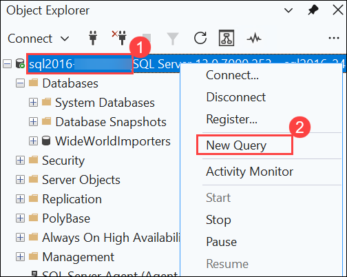
   
1. Paste the following script, and then select **Execute**. The script confirms the SQL Server build, sets the recovery model to **FULL**, and enables **Service Broker**.

    ```sql
    -- Build 13.0.7xxx = SQL Server 2016 SP3 + Azure Connect pack; Edition must be Developer/Standard/Enterprise
    SELECT SERVERPROPERTY('ProductVersion') AS ProductVersion,
           SERVERPROPERTY('ProductLevel')   AS ProductLevel,
           SERVERPROPERTY('Edition')        AS Edition;
    GO
    
    USE master;
    GO
    
    ALTER DATABASE WideWorldImporters<inject key="deploymentID" enableCopy="false"></inject> SET
    RECOVERY FULL,
    ENABLE_BROKER WITH ROLLBACK IMMEDIATE;
    GO
    ```

    
   
1. Confirm Edition = Developer (or Standard/Enterprise), ProductVersion starts with 13.0.7, ProductLevel = SP3.

   
   
     >**Note:**  SP3 alone is 13.0.6300; the Azure Connect pack raises it to 13.0.7000+. The MI link requires Developer/Standard/Enterprise — Evaluation is not supported. If it shows Evaluation, upgrade via Installation Center > Maintenance > Edition Upgrade.

## Task 2: Capture a Query Store performance baseline (optional)

In this task, you turn on **Query Store** on the source database and run a sample workload. Query Store data is stored inside the database, so it travels with the database to SQL MI. In Exercise 4, you run the same workload on SQL MI and compare the results.

1. In SSMS, select **New Query**, paste the following script, and then select **Execute** to enable Query Store:

    ```sql
    USE master;
    GO
    ALTER DATABASE WideWorldImporters<inject key="deploymentID" enableCopy="false"></inject> SET QUERY_STORE = ON;
    ALTER DATABASE WideWorldImporters<inject key="deploymentID" enableCopy="false"></inject> SET QUERY_STORE (
        OPERATION_MODE = READ_WRITE, QUERY_CAPTURE_MODE = ALL, INTERVAL_LENGTH_MINUTES = 5);
    GO
    ```
   
    
1. Select **New Query**, paste the following sample workload, and then select **Execute**. The `GO 50` batch separator runs each query 50 times.

    ```sql
    USE WideWorldImporters<inject key="deploymentID" enableCopy="false"></inject>;
    GO
    -- Leaderboard query
    SELECT TOP (50) GamerId, GamerScore, GamesPlayed
    FROM dbo.Leaderboard
    ORDER BY GamerScore DESC;
    GO 50
    -- Catalog query
    SELECT Title, Rating
    FROM dbo.Game
    WHERE IsOnlineMultiplayer = 1
    ORDER BY Title;
    GO 50
    ```

    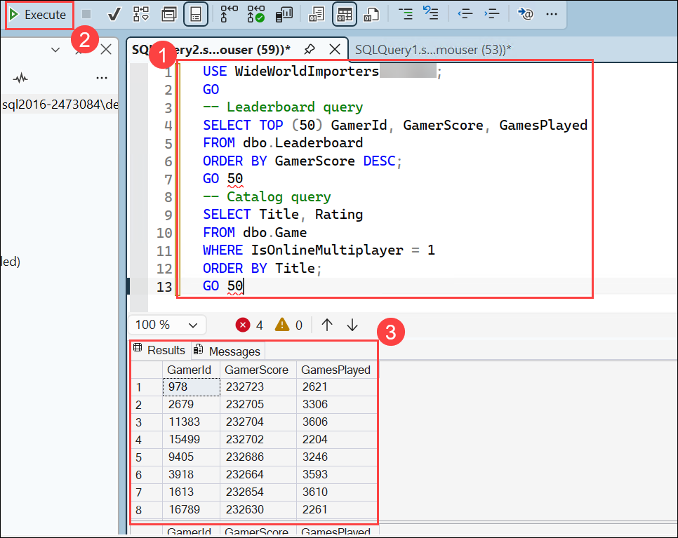
   
1. In Object Explorer, expand **WideWorldImporters** > **Query Store**, and then double-click **Top Resource Consuming Queries**. Note the **duration** and **CPU time** of the Leaderboard query - you compare these values after the migration.

   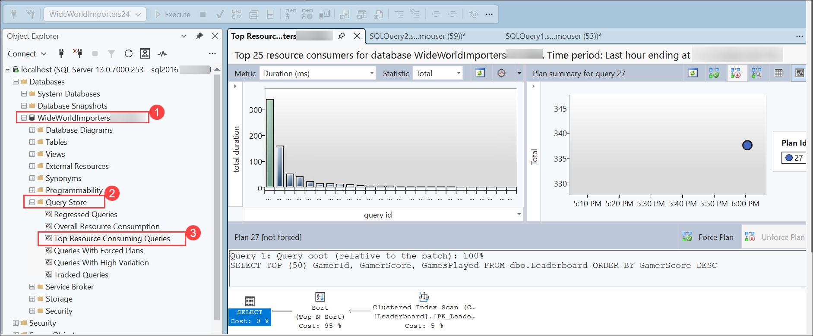


### Task 3: Review the Azure Arc-enabled SQL Server

The lab environment has already connected the SQL Server 2016 VM to Azure through **Azure Arc**. In this task, you review the Arc-enabled SQL Server resource.

1. In the **Azure portal**, search for **Azure Arc** and select it.

    

1. Azure Arc > Machines and confirm the machine shows Connected.


   
1. Under **Data services**, select **SQL Server instances**, and then select the **<inject key="SQLVM Name" enableCopy="false"/>** instance.

    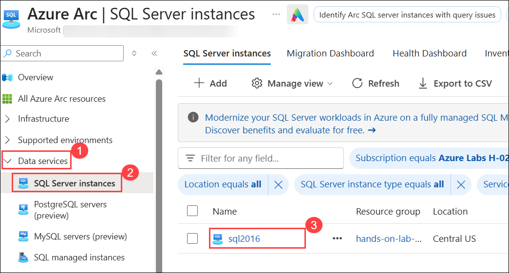
   
1. On the **Overview** page, review the instance details: version (SQL Server 2016), edition, license type, and host.

    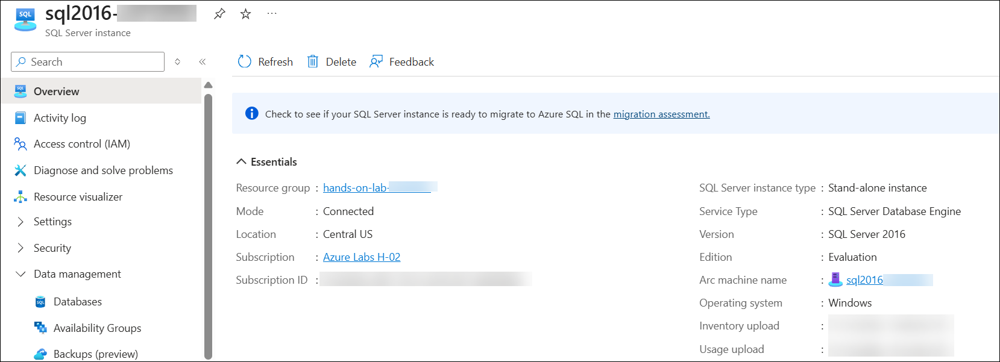
   
1. In the left menu, select **Databases** and confirm that **WideWorldImporters<inject key="deploymentID" enableCopy="false"></inject>** is listed.

    
   
   >**Note:** Azure Arc gives you one place to manage SQL Server outside Azure — inventory, best-practices and migration assessments, and Extended Security Updates for out-of-support versions such as SQL Server 2016.

## Task 4: Run the Azure Arc migration assessment

In this task, you run a migration assessment and review the database's readiness for Azure SQL Managed Instance and Azure SQL Database.

1. On the **<inject key="SQLVM Name" enableCopy="false"/>** Arc-enabled SQL Server resource, in the left menu, under **Migration**, select **Assessments**. From the toolbar, select **Run assessment**. The assessment may take a few minutes to complete.

     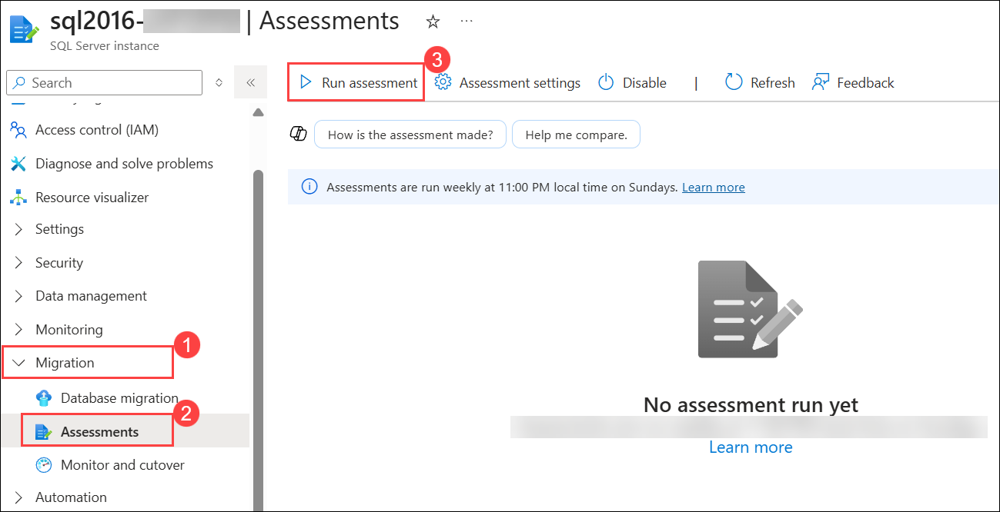 

   >**Note:** Azure Arc also runs assessments automatically on a weekly schedule. The **Run assessment** button runs one on demand, which is what this task needs. If the page shows "No assessment run yet," select **Run assessment** and wait.

1. When the assessment completes, the **Assessment results** open with a **Migration strategy** of **Modernize to PaaS** and an **Overview** showing three target options side by side:

   - **Azure SQL MI** - **Ready** (0 migration issues)
   - **SQL Server on Azure VM** - Ready
   - **Azure SQL DB** - **Not ready**

      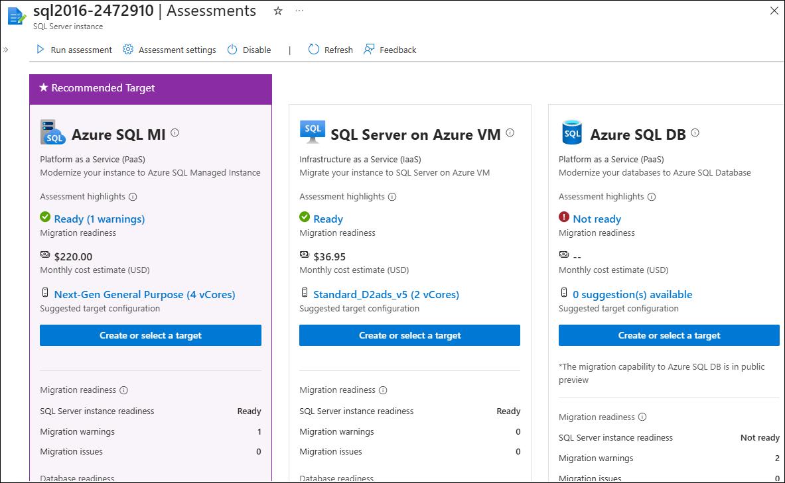
      
1. Under the **Azure SQL DB** card, select **View assessment details**. In **Migration target type**, ensure **Azure SQL DB** is selected, and open the **Compatibility** tab. Under **Database compatibility**, note the blocking finding: **"Service Broker feature is not supported in Azure SQL Database"** (Issue). This is why Azure SQL Database is ruled out.

   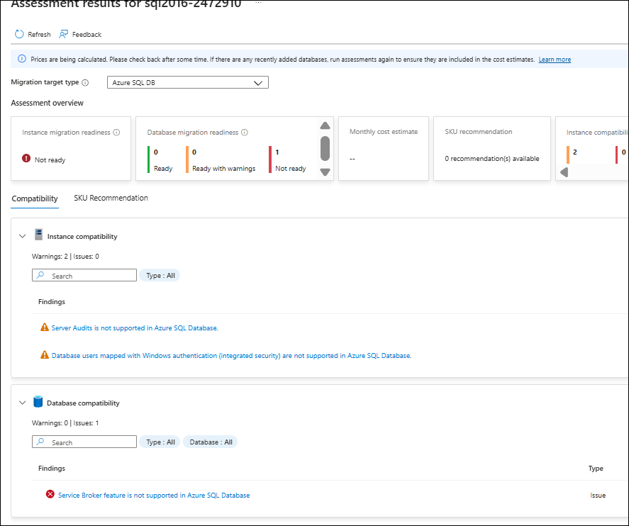
   
1. Change **Migration target type** to **Azure SQL Managed Instance**.

   
   
1. Confirm it shows **Ready** with no blocking issues. Then review the **SKU Recommendation** tab for the recommended service tier, vCores and storage, based on the source server's performance data.

    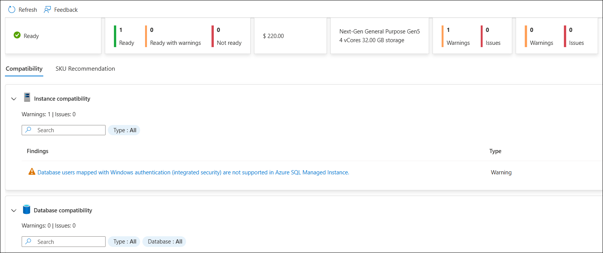  

   >**Note:** The database, including the Service Broker feature, can be migrated as-is, giving WWI a fully managed PaaS database with _near 100% compatibility_, including the features that prevented them from using Azure SQL Database.

   > **Alternative:** If Azure Arc isn't available in your environment, you can assess the database with **Azure Migrate** instead (discovery and assessment using the Azure Migrate appliance).

## Summary

In this exercise, you prepared the `WideWorldImporters` database on SQL Server 2016 SP3, optionally captured a Query Store baseline, and used the Azure Arc migration assessment to confirm that Azure SQL Managed Instance is the right target.

### You have successfully completed the exercise. Now click on **Next >>** from the lower right corner to move on to the next exercise.
