# Exercise 2: Migrate with Azure Arc and the Managed Instance link

### Duration: 60 Minutes

## 📖 Overview

In this exercise, you will migrate the **<inject key="Database Name" enableCopy="false"/>** database from SQL Server 2016 to Azure SQL Managed Instance using the Managed Instance link. You will configure the migration, verify near-real-time replication, and complete the cutover with minimal downtime.

You will first prepare and validate the migration, then start replication between the source SQL Server and the target SQL Managed Instance, verify that data changes are replicated, and finally complete the cutover to the Azure SQL Managed Instance.

## 🎯 Objectives

- **Task 1:** Retrieve the SQL MI connection information
- **Task 2:** Check the Managed Instance link prerequisites
- **Task 3:** Select the target and start the Managed Instance link migration
- **Task 4:** Verify near real-time replication
- **Task 5:** Cut over to SQL MI

### Task 1: Retrieve the SQL MI connection information

In this task, you will retrieve the **SQL Managed Instance FQDN** that you will use to connect to the target database during the migration.

1. In the Azure portal, select the **Cloud Shell (1)** icon in the top menu, and select **PowerShell (2)**.

    
   
1. In the **Getting started** pane, select **No storage account required (1)**, select your **Subscription (2)**, and select **Apply (3)**.

    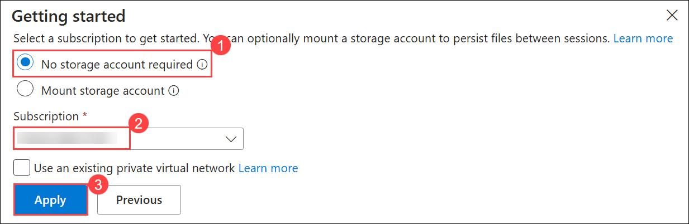
   
1. Run the following command to retrieve the **SQL Managed Instance** details from the **SQLMI-Shared-RG** resource group:

   ```PowerShell
   $resourceGroup = "SQLMI-Shared-RG"
   az sql mi list --resource-group $resourceGroup --query "[].{name:name, fqdn:fullyQualifiedDomainName, tier:sku.tier}" -o table
   ```
   
1. In the command output, locate the **fqdn** value and copy it to **Notepad**. You will use this value in later steps and exercises.

   

## Task 2: Prepare the database for the Managed Instance link

In this task, you will prepare the source database for the **Managed Instance link** by taking a full backup and verifying connectivity to the SQL Managed Instance.

The source SQL Server prerequisites for the Managed Instance link are already configured in the lab environment (built into the SQL Server VM image): a supported edition + SP3 with the Azure Connect pack (confirmed in Exercise 1), Always On availability groups enabled, a database master key in master, the required NT AUTHORITY\SYSTEM availability-group grants, and the network ports (5022 and 11000–11999). The only step you perform here is a full backup, which establishes the log chain required for the link's automatic seeding.

1. On the VM, in SSMS (connected to Source/localhost), select **New Query**.

     
   
1. Paste the following (replace SUFFIX with **<inject key="Suffix" />**), and select **Execute**:

    ```
    -- Full backup to establish the log chain for the link's automatic seeding
    BACKUP DATABASE WideWorldImportersSUFFIX
    TO DISK = 'WideWorldImportersSUFFIX_full.bak'
    WITH CHECKSUM, INIT, COMPRESSION;
    GO
    ```
    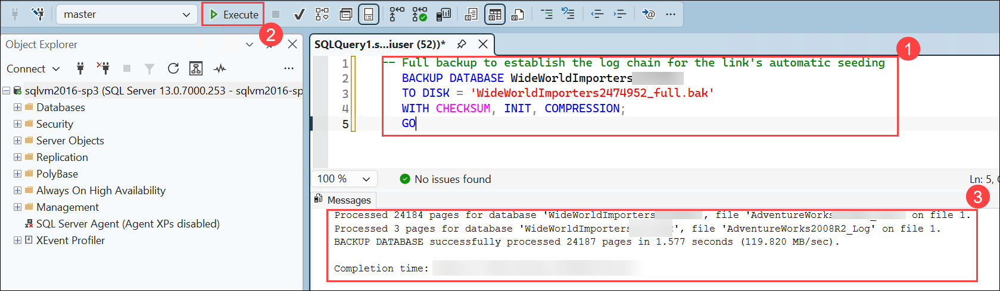
    
1. Search for **PowerShell (1)** in the Windows search bar, select **Windows PowerShell ISE (2)**, then select **Run as administrator (3)**.

    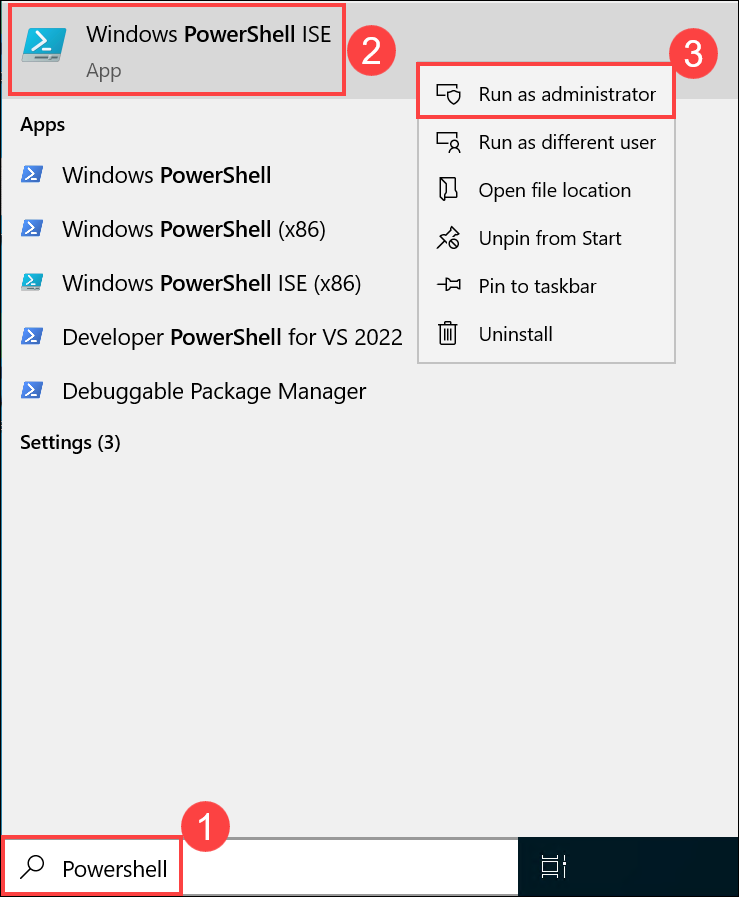
   
1. Run the following command, replacing <sqlmi-fqdn> with the **FQDN** retrieved in Task 1:

    ```PowerShell
    Test-NetConnection -ComputerName <sqlmi-fqdn> -Port 5022
    ```

     
   
1. Confirm that **TcpTestSucceeded** is **True**.

    

### Task 3: Select the target and start the Managed Instance link migration

In this task, you will select the Azure SQL Managed Instance as the migration target and start the **Managed Instance link** migration.

1. In the Azure portal, search for **Azure Arc (1)**, select **Azure Arc (2)**.

    

1. On the **Azure Arc** page, navigate back to **sqlvm2016-sp3 | Assessments** blade.
   
   **>Note:** If you missed navigating to the Azure Arc page, follow these steps to continue the flow:
    On the **Azure Arc** page, expand **Data services (1)** and select **SQL Server instances (2)**. On the **SQL Server instances** page, select your **<inject key="Resource Group Name" enableCopy="false"/>** in the **Resource group** filter, and then select **sqlvm2016-sp3 (4)**.

   
   
1. On the **SQL Server instance** page, expand **Migration (1)** and select **Database migration (2)**.

     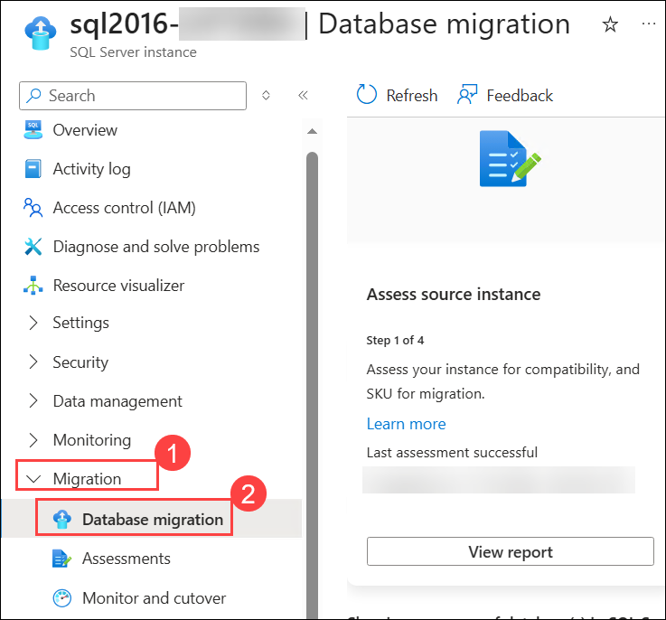
   
1. Click on **Select the target**.

     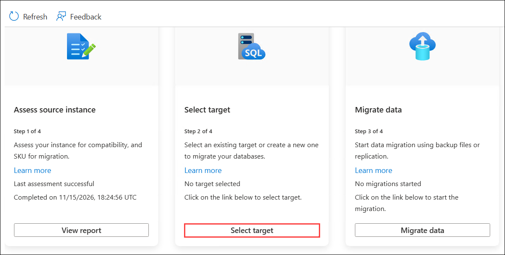
   
1. On the **Create or select target** pane, configure the following settings:

   - **Target exists:** **Yes, I have already created a target (1)**
   - **Target type:** **Azure SQL Managed Instance (2)**
   - **Subscription:** **Select your Subscription (3)**.
   - **Resource group:** Select **SQLMI-Shared-RG (4)**.
   - **Region:** Select **Central US (5)**.
   - **Managed Instance:** **Select the shared managed instance (for example, **sqlmi--cus**) (6)**.
   - Select **Select target (7)**.

   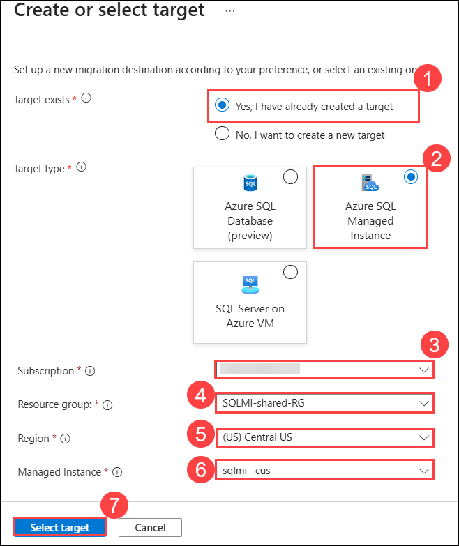
     
1. Back on the **Database migration** pane, select the **Migrate data** tile (Step 3).

      

1. On the **New data migration** pane, under **Migration method**, select **Migrate using real-time replication - MI link (1)**. This is the recommended and most performant option for SQL Server 2016 and later. Select **Select (2)**.

   

1. On the **Select source databases** tab, select **<inject key="Database Name" enableCopy="false"/>**. Verify that **Migration readiness** is **Ready** and **Status** is **Online**, then select **Next: Settings**.

   

1. On the **Settings** tab, under **Link parameters**, leave the auto-generated **MI link name** (`DAG_WideWorldImporters<Suffix>`) and **Source availability group name** (`AG_WideWorldImporters<Suffix>`). Leave **Automatic detection** on for the **Source SQL Server Instance IP address** - it detects the VM's private IP automatically. Select **Test connection**.

    
   
1. Confirm it succeeds, then select **Next: Review + Create >**.

   

1. On the **Review + create** tab, review the **Validations**. Verify that **SQL Server configuration**, **SQL Server AG name**, **SQL MI storage size**, and **SQL MI permissions** all show **Success**. Then select **Start data migration**.

   
   
1. After you select **Start migration**, you are automatically returned to the **Database migration** pane. Select **Monitor migration** to monitor the migration progress.

    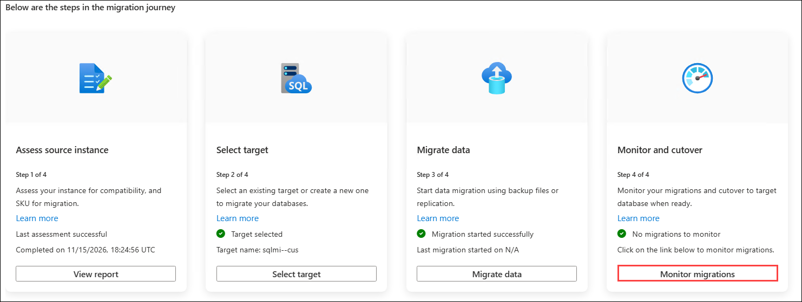

1. On the **Monitor and cutover** tab, **Refresh** until the **Migration status** for your database shows **Ready for cutover** and **Connection status** is **Healthy**. This typically takes less than **2–3 minutes**
   
     
   
### Task 4: Verify near real-time replication

In this task, you will verify that changes made to the source database are replicated to SQL Managed Instance in near real time.

1. Navigate back to SSMS, select **Connect** > **Database Engine**.

   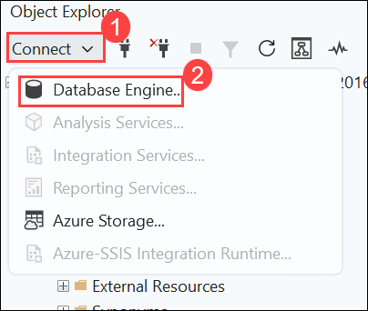

1. Enter the SQL MI **FQDN** from Task 1, select **SQL Server Authentication**, log in as `contosoadmin` / `IAE5fAijit0w^rDM`, check **Trust server certificate**, and select **Connect**.

   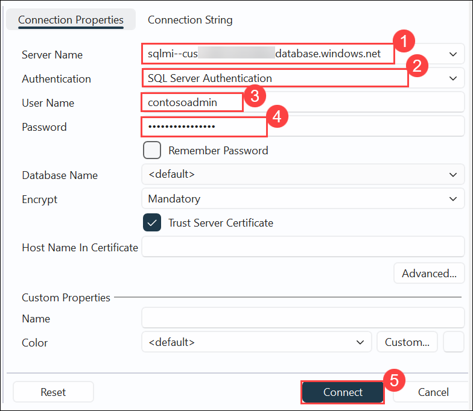
   
1. In **SQL Server Management Studio (SSMS)**, on the **SQLVM 2016 source connection**, right-click the **sqlvm2016-sp3** server connection and select **New Query**.

    
   
1. Run the following to insert a record on the source. Replace **SUFFIX** with **<inject key="Suffix" />**:

   ```sql
   USE WideWorldImportersSUFFIX;
   GO

   INSERT [dbo].[Game] (Title, Description, Rating, IsOnlineMultiplayer)
   VALUES ('Space Adventure', 'Explore the universe with our newest online multiplayer gaming experience.', 'T', 1);
   ```

   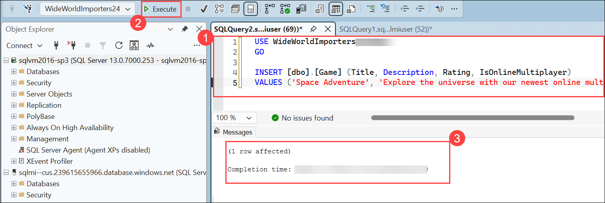

1. On the **SQL MI connection** (`sqlmi--cus`), right-click the connection and select **New Query**.

    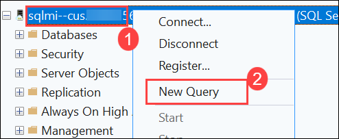

1. Run the following and replace **SUFFIX** with **<inject key="Suffix" />**:

   ```sql
   USE WideWorldImportersSUFFIX;
   GO

   SELECT Title, Rating FROM dbo.Game WHERE Title = 'Space Adventure';
   SELECT DATABASEPROPERTYEX(DB_NAME(), 'Updateability') AS Updateability;
   ```

   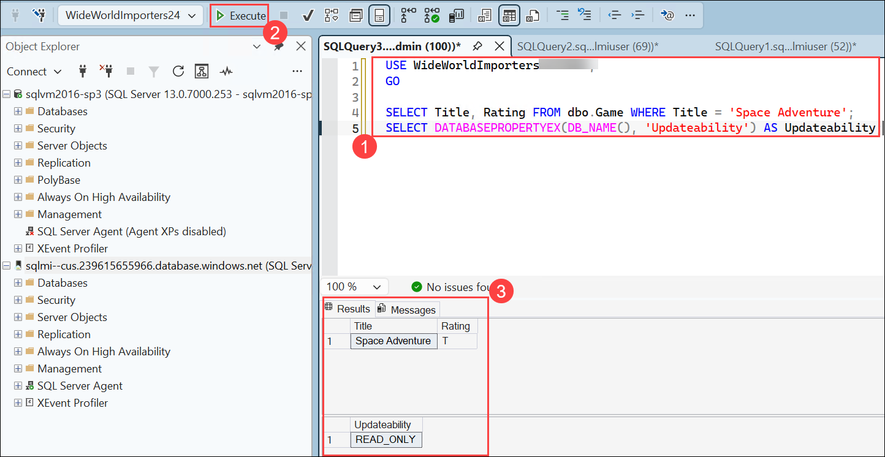

1. Observe that the **Space Adventure** row is already on SQL MI and **Updateability** is **READ_ONLY**, while the link is active, the SQL MI copy is a readable secondary.

### Task 5: Cut over to SQL MI

In this task, you will complete the cutover to **Azure SQL Managed Instance**, making it the primary read-write database and completing the migration.

1. Navigate back to the **Azure portal** browser page where the **Monitor and cutover** tab is open.

1. On the **Monitor and cutover** tab, confirm the **<inject key="Database Name" enableCopy="false"/>** row shows **Migration status: Ready for cutover** and **Connection status: Healthy**.

   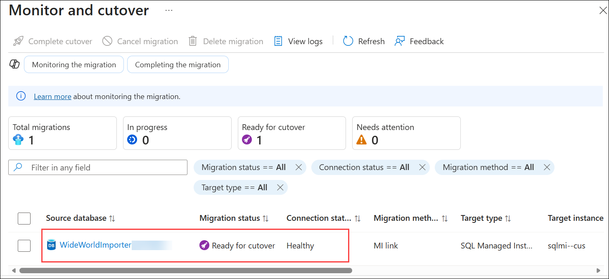

1. On the **Monitor and cutover** page, select the **<inject key="Database Name" enableCopy="false"/>** database row.

1. Select **Complete cutover (1)** and, in the **Complete cutover** dialog, select **I confirm that I have stopped all incoming traffic to the source database** and **I want to do a forced failover (2)**. Then select **Complete cutover (3)** to start the cutover.

    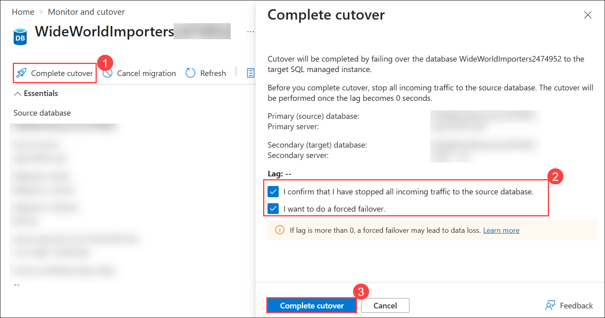
   
1. Wait for the cutover to complete, and monitor the Notifications pane for a Cutover completed notification.

   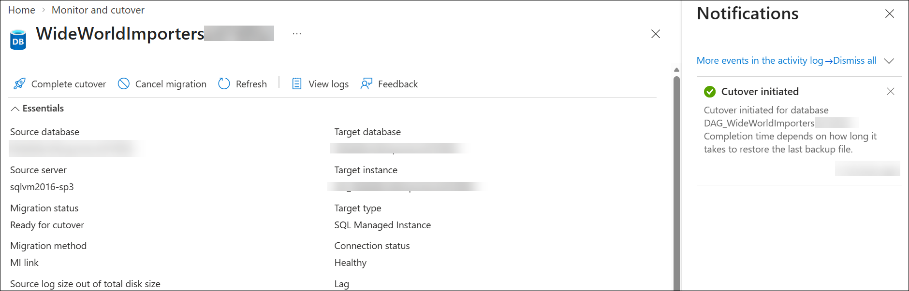

1. On the **SQL MI connection** (`sqlmi--cus`), right-click the connection and select **New Query**.

    
   
1. Run the following again (replace **SUFFIX** with **<inject key="Suffix" />**):

   ```sql
   USE WideWorldImportersSUFFIX;
   GO

   SELECT DATABASEPROPERTYEX(DB_NAME(), 'Updateability') AS Updateability;
   SELECT COUNT(*) AS Games FROM dbo.Game;
   ```

1. Observe that **Updateability** is now **READ_WRITE** - the database on SQL MI is the primary, and the migration is complete.

    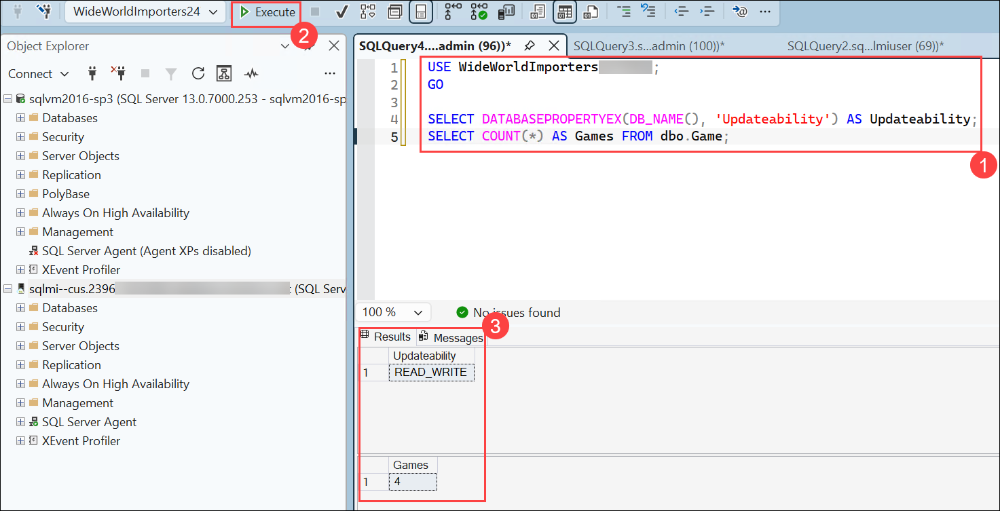
   
### 🧾 Summary

In this exercise, you migrated the `WideWorldImporters` database from SQL Server 2016 to **Azure SQL Managed Instance** using the Managed Instance link. You configured the migration, verified near-real-time replication, and completed the cutover with minimal downtime.

#### You have successfully completed the exercise. Select **Next >>** to continue.
