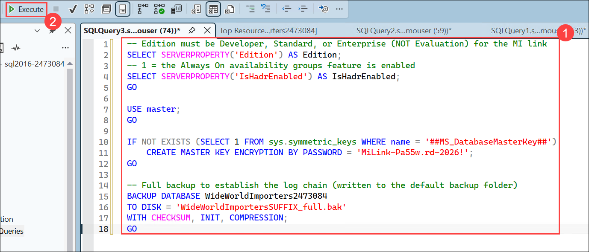
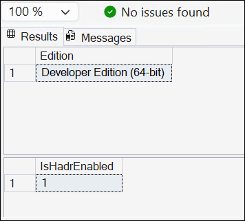
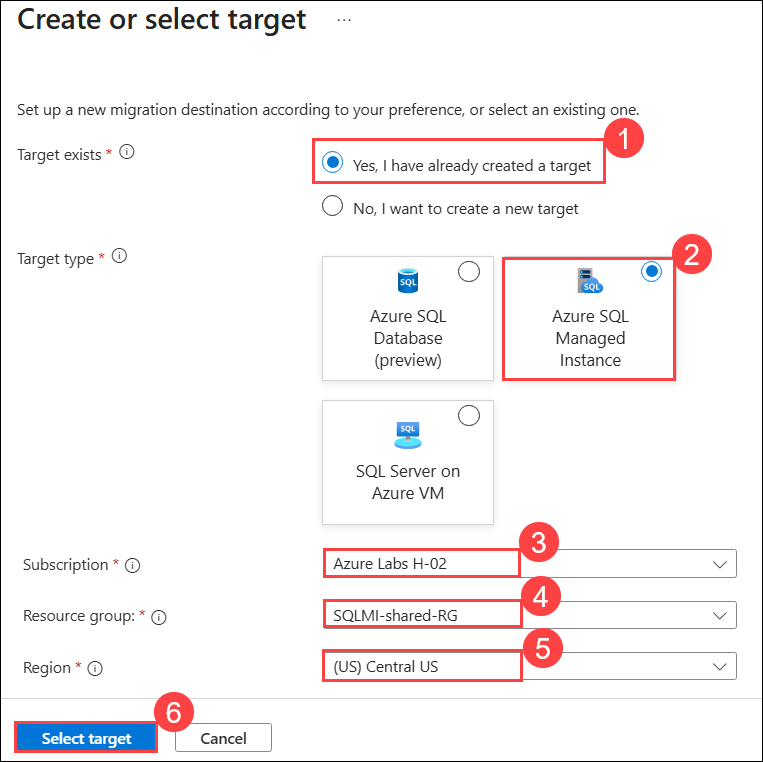
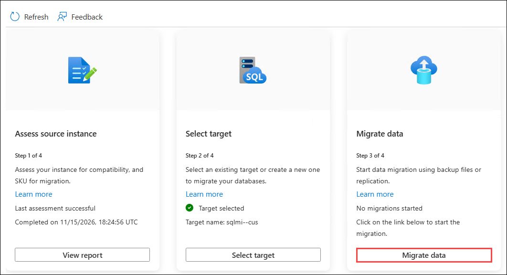
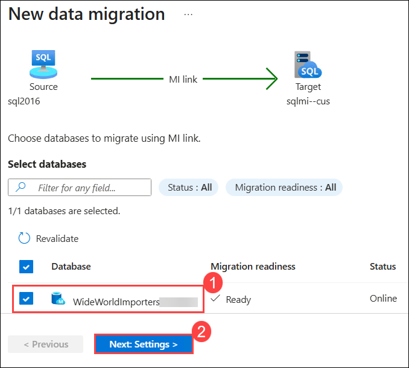
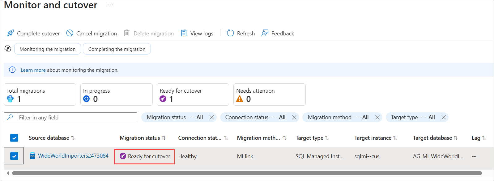

## Exercise 2: Migrate with Azure Arc and the Managed Instance link

Duration: 60 minutes

In this exercise, you migrate the `WideWorldImporters<inject key="Suffix" enableCopy="false"/>` database to Azure SQL Managed Instance using the **Managed Instance link**, starting from the Azure Arc-enabled SQL Server.

> **Note:** The source database is named `WideWorldImporters<inject key="Suffix" enableCopy="false"/>` (with your deployment ID). The Managed Instance link keeps the same name on SQL MI, and because the managed instance is shared by all attendees, this suffix keeps your database unique on it.

The Managed Instance link uses **distributed availability groups** to replicate the database to SQL MI in near real time. While the link is active, the source database stays online and the copy on SQL MI is readable. When you're ready, you cut over, and the application downtime is only the few seconds the cutover takes. This is the recommended online migration path for SQL Server 2016 SP3 and later. For a SQL Server 2016 source, the link is one-way: once you cut over to SQL MI, you cannot fail back to SQL Server 2016.

### Task 1: Retrieve the SQL MI connection information

1. In the Azure portal, select the **Cloud Shell** icon in the top menu, and choose **PowerShell**.

    
   
1. On the **Getting started** pane, select **No storage account required**, select your subscription, and select **Apply**.

    
   
1. Run the following to get the SQL MI details in the **SQLMI-Shared-RG** resource group:

   ```PowerShell
   $resourceGroup = "SQLMI-Shared-RG"
   az sql mi list --resource-group $resourceGroup --query "[].{name:name, fqdn:fullyQualifiedDomainName, tier:sku.tier}" -o table
   ```

1. Copy the **fqdn** value into Notepad. You use it in later steps and exercises.

   

### Task 2: Check the Managed Instance link prerequisites

The Managed Instance link requires, on the source SQL Server: SQL Server 2016 SP3 with the Azure Connect pack (confirmed in Exercise 1); a **supported edition** (**Developer**, **Standard**, or **Enterprise** — *not* Evaluation); the **Always On availability groups** feature enabled; a **database master key** in `master`; the FULL recovery model with a full backup; and network connectivity to SQL MI (TCP **5022** both directions, **11000–11999** from SQL Server to SQL MI). The lab environment has the supported edition installed, the availability groups feature enabled, and the ports opened. In this task you verify them and prepare the database.

1. On the **<inject key="SQLVM Name" enableCopy="false"/>** VM, in SSMS, select **New Query**, paste the following (replace **SUFFIX** with **<inject key="Suffix" />**), and select **Execute**:

    ```sql
    -- Edition must be Developer, Standard, or Enterprise (NOT Evaluation) for the MI link
    SELECT SERVERPROPERTY('Edition') AS Edition;
    -- 1 = the Always On availability groups feature is enabled
    SELECT SERVERPROPERTY('IsHadrEnabled') AS IsHadrEnabled;
    GO

    USE master;
    GO

    IF NOT EXISTS (SELECT 1 FROM sys.symmetric_keys WHERE name = '##MS_DatabaseMasterKey##')
        CREATE MASTER KEY ENCRYPTION BY PASSWORD = 'MiLink-Pa55w.rd-2026!';
    GO

    -- Full backup to establish the log chain (written to the default backup folder)
    BACKUP DATABASE WideWorldImportersSUFFIX
    TO DISK = 'WideWorldImportersSUFFIX_full.bak'
    WITH CHECKSUM, INIT, COMPRESSION;
    GO
    ```

    
   
1. Confirm **Edition** is **Developer/Standard/Enterprise** (not Evaluation), **IsHadrEnabled** is **1**, and the backup completes successfully.

    
   
   >**Note:** If **IsHadrEnabled** is **0**, open **SQL Server Configuration Manager**, right-click **SQL Server (MSSQLSERVER)** > **Properties**, and on the **AlwaysOn High Availability** tab, check **Enable AlwaysOn Availability Groups**, select **OK**, and restart the SQL Server service.

1. On the VM, open **Windows PowerShell** and run the following, replacing `<sqlmi-fqdn>` with the FQDN from Task 1:

    ```PowerShell
    Test-NetConnection -ComputerName <sqlmi-fqdn> -Port 5022
    ```

     
   
1. Confirm that **TcpTestSucceeded** is **True**.

    

### Task 3: Select the target and start the Managed Instance link migration

1. In the Azure portal, go to **Azure Arc** > **SQL Server instances** > **<inject key="SQLVM Name" enableCopy="false"/>** > under **Migration**, select **Database migration**.

1. **Select the target.** On the **Database migration** pane, select the **Select target** tile (Step 2). On the **Create or select target** pane, set:

   - **Target exists:** **Yes, I have already created a target**
   - **Target type:** **Azure SQL Managed Instance**
   - **Subscription:** your subscription
   - **Resource group:** **SQLMI-Shared-RG**
   - **Region:** the region of the managed instance (Central US)
   - **Managed Instance:** select the shared instance (for example **sqlmi--cus**)
   - Then select **Select target**.

      
     
1. **Start the migration.** Back on the **Database migration** pane, select the **Migrate data** tile (Step 3).

      
   
1. On the **New data migration** pane, under **Migration method**, choose **Migrate using real-time replication - MI link** (the most performant option, recommended for SQL Server 2016 and above), and select **Select**.

      
   
1. On the **Select source databases** tab, check **WideWorldImporters<inject key="Suffix" enableCopy="false"/>** (it should show **Migration readiness: Ready** and **Status: Online**), then select **Next: Settings**.

    
   
1. On the **Settings** tab, under **Link parameters**, leave the auto-generated **MI link name** (`DAG_WideWorldImporters<Suffix>`) and **Source availability group name** (`AG_WideWorldImporters<Suffix>`). Leave **Automatic detection** on for the **Source SQL Server Instance IP address** - it detects the VM's private IP automatically. Select **Test connection**.

    
   
1. Confirm it succeeds, then select **Next: Review + create**.

   

1. On the **Review + create** tab, review the **Validations**. **SQL Server configuration**, **SQL Server AG name**, **SQL MI storage size**, and **SQL MI permissions** should all show **Success**. The remaining items are warnings you can proceed past - the Always On mirroring endpoint, its certificate, and encryption are **created automatically during link creation**, and the recommended trace flags `-T1800`/`-T9567` are optional performance tuning. Select **Start data migration**.

   
   
   >**Note:** If **SQL Server configuration** shows **Not ready** with *"unsupported edition"*, the source is running SQL Server **Evaluation** edition. Upgrade it to **Developer/Standard/Enterprise** (**SQL Server Installation Center** > **Maintenance** > **Edition Upgrade**), then select **Revalidate**.

   >**Note:** Azure Arc grants just-in-time permissions, creates the distributed availability group, and seeds the database to SQL MI. Creating the link can take up to about 10 minutes.

1. On the **Database migration** pane, select the **Monitor and cutover** tile. On the **Monitoring the migration** tab, **Refresh** until the **Migration status** for your database shows **Ready for cutover** and **Connection status** is **Healthy** (for a small database this takes only a few minutes).

     

      
   > **Alternative:** You can create the same link from SSMS — right-click **WideWorldImporters<inject key="Suffix" enableCopy="false"/>** > **Azure SQL Managed Instance link** > **New...** — and follow the wizard.

### Task 4: Verify near real-time replication

1. In SSMS, select **Connect** > **Database Engine**.
   

3. Enter the SQL MI **FQDN** from Task 1, select **SQL Server Authentication**, log in as `contosoadmin` / `IAE5fAijit0w^rDM`, check **Trust server certificate**, and select **Connect**.

   
   
1. On the **<inject key="SQLVM Name" enableCopy="false"/>** connection, select **New Query** and run the following to insert a record on the source (replace **SUFFIX** with **<inject key="Suffix" />**):

   ```sql
   USE WideWorldImportersSUFFIX;
   GO

   INSERT [dbo].[Game] (Title, Description, Rating, IsOnlineMultiplayer)
   VALUES ('Space Adventure', 'Explore the universe with our newest online multiplayer gaming experience.', 'T', 1);
   ```

1. On the **SQL MI** connection, select **New Query** and run the following (replace **SUFFIX** with **<inject key="Suffix" />**):

   ```sql
   USE WideWorldImportersSUFFIX;
   GO

   SELECT Title, Rating FROM dbo.Game WHERE Title = 'Space Adventure';
   SELECT DATABASEPROPERTYEX(DB_NAME(), 'Updateability') AS Updateability;
   ```

1. Observe that the **Space Adventure** row is already on SQL MI and **Updateability** is **READ_ONLY** — while the link is active, the SQL MI copy is a readable secondary.

### Task 5: Cut over to SQL MI

1. In a production migration you would stop the application's writes to the source database first (at the application layer). **Do not set the source database to `READ_ONLY`** — while the database is part of the Managed Instance link, that can block the cutover from completing. The cutover itself coordinates the switch of the write workload to SQL MI.

1. In the Azure portal, return to **<inject key="SQLVM Name" enableCopy="false"/>** > **Database migration**, and select the **Monitor and cutover** tile.

1. On the **Monitoring the migration** tab, confirm the **WideWorldImporters<inject key="Suffix" enableCopy="false"/>** row shows **Migration status: Ready for cutover** and **Connection status: Healthy**. Select the migration (check its box), then select **Complete cutover** from the toolbar.

1. In the **Complete cutover** dialog, confirm **Lag** shows **--** (zero). Check **I confirm that I have stopped all incoming traffic to the source database** and **I want to do a forced failover**, then select **Complete cutover**. (The forced failover is safe when Lag is 0; the link is removed and SQL Server 2016 doesn't support failback.)

1. **Refresh** until the migration status shows it has completed (1–2 minutes).

1. On the **SQL MI** connection, run the following again (replace **SUFFIX** with **<inject key="Suffix" />**):

   ```sql
   USE WideWorldImportersSUFFIX;
   GO

   SELECT DATABASEPROPERTYEX(DB_NAME(), 'Updateability') AS Updateability;
   SELECT COUNT(*) AS Games FROM dbo.Game;
   ```

1. Observe that **Updateability** is now **READ_WRITE** — the database on SQL MI is the primary, and the migration is complete.

## Summary

In this exercise, you used Azure Arc and the Managed Instance link to replicate the `WideWorldImporters<inject key="Suffix" enableCopy="false"/>` database from SQL Server 2016 to Azure SQL Managed Instance, confirmed near-real-time replication, and cut over with only seconds of downtime.

### You have successfully completed the exercise. Now click on **Next >>** from the lower right corner to move on to the next exercise.
