## Exercise 2: Migrate with Azure Arc and the Managed Instance link

**Duration: 60 Minutes**

### Overview

In this exercise, you will migrate the `WideWorldImporters<Suffix>` database to Azure SQL Managed Instance using the **Managed Instance link**, starting from the Azure Arc-enabled SQL Server. The link uses distributed availability groups to replicate the database in near real time; when you are ready, you cut over with only seconds of downtime.

### Objectives

- **Task 1:** Retrieve the SQL MI connection information
- **Task 2:** Check the Managed Instance link prerequisites
- **Task 3:** Select the target and start the Managed Instance link migration
- **Task 4:** Verify near real-time replication
- **Task 5:** Cut over to SQL MI

### Task 1: Retrieve the SQL MI connection information

In this task, you will use **Azure Cloud Shell** to retrieve the fully qualified domain name (FQDN) of the shared Azure SQL Managed Instance.

1. In the Azure portal, select the **Cloud Shell (1)** icon in the top menu, and select **PowerShell (2)**.

    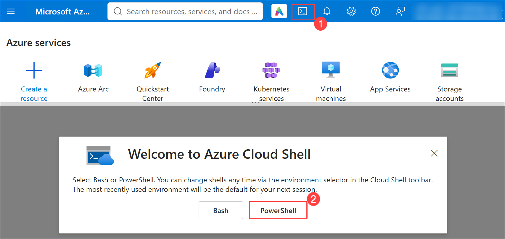
   
1. In the **Getting started** pane, select **No storage account required (1)**, select your **Subscription (2)**, and select **Apply (3)**.

    
   
1. Run the following command to retrieve the **SQL Managed Instance** details from the **SQLMI-Shared-RG** resource group:

   ```PowerShell
   $resourceGroup = "SQLMI-Shared-RG"
   az sql mi list --resource-group $resourceGroup --query "[].{name:name, fqdn:fullyQualifiedDomainName, tier:sku.tier}" -o table
   ```
   
1. In the command output, locate the **fqdn** value and copy it to **Notepad**. You will use this value in later steps and exercises.

   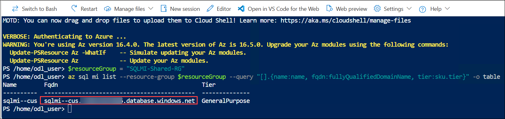

## Task 2: Prepare the database for the Managed Instance link

The source SQL Server prerequisites for the Managed Instance link are already configured in the lab environment (built into the SQL Server VM image): a supported edition + SP3 with the Azure Connect pack (confirmed in Exercise 1), Always On availability groups enabled, a database master key in master, the required NT AUTHORITY\SYSTEM availability-group grants, and the network ports (5022 and 11000–11999). The only step you perform here is a full backup, which establishes the log chain required for the link's automatic seeding.

1. On the VM, in SSMS (connected to Source/localhost), select **New Query**.

     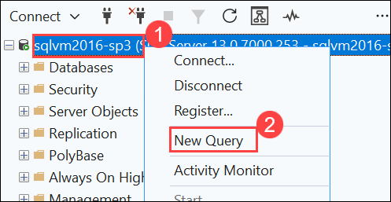
   
1. Paste the following (replace SUFFIX with ), and select **Execute**:

    ```
    -- Full backup to establish the log chain for the link's automatic seeding
    BACKUP DATABASE WideWorldImportersSUFFIX
    TO DISK = 'WideWorldImportersSUFFIX_full.bak'
    WITH CHECKSUM, INIT, COMPRESSION;
    GO
    ```
    
    
1. On the VM, open **Windows PowerShell** and run the following command, replacing **<sqlmi-fqdn>** with the **FQDN** retrieved in Task 1:

    ```PowerShell
    Test-NetConnection -ComputerName <sqlmi-fqdn> -Port 5022
    ```

     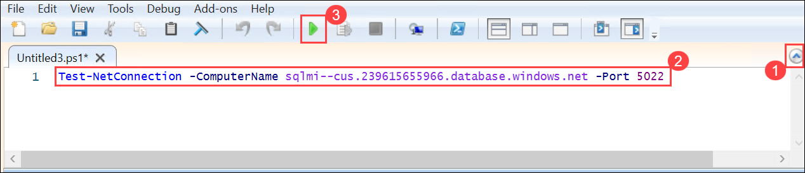
   
1. Confirm that **TcpTestSucceeded** is **True**.

    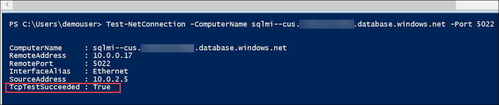

### Task 3: Select the target and start the Managed Instance link migration

In this task, you will select the managed instance as the target and start the Managed Instance link migration from the Azure Arc portal.

1. In the Azure portal, search for **Azure Arc (1)**, select **Azure Arc (2)**.

    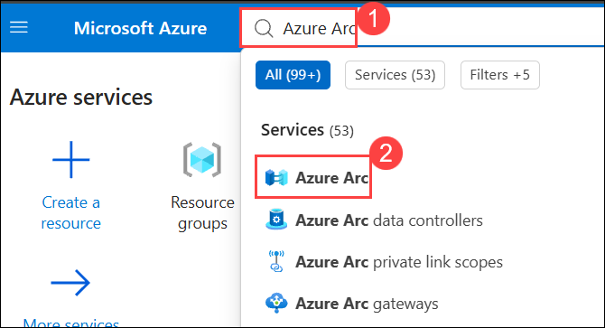

1. On the **Azure Arc** page, expand **Data services (1)** and select **SQL Server instances (2)**. On the **SQL Server instances** page, select your **<inject key="Resource Group Name" enableCopy="false"/>** in the **Resource group** filter, and then select **sqlvm2016-sp3 (4)**.

   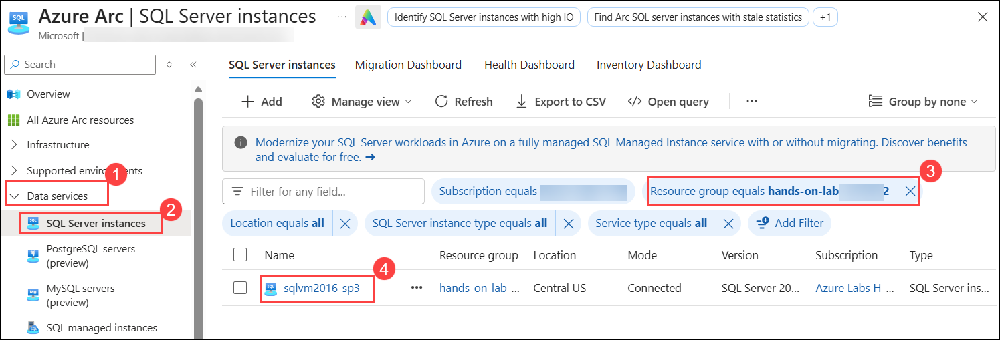
   
1. On the **SQL Server instance** page, expand **Migration (1)** and select **Database migration (2)**.

     
   
1. Click on **Select the target**.

     
   
3. On the **Create or select target** pane, configure the following settings:

   - **Target exists:** **Yes, I have already created a target (1)**
   - **Target type:** **Azure SQL Managed Instance (2)**
   - **Subscription:** **Select your Subscription (3)**.
   - **Resource group:** Select **SQLMI-Shared-RG (4)**.
   - **Region:** Select **Central US (5)**.
   - **Managed Instance:** **Select the shared managed instance (for example, **sqlmi--cus**) (6)**.
   - Select **Select target (7)**.

   
     
1. Back on the **Database migration** pane, select the **Migrate data** tile (Step 3).

      


1. On the **New data migration** pane, under **Migration method**, select **Migrate using real-time replication - MI link**. This is the recommended and most performant option for SQL Server 2016 and later. Select **Select**.

   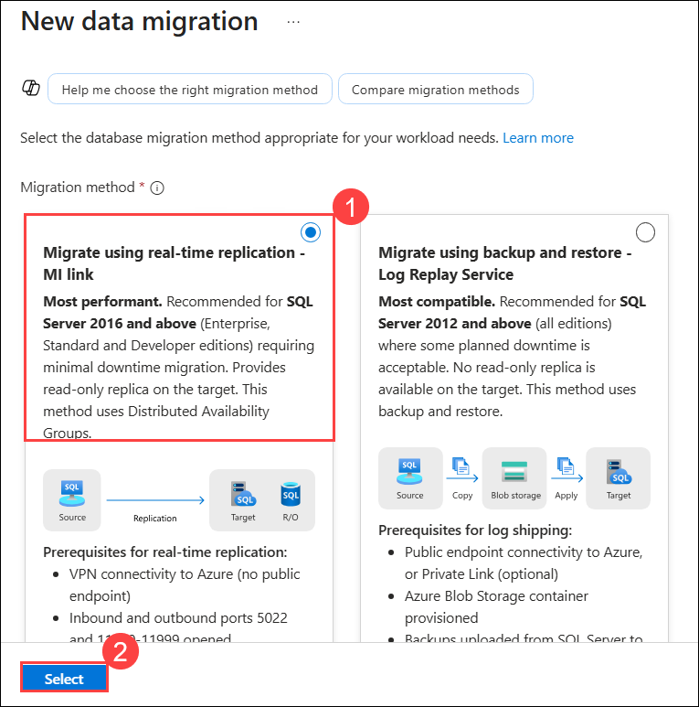

1. On the **Select source databases** tab, select **WideWorldImporters<inject key="Suffix" enableCopy="false"/>**. Verify that **Migration readiness** is **Ready** and **Status** is **Online**, then select **Next: Settings**.

   

1. On the **Settings** tab, under **Link parameters**, leave the auto-generated **MI link name** (`DAG_WideWorldImporters<Suffix>`) and **Source availability group name** (`AG_WideWorldImporters<Suffix>`). Leave **Automatic detection** on for the **Source SQL Server Instance IP address** - it detects the VM's private IP automatically. Select **Test connection**.

    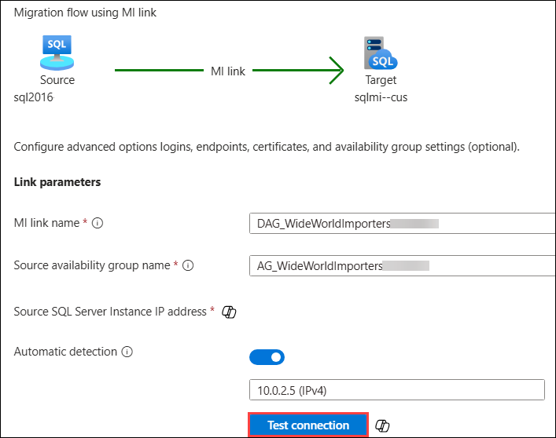
   
1. Confirm it succeeds, then select **Next: Review + create**.

   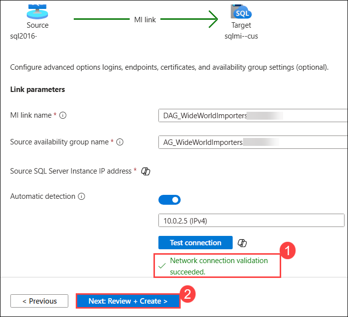

1. On the **Review + create** tab, review the **Validations**. Verify that **SQL Server configuration**, **SQL Server AG name**, **SQL MI storage size**, and **SQL MI permissions** all show **Success**. Then select **Start data migration**.

   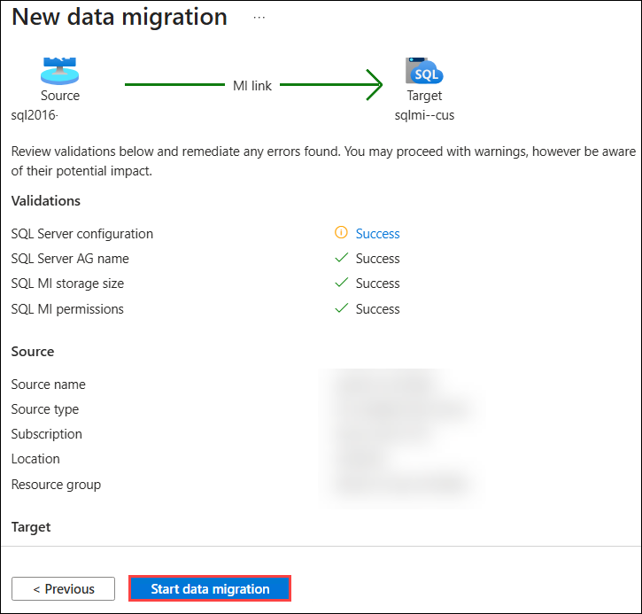
   
1. On the **Database migration** pane, select the **Monitor and cutover** tile.

    

1. On the **Monitoring the migration** tab, **Refresh** until the **Migration status** for your database shows **Ready for cutover** and **Connection status** is **Healthy**. This typically takes less than **2–3 minutes** 

     

     
   
### Task 4: Verify near real-time replication

In this task, you will confirm that changes made on the source database replicate to the read-only copy on SQL Managed Instance in near real time.

1. In SSMS, select **Connect** > **Database Engine**.

   

3. Enter the SQL MI **FQDN** from Task 1, select **SQL Server Authentication**, log in as `contosoadmin` / `IAE5fAijit0w^rDM`, check **Trust server certificate**, and select **Connect**.

   
   
1. On the **<inject key="SQLVM Name" enableCopy="false"/>** connection, select **New Query** and run the following to insert a record on the source (replace **SUFFIX** with **<inject key="Suffix" />**):

   ```sql
   USE WideWorldImportersSUFFIX;
   GO

   INSERT [dbo].[Game] (Title, Description, Rating, IsOnlineMultiplayer)
   VALUES ('Space Adventure', 'Explore the universe with our newest online multiplayer gaming experience.', 'T', 1);
   ```

1. On the **SQL MI** connection, select **New Query** and run the following (replace **SUFFIX** with **<inject key="Suffix" />**):

   ```sql
   USE WideWorldImportersSUFFIX;
   GO

   SELECT Title, Rating FROM dbo.Game WHERE Title = 'Space Adventure';
   SELECT DATABASEPROPERTYEX(DB_NAME(), 'Updateability') AS Updateability;
   ```

1. Observe that the **Space Adventure** row is already on SQL MI and **Updateability** is **READ_ONLY** — while the link is active, the SQL MI copy is a readable secondary.

### Task 5: Cut over to SQL MI

In this task, you will cut over to SQL Managed Instance, making it the read-write primary and completing the migration.

1. In a production migration you would stop the application's writes to the source database first (at the application layer). **Do not set the source database to `READ_ONLY`** - while the database is part of the Managed Instance link, that can block the cutover from completing. The cutover itself coordinates the switch of the write workload to SQL MI.

1. In the Azure portal, return to **<inject key="SQLVM Name" enableCopy="false"/>** > **Database migration**, and select the **Monitor and cutover** tile.

1. On the **Monitoring the migration** tab, confirm the **WideWorldImporters<inject key="Suffix" enableCopy="false"/>** row shows **Migration status: Ready for cutover** and **Connection status: Healthy**. Select the migration (check its box), then select **Complete cutover** from the toolbar.

1. In the **Complete cutover** dialog, confirm **Lag** shows **--** (zero). Check **I confirm that I have stopped all incoming traffic to the source database** and **I want to do a forced failover**, then select **Complete cutover**. (The forced failover is safe when Lag is 0; the link is removed and SQL Server 2016 doesn't support failback.)

1. **Refresh** until the migration status shows it has completed (1–2 minutes).

1. On the **SQL MI** connection, run the following again (replace **SUFFIX** with **<inject key="Suffix" />**):

   ```sql
   USE WideWorldImportersSUFFIX;
   GO

   SELECT DATABASEPROPERTYEX(DB_NAME(), 'Updateability') AS Updateability;
   SELECT COUNT(*) AS Games FROM dbo.Game;
   ```

1. Observe that **Updateability** is now **READ_WRITE** - the database on SQL MI is the primary, and the migration is complete.

## Summary

In this exercise, you used Azure Arc and the Managed Instance link to replicate the `WideWorldImporters<inject key="Suffix" enableCopy="false"/>` database from SQL Server 2016 to Azure SQL Managed Instance, confirmed near-real-time replication, and cut over with only seconds of downtime.

### You have successfully completed the exercise. Now click on **Next >>** from the lower right corner to move on to the next exercise.
