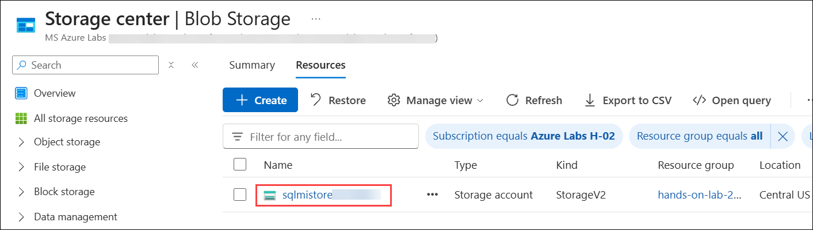
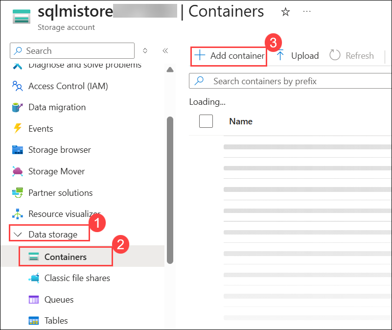
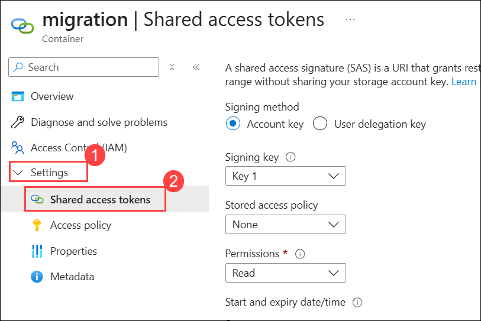
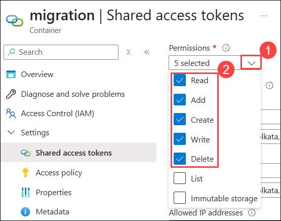
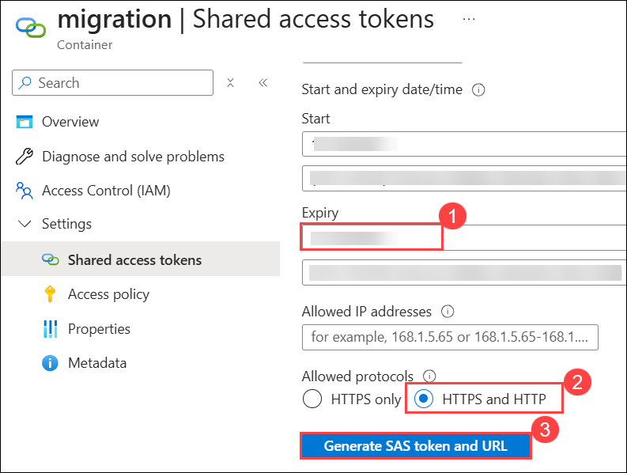
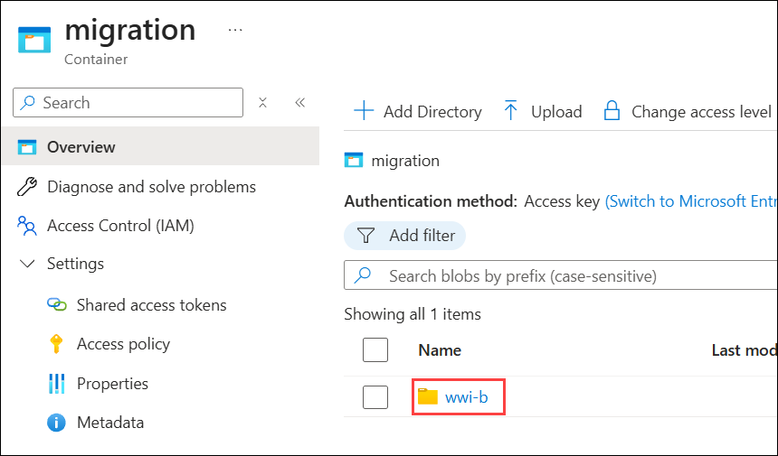
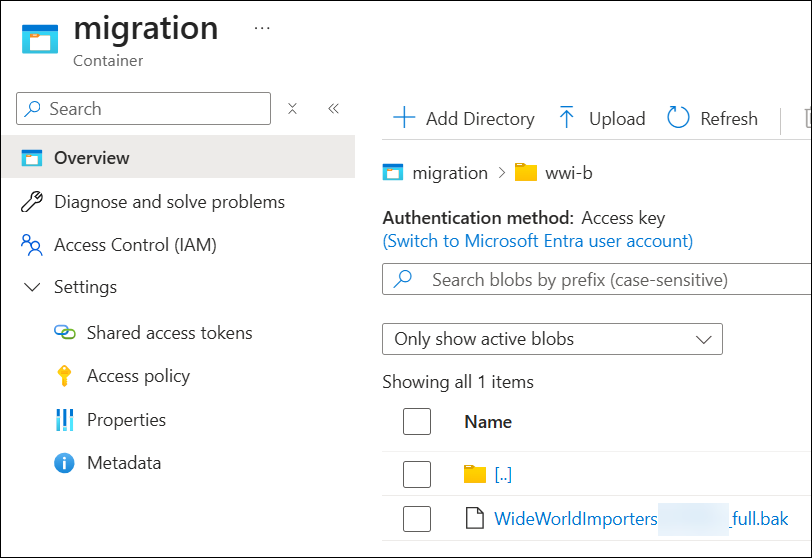

## Exercise 3: Migrate with Azure DMS from Azure Blob Storage

**Duration: 45 Minutes**

### Overview

In this exercise, you will migrate a second copy of the database to Azure SQL Managed Instance using **Azure Database Migration Service (DMS)** from backups stored in **Azure Blob Storage**. SQL Server 2016 writes backups directly to Blob Storage with `BACKUP ... TO URL`, and DMS restores them to the managed instance — with no file share or self-hosted integration runtime required.

### Objectives

- **Task 1:** Create a SAS token for the backup container
- **Task 2:** Back up the database to Azure Blob Storage
- **Task 3:** Create the Azure Database Migration Service
- **Task 4:** Create and run an online migration from Blob Storage
- **Task 5:** Back up the transaction log and cut over

## Task 1: Create a SAS token for the backup container

In this task, you will create a container and generate a Shared Access Signature (SAS) token so SQL Server can write backups to Azure Blob Storage.

1. In the Azure portal, search for and select **Storage accounts**.

   

1. Select sqlmistore<inject key="Suffix" enableCopy="false"/>.

    

1. Expand **Data storage (1)**, select **Containers (2)**, then select **+ Add container (3)**.

   
    
3. On the New container pane, enter **migration** as the container name **(1)**, then select **Create (2)**.

   
   
1. Select the **migration** container, then go to **Settings (1)** > **Shared access tokens (2)**.

    

    
   
1. Under **Permissions**, select **Read**, **Add**, **Create**, **Write**, **Delete**, and **List**.

    
   
4. Set the **Expiry** to **two days from now (1)**, select **HTTPS** and **HTTP (2)**, then select **Generate SAS token and URL (3)**.

    

5. Copy the **Blob SAS token** into Notepad.

    
   
## Task 2: Back up the database to Azure Blob Storage

In this task, you will back up the database directly to Azure Blob Storage using BACKUP ... TO URL.

1. On the **<inject key="SQLVM Name" enableCopy="false"/>** VM, in SSMS on the source connection, paste the following (replace **SUFFIX** with **<inject key="Suffix" />** and `<SAS-token>`), and **Execute**:
   
    ```sql
    USE master;
    GO
    
    -- credential name must match the container URL exactly
    CREATE CREDENTIAL [https://sqlmistoreSUFFIX.blob.core.windows.net/migration]
    WITH IDENTITY = 'SHARED ACCESS SIGNATURE',
         SECRET = '<SAS-token>';
    GO
    
    BACKUP DATABASE WideWorldImporters2474952
    TO URL = 'https://sqlmistoreSUFFIX.blob.core.windows.net/migration/wwi-b/WideWorldImportersSUFFIX_full.bak'
    WITH CHECKSUM, COMPRESSION, MAXTRANSFERSIZE = 4194304, BLOCKSIZE = 65536;
    GO
    ```

    
   
1. Navigate back to the migration container and select the **wwi-b** folder. Confirm that the backup file is present in the folder.

    

    

## Task 3: Create the Azure Database Migration Service

In this task, you will deploy an Azure Database Migration Service instance.


1. Portal > search **Azure Database Migration Services** > **+ Create**.
1. Source server type **SQL Server**, target **Azure SQL Managed Instance**, pricing **Database Migration Service**, then **Select**.
1. Resource group **<inject key="Resource Group Name" enableCopy="false"/>**, name **wwi-dms-<inject key="Suffix" enableCopy="false"/>**, same region, then **Review + create** > **Create** > **Go to resource**.

## Task 4: Create and run an online migration from Blob Storage

In this task, you will create and start an online migration that restores the backup from Blob Storage to the managed instance.

1. On **wwi-dms-<inject key="Suffix" enableCopy="false"/>**, select **+ New migration**.
1. Set source **SQL Server**, target **Azure SQL Managed Instance**, mode **Online migration**, backup location **Azure Blob Storage**, then **Select**.
1. On **Target**, select your subscription, **SQLMI-Shared-RG**, and the managed instance; **Next**.
1. On **Database and backup**, enter: source **WideWorldImporters**, target **WideWorldImportersB<inject key="Suffix" enableCopy="false"/>**, storage account **sqlmistore<inject key="Suffix" enableCopy="false"/>**, container **migration**, folder **wwi-b**; **Next**.
1. Review and **Start migration**.
1. On **Migrations**, **Refresh** until the full backup shows **Restored** and status is **Ready for cutover** (~10–15 min).

## Task 5: Back up the transaction log and cut over

In this task, you will back up the transaction log and complete the cutover to finish the migration.

1. On the source connection, run (replace **SUFFIX**):

   ```sql
   USE WideWorldImporters;
   GO
   INSERT [dbo].[Game] (Title, Description, Rating, IsOnlineMultiplayer)
   VALUES ('Ocean Odyssey', 'Dive into an underwater world full of hidden treasures.', 'E', 1);
   GO
   BACKUP LOG WideWorldImporters
   TO URL = 'https://sqlmistoreSUFFIX.blob.core.windows.net/migration/wwi-b/WideWorldImporters_log1.trn'
   WITH CHECKSUM, COMPRESSION, MAXTRANSFERSIZE = 4194304, BLOCKSIZE = 65536;
   GO
   ```

1. In the portal, **Refresh** until **WideWorldImporters_log1.trn** shows **Restored**.
1. Select **Complete cutover**, confirm **0** pending log backups, check the box, and **Complete cutover**.
1. **Refresh** until the status is **Succeeded**.
1. On the SQL MI connection, verify (replace **SUFFIX**):

   ```sql
   USE WideWorldImportersBSUFFIX;
   GO
   SELECT Title FROM dbo.Game WHERE Title IN ('Space Adventure', 'Ocean Odyssey');
   ```

## Summary

You backed up a SQL Server 2016 database directly to Azure Blob Storage and used Azure DMS to run an online migration to SQL MI, with no file share or self-hosted integration runtime.

### You have successfully completed the exercise. Now click on **Next >>** from the lower right corner to move on to the next exercise.
