# Exercise 3: Migrate with Azure DMS from Azure Blob Storage

### Duration: 45 Minutes

## 📖 Overview

In this exercise, you will migrate a second copy of the WideWorldImporters database from SQL Server 2016 to Azure SQL Managed Instance using Azure Database Migration Service (DMS) and backups stored in Azure Blob Storage. You will first create the required storage and access configuration, back up the database directly to Blob Storage, and configure an online migration in DMS.

You will then monitor the migration, provide the final transaction-log backup, and complete the cutover to Azure SQL Managed Instance. This approach uses Blob Storage for the backup files and does not require a file share or self-hosted integration runtime.

## 🎯 Objectives

- **Task 1:** Create the backup container, generate a SAS token, and grant storage access
- **Task 2:** Back up the database to Azure Blob Storage
- **Task 3:** Create the DMS and run the online migration
- **Task 4:** Back up the transaction log and cut over

### Task 1: Create the backup container, generate a SAS token, and grant storage access

In this task, you will prepare **Azure Blob Storage** for the migration by creating a container, generating a SAS token, and granting the SQL Managed Instance access to the storage account.

1. In the Azure portal, search for and select **Storage accounts**.

   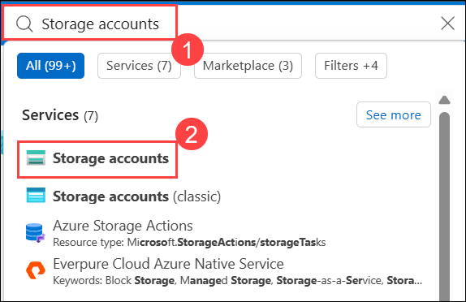

1. Select **sqlmistore<inject key="Suffix" />**.

    

1. Expand **Data storage (1)**, select **Containers (2)**, then select **+ Add container (3)**.

   
    
1. On the New container pane, enter **migration** as the container name **(1)**, then select **Create (2)**.

   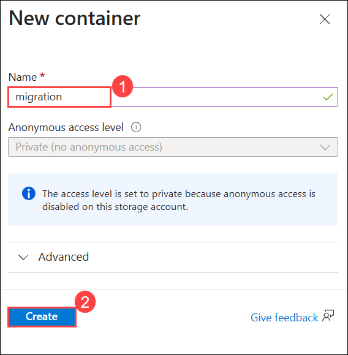
   
1. Select the **migration** container.

    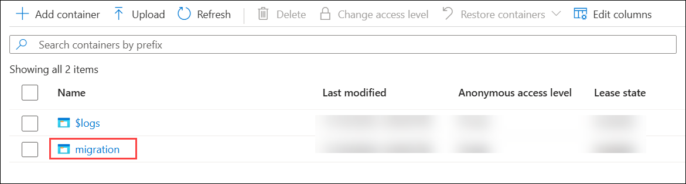

1. Then go to **Settings (1)** > **Shared access tokens (2)**.

   
   
1. Under **Permissions**, select **Read**, **Add**, **Create**, **Write**, **Delete** and **List**.

    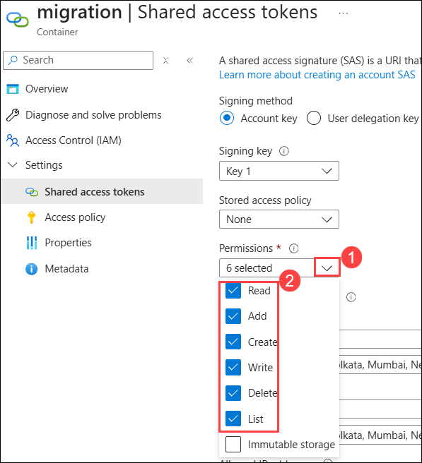
   
1. Set the **Expiry** to **two days from now (1)**, select **HTTPS** and **HTTP (2)**, then select **Generate SAS token and URL (3)**.

    

1. Copy the **Blob SAS token** into Notepad.

    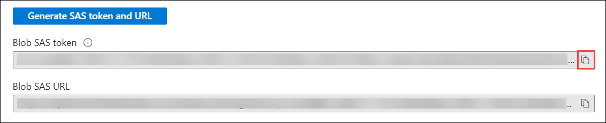

1. Select **sqlmistore<inject key="Suffix" enableCopy="false"/> | Containers** to navigate back to the storage account page, then select **Access Control (IAM)** from the left navigation pane.

    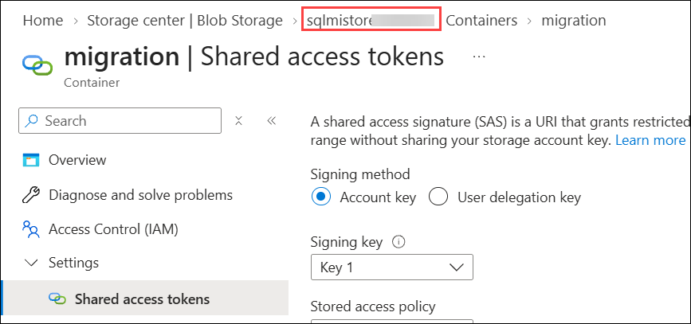
   
1. Select **+ Add**, then select **Add role assignment**.

   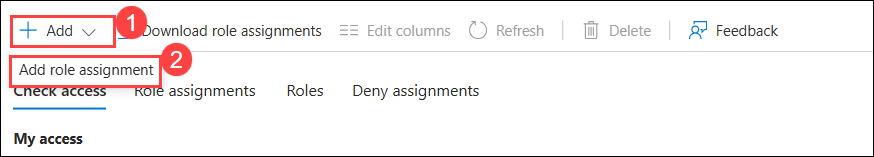

1. On the **Role** tab of the **Add role assignment** page, enter **Storage Blob Data Contributor (1)** in the search box, select **Storage Blob Data Contributor (2)** from the results, and then click on **Next (3)**.

   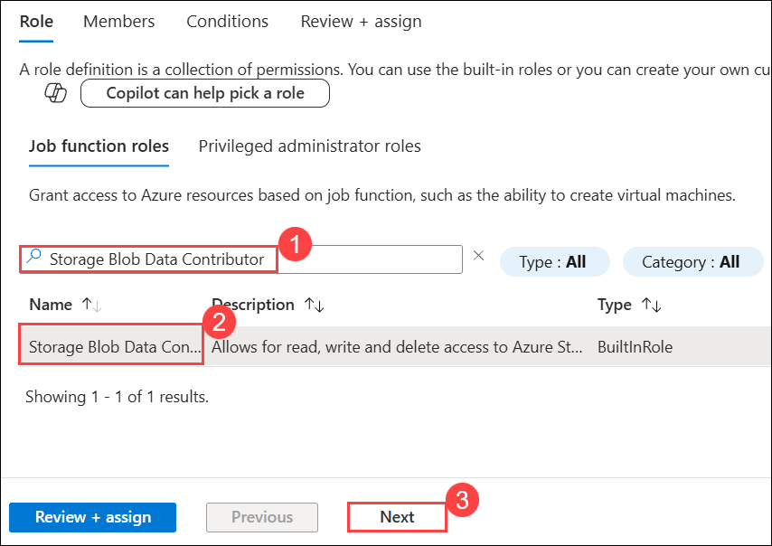

1. On the **Members** tab, **Assign access to:** Select **Managed identity (1)**, then under **Members**, select **+ Select members (2)**, choose **SQL managed instance (3)**, and select the **sqlmi--cus (4)** managed instance. then click on the **Select (5)** button.

    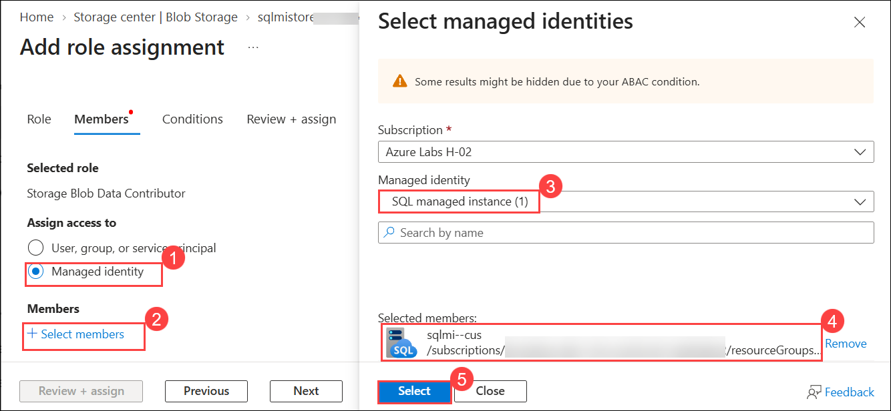
   
1. Then click on the **Review + assign** button.

   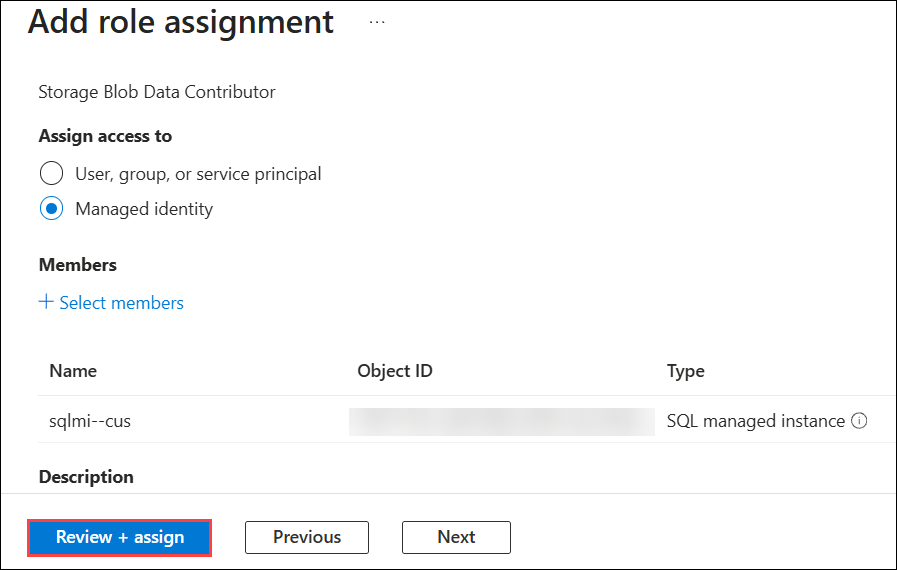

   > **Note:** A notification confirming that the role assignment was added appears in the top-right corner of the portal. Role assignments can take up to five minutes to take effect.
   
### Task 2: Back up the database to Azure Blob Storage

In this task, you will create a SQL Server credential and back up the **<inject key="Database Name" enableCopy="false"/>** database directly to **Azure Blob Storage**. You will then verify that the backup file is available in the storage container.

1. On the **<inject key="SQLVM Name" enableCopy="false"/>** VM, in SSMS on the **source** connection, right-click the **sqlvm2016-sp3** server connection and select **New Query**.

    

1. Paste the following (replace **SUFFIX** with **<inject key="Suffix" />** and `<SAS-token>`), and **Execute**:
   
    ```sql
    USE master;
    GO
    
    -- credential name must match the container URL exactly
    CREATE CREDENTIAL [https://sqlmistoreSUFFIX.blob.core.windows.net/migration]
    WITH IDENTITY = 'SHARED ACCESS SIGNATURE',
         SECRET = '<SAS-token>';
    GO
    
    BACKUP DATABASE WideWorldImportersSUFFIX
    TO URL = 'https://sqlmistoreSUFFIX.blob.core.windows.net/migration/wwi-b/WideWorldImportersSUFFIX_full.bak'
    WITH CHECKSUM, COMPRESSION, MAXTRANSFERSIZE = 4194304, BLOCKSIZE = 65536;
    GO
    ```

    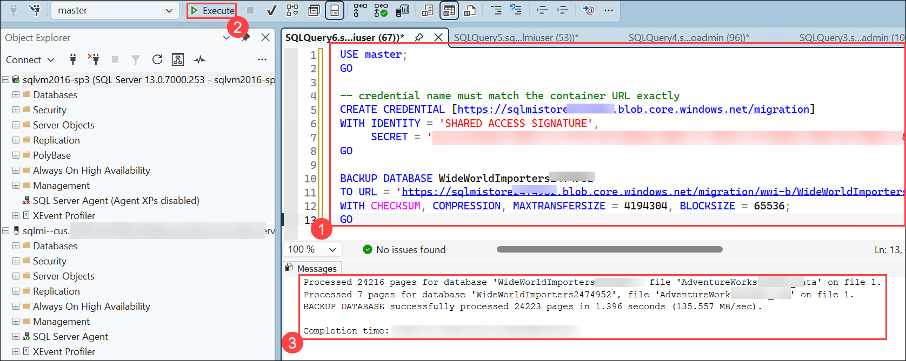
   
1. Navigate back to the migration container and select the **wwi-b** folder. Confirm that the backup file is present in the folder.

    

    

### Task 3: Create the DMS and run the online migration

In this task, you will create **Azure Database Migration Service (DMS)** and configure an online migration from SQL Server to **Azure SQL Managed Instance** using the database backup stored in Azure Blob Storage. You will start the migration and monitor it until it is ready for cutover.

1. In the Azure portal, search for **Azure Database Migration Services** and select **Azure Database Migration Services**.

    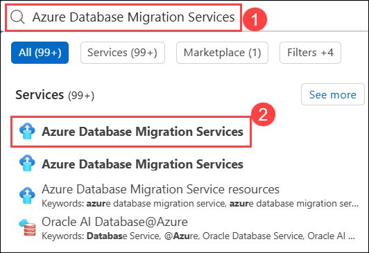
   
1. On the **Azure Database Migration Service** page, under **Azure Database Migration Service**, select **Start a new migration**.

   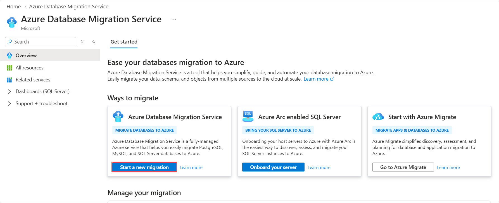

1. On the **Select migration scenario and Database Migration Service** page, set:

   - **Source server type:** **SQL Server (1)**
   - **Target server type:** **Azure SQL Managed Instance (2)**
   - **Database Migration Service:** **Database Migration Service (3)**
   - Then select **Select (4)**.

     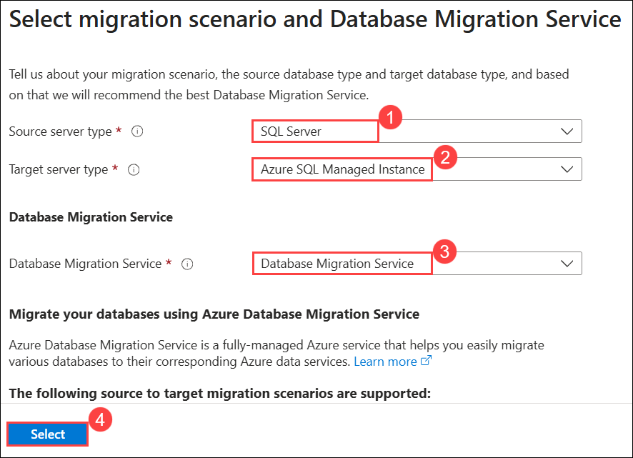

1. On the **Create Data Migration Service** page:
   - **Resource group:** Select the required **<inject key="Resource Group Name" enableCopy="false"/> (1)**.
   - **Location:** Select **Central US (2)**.
   - **Migration service name:** Enter **wwi-dms-<inject key="Suffix" enableCopy="false"/>  (3)**.
   - Select **Review + create (4)**.

     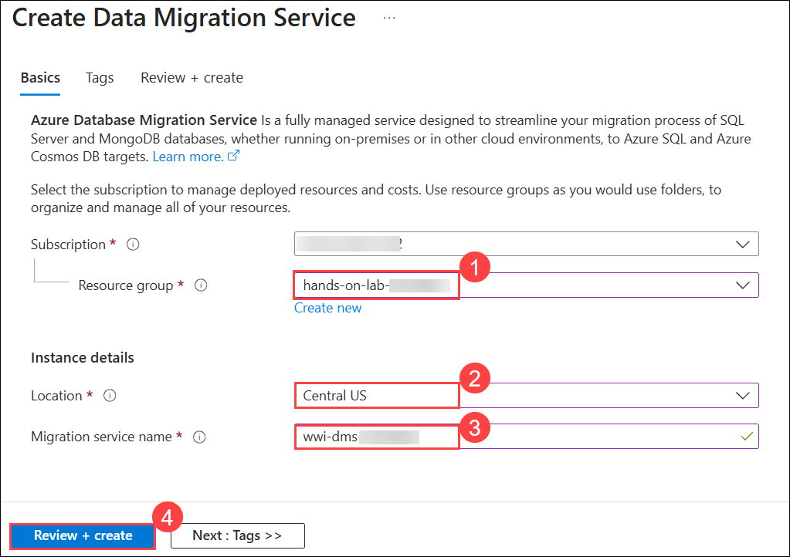

1. On the **Review + create** tab, select **Create**. Wait for the deployment to complete, then select **Go to resource**.

    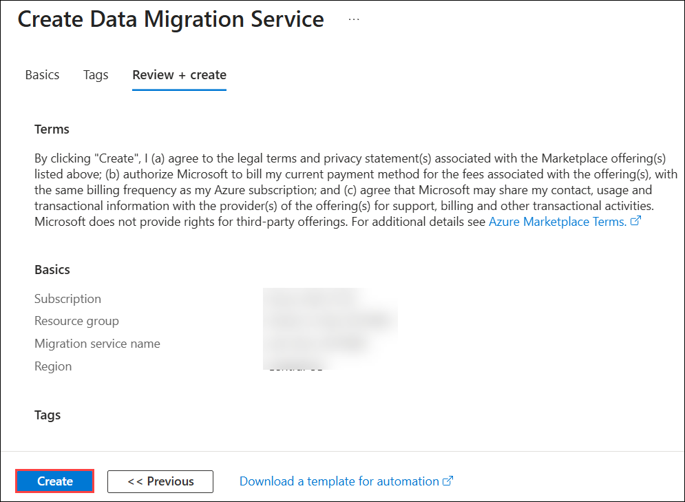

    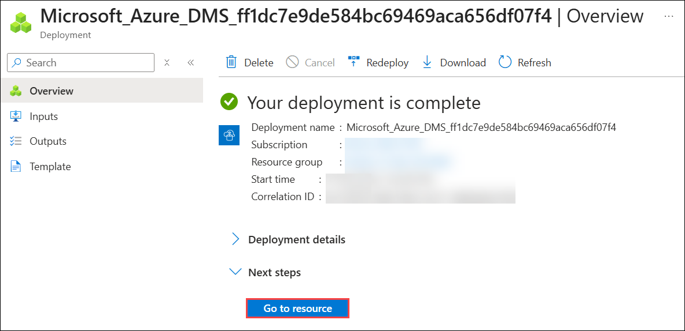

1. On the **Azure Database Migration Service** resource page, select **+ New Migration**.

    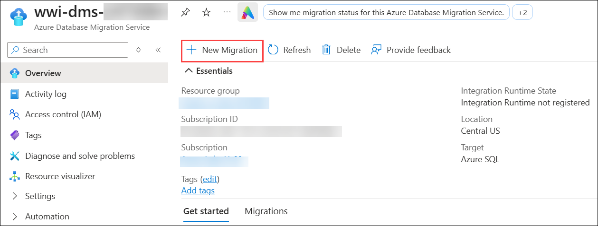

1. On the **Select new migration scenario** page, set:

   - **Source server type:** **SQL Server (1)**
   - **Target server type:** **Azure SQL Managed Instance (2)**
   - **Backup file storage location:** **Blob storage (3)**
   - **Migration mode:** **Online (4)**
   - Then select **Select (5)**.

     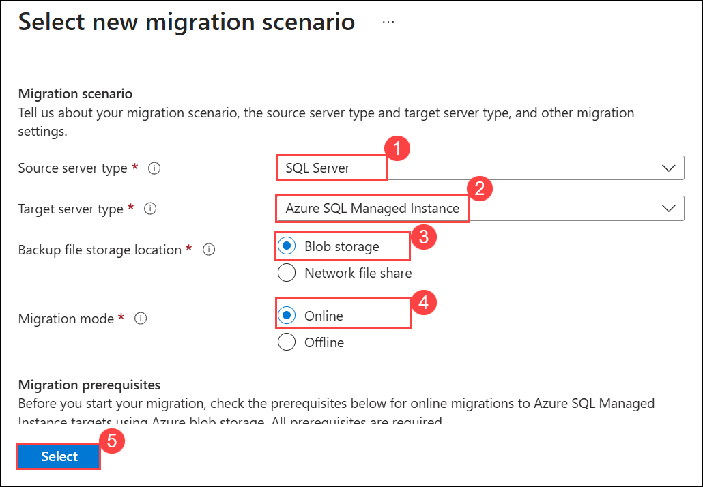

1. On the **Source details** page:

   - Select **Yes (1)** for **Is your source SQL Server instance tracked in Azure?**
   - **Resource group:** Select the required **<inject key="Resource Group Name" enableCopy="false"/> (2)**.
   - **Location:** Select **Central US (3)**.
   - **SQL Server Instance:** Select **sqlvm2016-sp3**.
   - Select **Next: Select migration target >>**.

      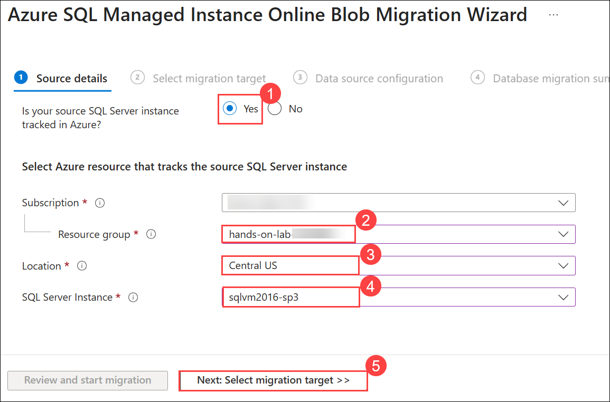

1. On the **Select migration target** page:

    - Under **Resource group**, select **SQLMI-shared-RG (1)**
    - under **Target SQL Managed Instance**, select **sqlmi--cus (2)**.
    - select **Next: Data source configuration >> (3)**.

        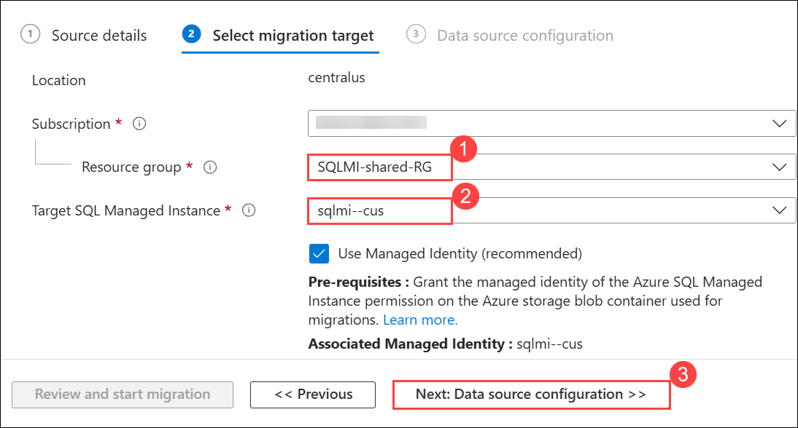

1. On the **Data source configuration** page:

   - **Resource group:** Select **<inject key="Resource Group Name" enableCopy="false"/>**.
   - **Storage account:** Select **sqlmistore<inject key="Suffix" enableCopy="false"/>**.
   - **Blob container:** Select **migration**.
   - **Folder:** Select **wwi-b**.
   - **Target database:** Select **WideWorldImportersB<inject key="Suffix" enableCopy="false"/>**.
   - Select **I confirm the Managed Identity has read access to the above blob container(s)**.
   - Select **Next: Database migration summary >>**.

       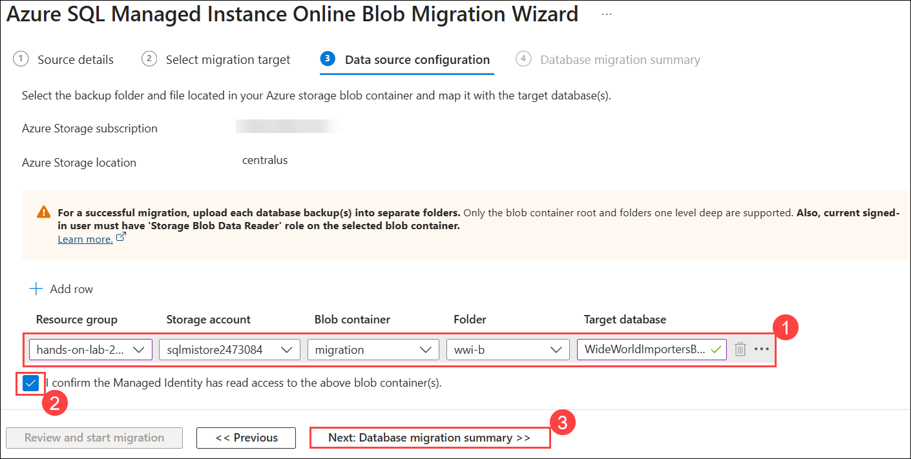

1. On the **Database migration summary** page:

   - Review the migration details.
   - Select **Start migration**.

     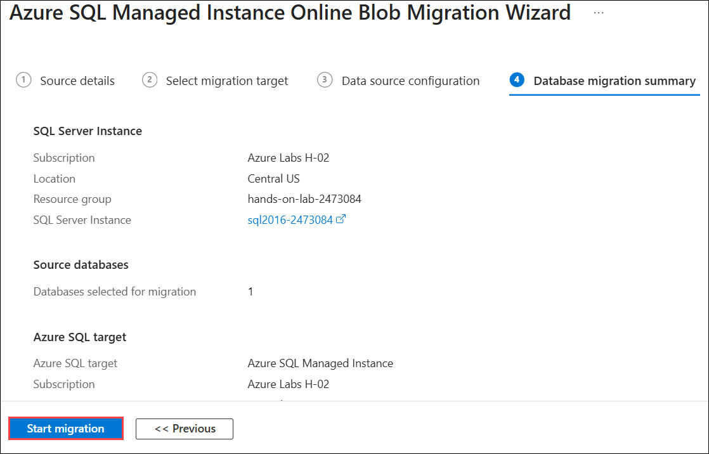
     
1. On the Migrations tab, select **Refresh** until the **Migration** status for **WideWorldImportersB** shows **Ready for cutover** (the full-backup restore takes a few minutes).

    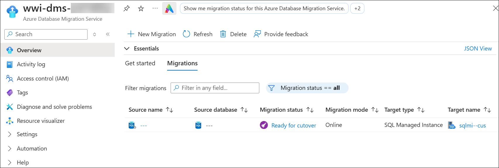
   
### Task 4: Complete the cutover

In this task, you will back up the latest transaction log, complete the **DMS cutover**, and verify that the migrated database on Azure SQL Managed Instance is available for read and write operations.

1. Navigate back to SSMS, on the **source** connection, right-click the **sqlvm2016-sp3** server connection and select **New Query**.

    

1. Run the following (replace **SUFFIX** with **<inject key="Suffix" />**):

   ```sql
   USE WideWorldImportersSUFFIX;
   GO

   INSERT [dbo].[Game] (Title, Description, Rating, IsOnlineMultiplayer)
   VALUES ('Ocean Odyssey', 'Dive into an underwater world full of hidden treasures.', 'E', 1);
   GO

   BACKUP LOG WideWorldImportersSUFFIX
   TO URL = 'https://sqlmistoreSUFFIX.blob.core.windows.net/migration/wwi-b/WideWorldImportersSUFFIX_log1.trn'
   WITH CHECKSUM, COMPRESSION, MAXTRANSFERSIZE = 4194304, BLOCKSIZE = 65536;
   GO
   ```

   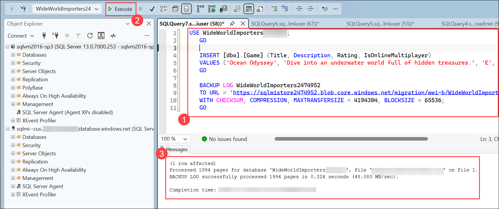
   
1. Naviagte back to **wwi-dms-<inject key="Suffix" enableCopy="false"/>** migration service, select the **Migrations** tab.

   - In the migration row, select the **Source name** to open the migration details.

       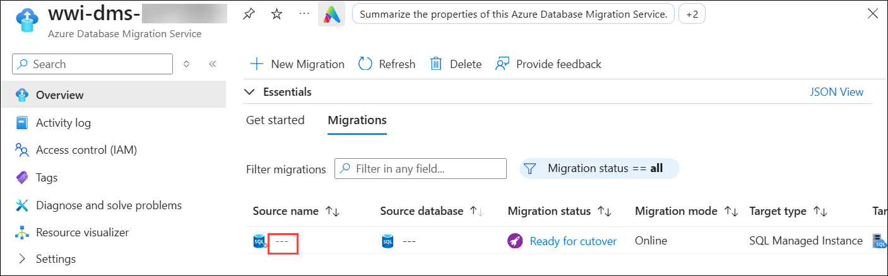
      
1. On the migration details page, select **Complete cutover**.

    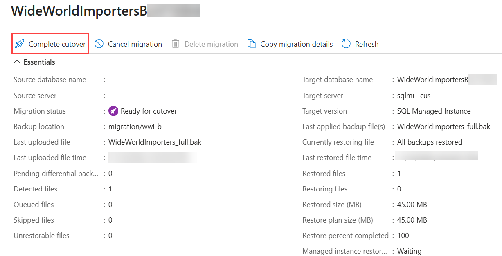

   - In the **Complete cutover** pane, verify **Log backups pending restore** is **0**.
   - Select **I confirm there are no additional log backups to provide and want to complete cutover**.
   - Select **Complete cutover**.

     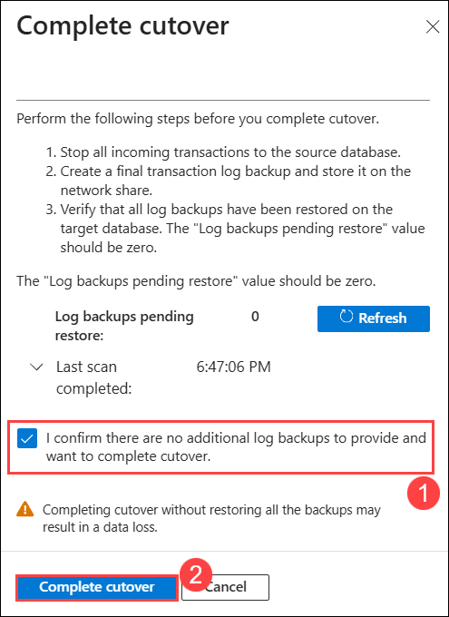
     
1. **Refresh** until the migration status is **Succeeded**.

     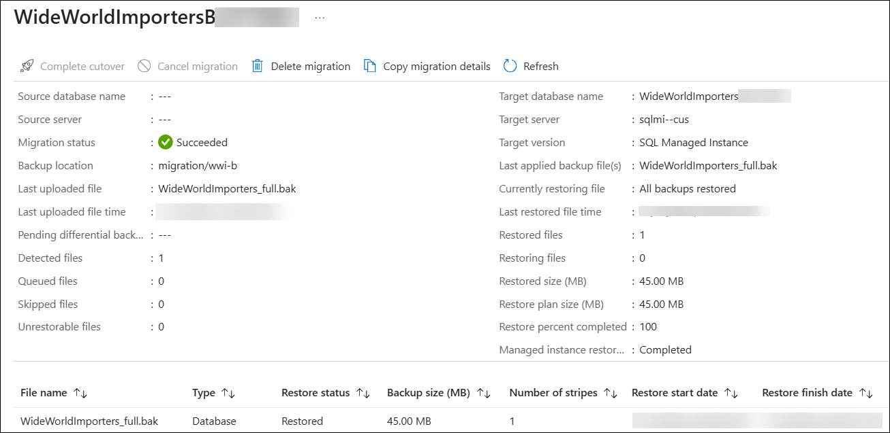

1. In SSMS, on the **SQL MI connection** (`sqlmi--cus`), right-click the connection and select **New Query**.

    

1. run the following (replace **SUFFIX** with **<inject key="Suffix" />**):

   ```sql
   SELECT DATABASEPROPERTYEX('WideWorldImportersBSUFFIX','Updateability') AS Updateability;

   USE WideWorldImportersBSUFFIX;
   GO
   SELECT Title, Rating FROM dbo.Game WHERE Title IN ('Space Adventure', 'Ocean Odyssey');
   ```

1. Observe that **Updateability** is **READ_WRITE** and the data migrated.

    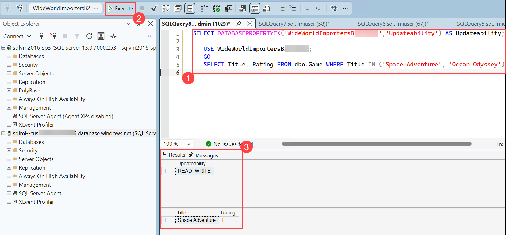
    
  > **Exercise 2 vs. Exercise 3:** The Managed Instance link replicates continuously, so cutover typically takes only a few seconds. However, it requires Always On availability groups and network connectivity to SQL Managed Instance. DMS from Blob Storage requires only outbound HTTPS connectivity from SQL Server to Azure Storage, while downtime depends on how long the final log backup takes to restore.

### 🧾 Summary

In this exercise, you backed up the `WideWorldImporters` database to **Azure Blob Storage** and used **Azure Database Migration Service (DMS)** to perform an online migration to **Azure SQL Managed Instance**. You configured the required storage access, started the migration, provided the final transaction-log backup, and completed the cutover.

#### You have successfully completed the exercise. Select Next >> to continue.
