## Exercise 4: Connect the web application and compare performance

**Duration: 40 Minutes**

### Overview

In this exercise, you will publish the WideWorldImporters web application to Azure App Service and point it at the database you migrated with the Managed Instance link (Path A). Because SQL Managed Instance has a private IP address inside its virtual network, you will connect the app to that network with **regional VNet integration** on a subnet delegated to `Microsoft.Web/serverFarms` — the modern replacement for the gateway-based point-to-site connection. Finally, you will use **Query Store** to compare the workload's performance on SQL MI with the baseline captured on SQL Server 2016.

### Objectives

- **Task 1:** Deploy the web app to Azure
- **Task 2:** Update the App Service connection strings
- **Task 3:** Configure regional VNet integration and open the web app
- **Task 4:** Compare performance with Query Store (optional)

## Task 1: Deploy the web app to Azure

In this task, you will publish the **WideWorldImporters** web application from Visual Studio to an existing Azure App Service.

1. Navigate to your **Lab VM** desktop.

1. In the File Explorer dialog, navigate to the `C:\hands-on-lab\MCW-Migrating-SQL-databases-to-Azure-master\Hands-on lab\lab-files`. In the **lab-files** folder, double-click **WideWorldImporters.sln** to open the solution in **Visual Studio**.

   

1. If prompted **How you want to open the file?**, select **Visual Studio 2022 (1)** and then click **OK (2)**.

    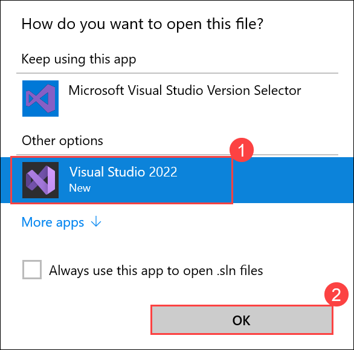

1. Select **Sign in with Microsoft** and choose **Work or school account (1)**, click **Continue (2)**.

    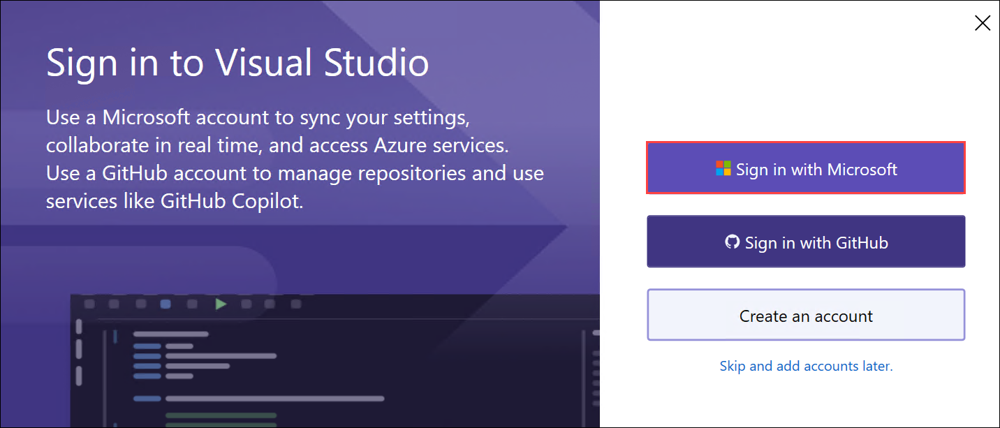

    
   
3. Enter the following **Azure account** credentials if prompted:
   
   * Email/Username: <inject key="AzureAdUserEmail"></inject>
   * Temporary Access Pass: <inject key="AzureAdUserPassword"></inject>

     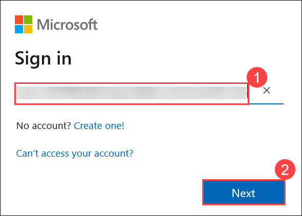

     

1. On the **Sign in to app apps, websites, and services on this device?** pop-up, click on **No, this app only**. Then, on the **Account added to this device** page, select **Done**. 

    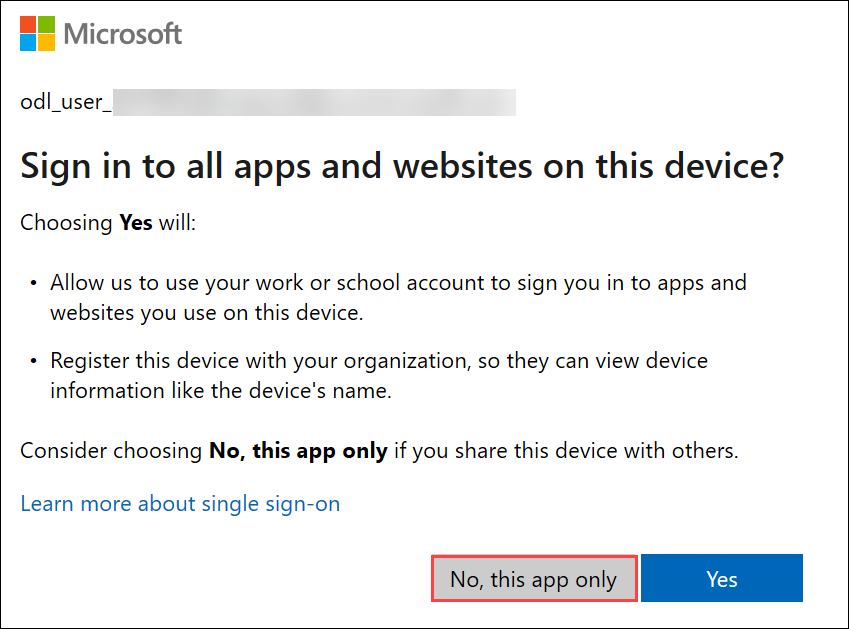

1. Once you sign in, click on **Start Visual Studio**.

    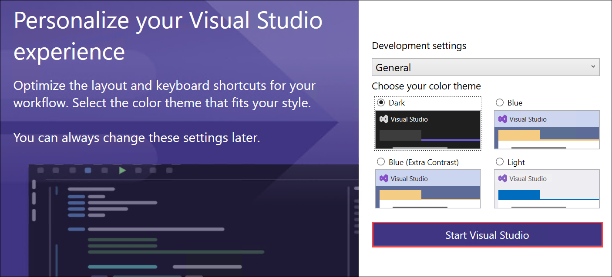


1. Once logged into **Visual Studio**, in the **Solution Explorer** on the right side, right-click the **WideWorldImporters.Web (1)** project, and then select **Publish (2)** from the context menu.

    

    >**Note:** If you see the **WideWorldImporters.Web (unloaded)** project, right-click on it and select **Reload Project**.

    > **Note:** If the project does not load even after clicking **Reload Project**, click **Install** under the prompt to install the required extra components and .NET framework (this process may take about 5 minutes). After installation, retry loading the project by right-clicking it and selecting **Reload Project**.

1. On the **Publish** dialog box, select **Azure (1)** in the **Target** box, and click **Next (2)**.

    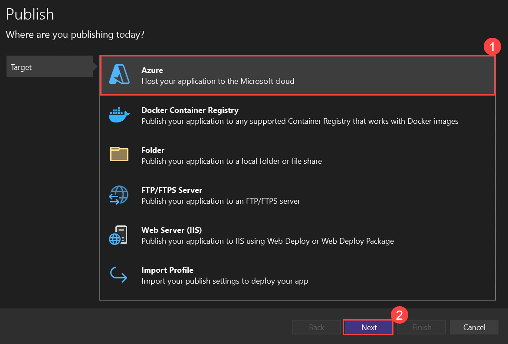

1. Next, in the **Specific target** box, select **Azure App Service (Windows) (1)** and click **Next (2)**.

    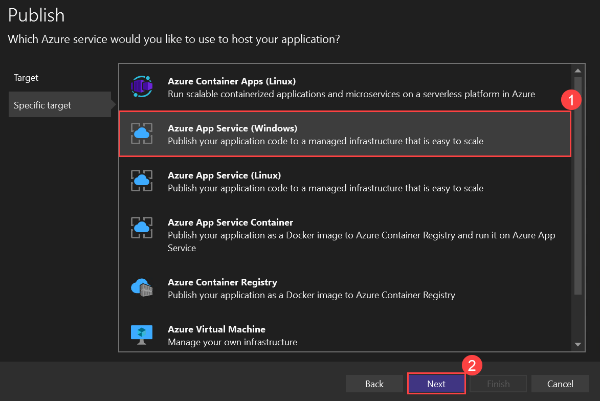

1. Finally, in the **App Service** box, select your **subscription (1)**, expand the **hands-on-lab-<inject key="Suffix" enableCopy="false"/> (2)** resource group, and select the **wwi-web-<inject key="Suffix" enableCopy="false"/> (3)** Web App then click on **Finish (3)**.

    

1. Once completed, click on **Close**.

    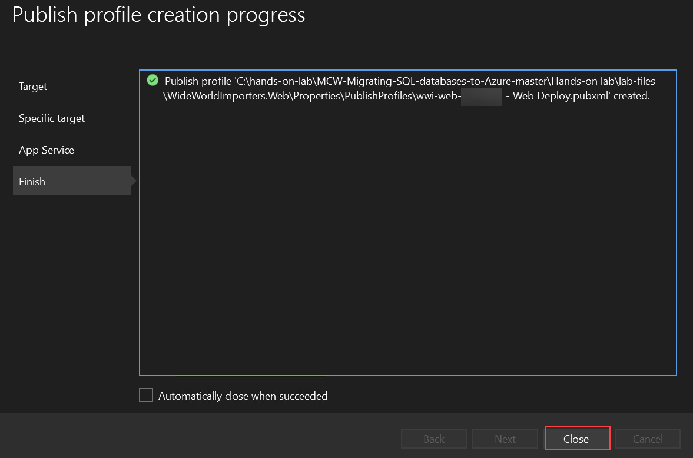

1. Back on the Visual Studio Publish page for the `WideWorldImporters.Web` project, select **Publish** to start the process of publishing your Web API to your Azure API App.

    

1. When the publish completes, you will see a message on the Visual Studio Output page that the **Publish Succeeded**.

    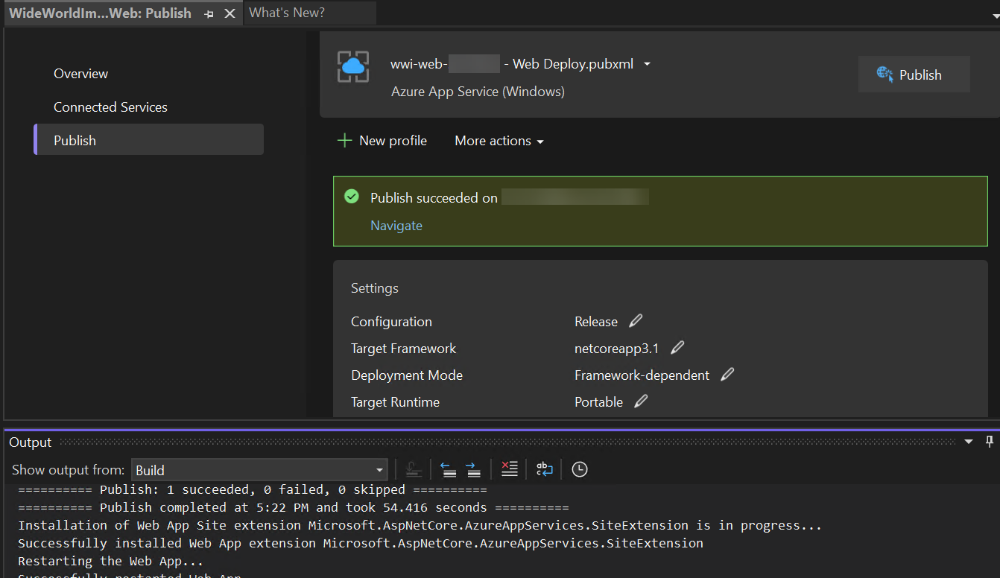

### Task 2: Enable the SQL Managed Instance public endpoint

In this task, you will enable the managed instance's public endpoint so the App Service can connect to it on port 3342, and note the public host name you will use in the connection string.

1. In the Azure portal, search and select **sqlmi--cus**.

     
   
1. Under **Security**, select **Networking**. Under **Public endpoint**, select **Enable**, then select **Save**.

    
   
   >**Note:** `sqlmi--cus` is a shared instance, so the public endpoint may already be enabled. If it is already on, leave it as-is and continue — enabling it again is harmless.


1. On the same **Networking** blade, copy the **Endpoint** value (the public host **and** port) into Notepad - it has the form **`sqlmi--cus.public.<dns-zone>.database.windows.net,3342`**.

   >**⚠️ The host MUST contain `.public.`** The plain host `sqlmi--cus.<dns-zone>.database.windows.net` (shown on the **Overview** blade) is the **private** endpoint — the App Service **cannot reach it** and you will get a *"socket forbidden / server not accessible"* error. Always copy the **`.public.`** host from the **Networking** blade, and use port **3342** (not the private 1433 used by the MI link).

### Task 3: Update the connection strings and open the web app

In this task, you will point the App Service at the managed instance's public endpoint and open the running site.

1. In the Azure portal, search for **App Services (1)** and select **App Services (2)** from the search results.

    

1. Select **wwi-web-<inject key="Suffix" enableCopy="false"/>** App Service.

   
   
1. Under **Settings**, select **Environment variables**, select the **Connection strings** tab, and select **Advanced edit**.

     
   
1. Set the value of both `wwiContext` and `WwiReadOnlyContext` to the following:

    ```
    Server=tcp:sqlmi--cus.public.<dns-zone>.database.windows.net,3342;Database=WideWorldImportersSUFFIX;User ID=contosoadmin;Password=IAE5fAijit0w^rDM;Encrypt=True;TrustServerCertificate=False;
    ```

    
   
1. Replace the host with the **public** FQDN you copied in Task 2 — it **must contain `.public.`** and end with **`,3342`** — and replace `SUFFIX` with **<inject key="Suffix" />**. Select **OK**.

   >**Note:** The application reads its connection strings with `GetConnectionString()`, so you only set them under **Connection strings**. `Encrypt=True;TrustServerCertificate=False` makes the app validate the managed instance's certificate.

1. Select **Apply**, then **Confirm** when told the app will restart.

   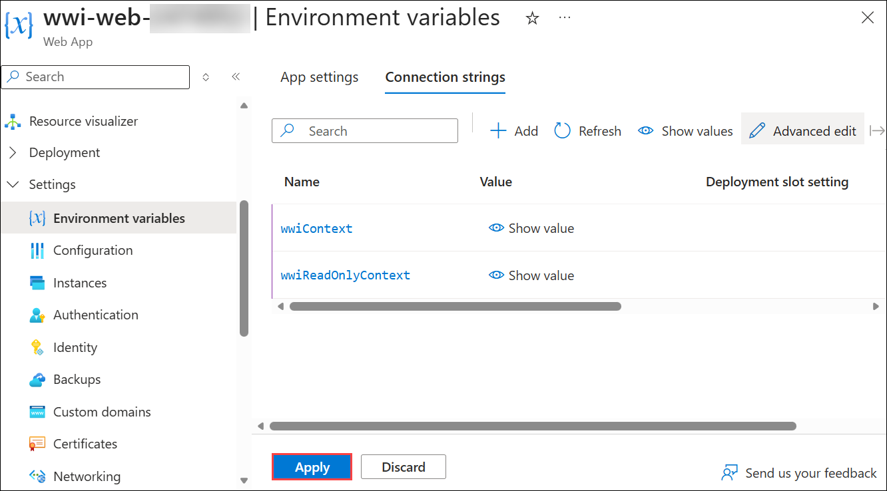

   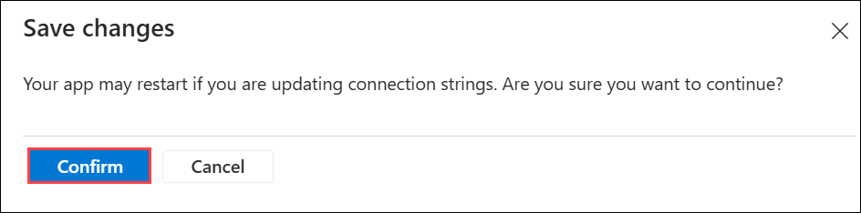
    
1. Select **Overview**, then select the **Default domain** link to open the website.

   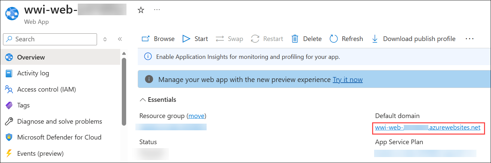

1. Verify it loads and shows data from SQL MI.

   

   >**Note:** The restart can take a minute. If you see an error, refresh a few times, or select **Restart** on the web app's toolbar.

### Task 4: Compare performance with Query Store (optional)

In this task, you will run the same workload on SQL Managed Instance and use Query Store to compare performance before and after the migration.

Query Store data is stored inside the database, so the baseline you captured on SQL Server 2016 in Exercise 1 moved to SQL MI with the database.

> **Note:** Do this task only if you completed **Exercise 1, Task 2**.

1. On the **JumpBox** VM, in SSMS, select the **SQL MI** connection, select **New Query**, paste the following (replace **SUFFIX** with **<inject key="Suffix" />**), and select **Execute**:

    ```sql
    USE WideWorldImportersSUFFIX;
    GO

    SELECT TOP (50) GamerId, GamerScore, GamesPlayed
    FROM dbo.Leaderboard
    ORDER BY GamerScore DESC;
    GO 50

    SELECT Title, Rating
    FROM dbo.Game
    WHERE IsOnlineMultiplayer = 1
    ORDER BY Title;
    GO 50
    ```

1. In Object Explorer, under the SQL MI connection, expand **Databases** > **WideWorldImporters<inject key="Suffix" enableCopy="false"/>** > **Query Store**, and double-click **Top Resource Consuming Queries**.

1. Select **Configure**, set the time interval to cover both runs, and select **OK**. Select the Leaderboard query and compare the average **duration** and **CPU time** between SQL Server 2016 (before) and SQL MI (after).

1. The migrated database keeps compatibility level **130** (SQL Server 2016). Run the following to raise it, then run the workload again and check **Regressed Queries** under Query Store:

    ```sql
    SELECT name, compatibility_level FROM sys.databases WHERE name = DB_NAME();
    GO
    ALTER DATABASE CURRENT SET COMPATIBILITY_LEVEL = 160;
    GO
    ```

   > Query Store lets you compare performance before and after migration with one tool. If a query regresses after the compatibility change, you can force its earlier plan from the plan summary pane until it's fixed.

## Summary

In this exercise, you published the web application, connected it to the migrated database through the managed instance's public endpoint, and used Query Store to compare the workload's performance before and after the migration.

### You have successfully completed the exercise. Now click on **Next >>** from the lower right corner to move on to the next exercise.

