# Exercise 4: Connect the web application and compare performance

### Duration: 40 Minutes

## 📖 Overview

In this exercise, you will publish the **<inject key="Database Name" enableCopy="false"/>** web application to Azure App Service and connect it to the database migrated to **Azure SQL Managed Instance**. You will configure the managed instance endpoint, update the App Service connection strings, and verify that the web application can connect to and display data from the migrated database.

You will first publish the web application, then configure the SQL Managed Instance endpoint and update the application connection settings before verifying the application connection.

## 🎯 Objectives

- **Task 1:** Deploy the WideWorldImporters web application to Azure.
- **Task 2:** Enable the SQL Managed Instance public endpoint.
- **Task 3:** Update the App Service connection strings and open the web application.

### Task 1: Deploy the web app to Azure

In this task, you will publish the **WideWorldImporters** web application from Visual Studio to the existing Azure App Service.

1. Navigate to your **Jump VM** desktop.

1. In the File Explorer dialog, navigate to the `C:\hands-on-lab\MCW-Migrating-SQL-databases-to-Azure-master\Hands-on lab\lab-files`. In the **lab-files** folder, double-click **WideWorldImporters.sln** to open the solution in **Visual Studio**.

   

1. If prompted **How you want to open the file?**, select **Visual Studio 2022 (1)** and then click **OK (2)**.

    

1. Select **Sign in with Microsoft** and choose **Work or school account (1)**, click **Continue (2)**.

    

    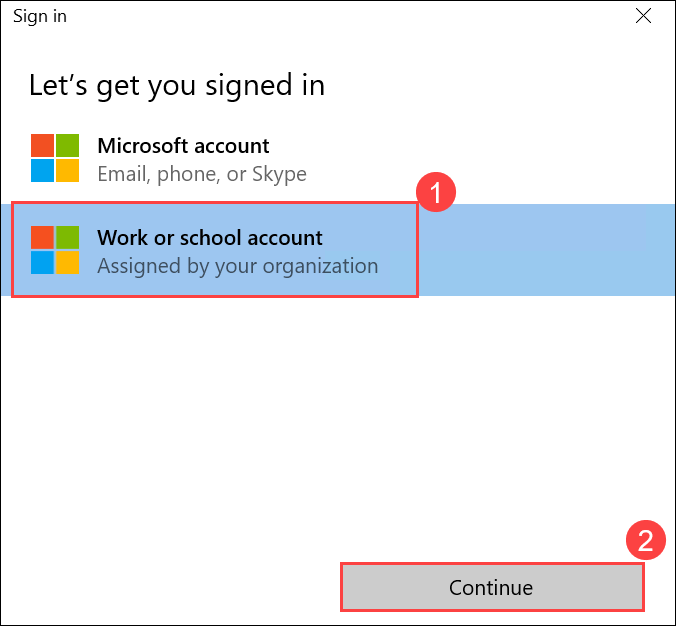
   
3. Enter the following **Azure account** credentials when prompted:
   
   * Email/Username: <inject key="AzureAdUserEmail"></inject>
   * Temporary Access Pass: <inject key="AzureAdUserPassword"></inject>

     

     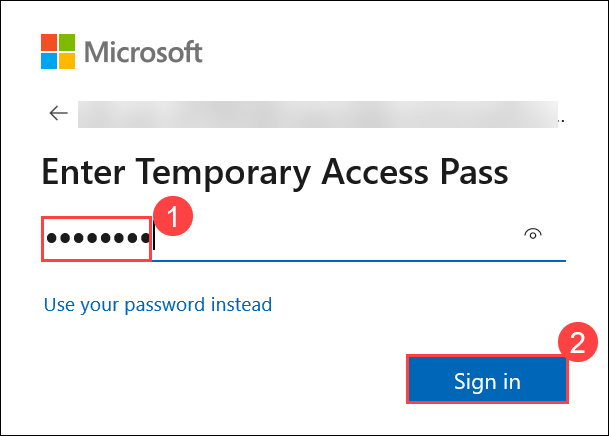

1. On the **Sign in to app apps, websites, and services on this device?** pop-up, click on **No, this app only**. Then, on the **Account added to this device** page, select **Done**. 

    

1. Once you sign in, click on **Start Visual Studio**.

    

1. Once logged into **Visual Studio**, in the **Solution Explorer** on the right side, right-click the **WideWorldImporters.Web (1)** project, and then select **Publish (2)** from the context menu.

    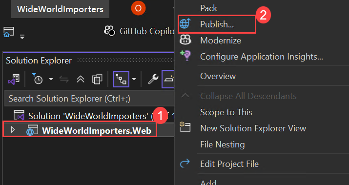

    >**Note:** If you see the **WideWorldImporters.Web (unloaded)** project, right-click on it and select **Reload Project**.

    > **Note:** If the project does not load even after clicking **Reload Project**, click **Install** under the prompt to install the required extra components and .NET framework (this process may take about 5 minutes). After installation, retry loading the project by right-clicking it and selecting **Reload Project**.

1. On the **Publish** dialog box, select **Azure (1)** in the **Target** box, and click **Next (2)**.

    

1. Next, in the **Specific target** box, select **Azure App Service (Windows) (1)** and click **Next (2)**.

    

1. Finally, in the **App Service** box, select your **subscription (1)**, expand the **hands-on-lab-<inject key="Suffix" enableCopy="false"/> (2)** resource group, and select the **wwi-web-<inject key="Suffix" enableCopy="false"/> (3)** Web App then click on **Finish (3)**.

    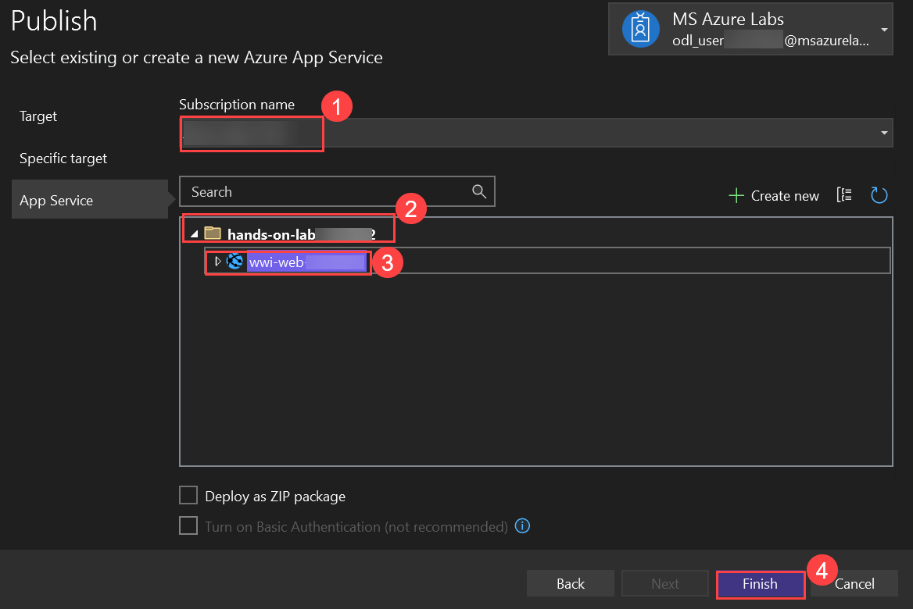

1. Once completed, click on **Close**.

    

1. Back on the **Visual Studio Publish** page for the `WideWorldImporters.Web` project, select **Publish** to start the process of publishing your Web API to your Azure API App.

    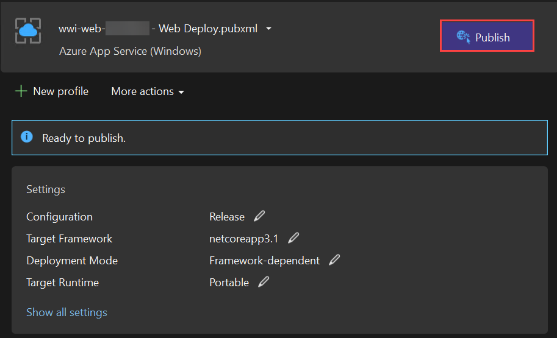

1. When the publish completes, you will see a message on the Visual Studio Output page that the **Publish Succeeded**.

    

### Task 2: Enable the SQL Managed Instance public endpoint

In this task, you will enable the **public endpoint** on the SQL Managed Instance and retrieve the endpoint information required to connect the web application to the database.

1. In the Azure portal, search and select **sqlmi--cus**.

     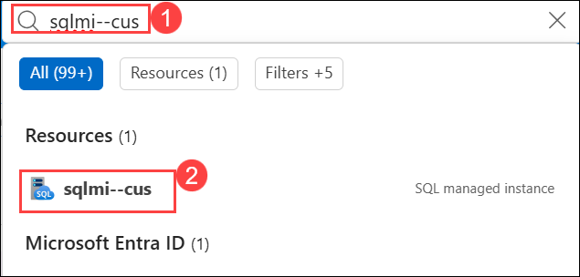
   
1. Under **Security**, select **Networking**. Under **Public endpoint**, select **Enable**, then select **Save**.

    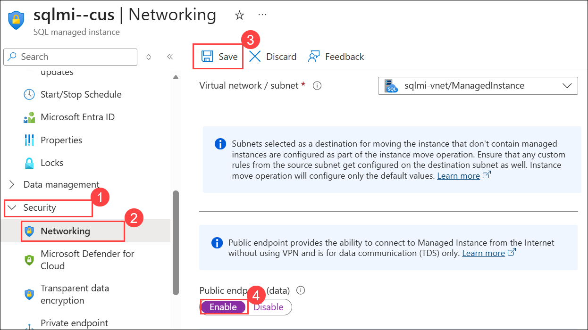
   
   >**Note:** `sqlmi--cus` is a shared instance, so the public endpoint may already be enabled. If it is already on, leave it as-is and continue — enabling it again is harmless.

1. On the same **Networking** blade, copy the **Endpoint** value (the public host **and** port) into Notepad - it has the form **`sqlmi--cus.public.<dns-zone>.database.windows.net,3342`**.

    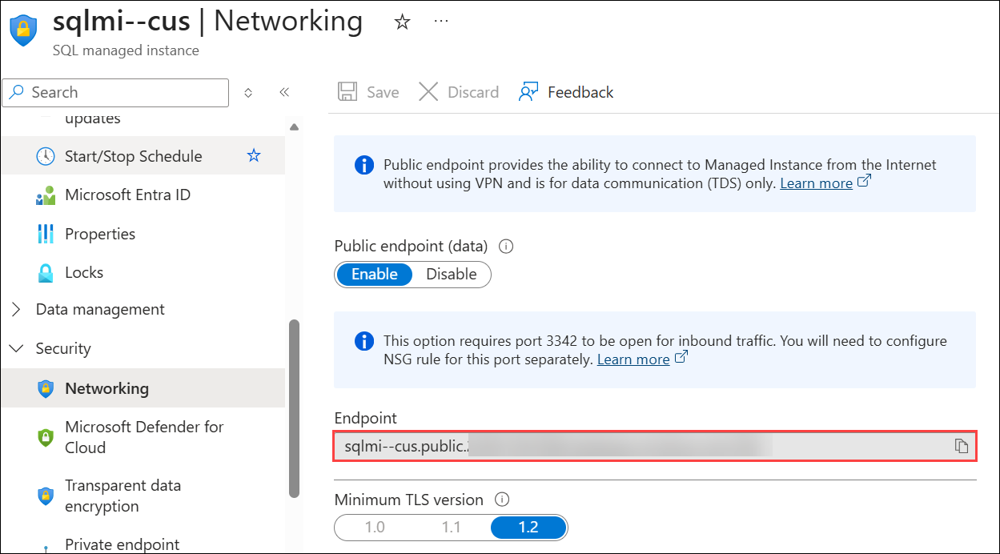
   
   >**⚠️ The host MUST contain `.public.`** The plain host `sqlmi--cus.<dns-zone>.database.windows.net` (shown on the **Overview** blade) is the **private** endpoint - the App Service **cannot reach it** and you will get a *"socket forbidden / server not accessible"* error. Always copy the **`.public.`** host from the **Networking** blade, and use port **3342** (not the private 1433 used by the MI link).

### Task 3: Update the connection strings and open the web app

In this task, you will update the App Service connection strings to point to the migrated database on **Azure SQL Managed Instance** and verify that the web application loads successfully.

1. In the Azure portal, search for **App Services (1)** and select **App Services (2)** from the search results.

    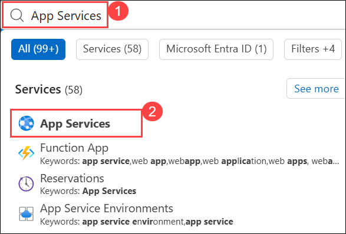

1. Select **wwi-web-<inject key="Suffix" enableCopy="false"/>** App Service.

   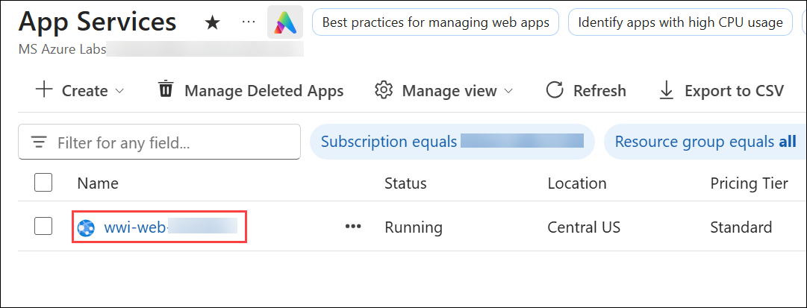
   
1. Under **Settings**, select **Environment variables**, select the **Connection strings** tab, and select **Advanced edit**.

     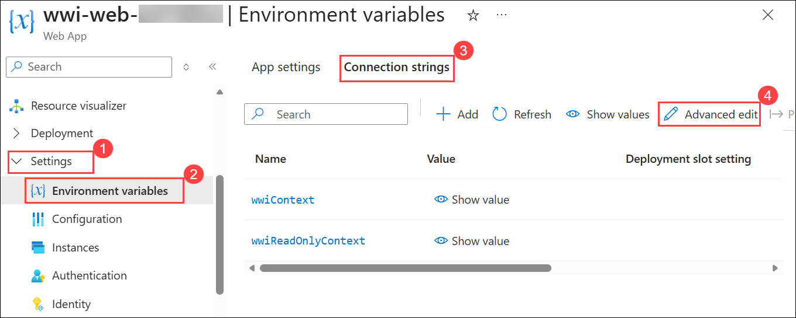
   
1. Set the value of both wwiContext and WwiReadOnlyContext by replacing your-sqlmi-public-fqdn-value,3342; with the public endpoint you recorded in the previous task.

    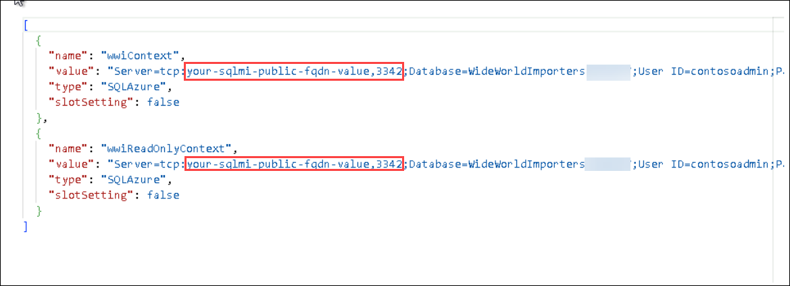

    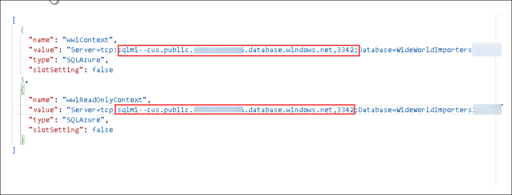
   
1. Replace the host with the **public** Endpoint FQDN you copied in Task 2 — it **must contain `.public.`** and end with **`,3342`** — and replace `SUFFIX` with **<inject key="Suffix" />**. Select **OK**.

   >**Note:** The application reads its connection strings with `GetConnectionString()`, so you only set them under **Connection strings**. `Encrypt=True;TrustServerCertificate=False` makes the app validate the managed instance's certificate.

1. Select **Apply**, then **Confirm** when told the app will restart.

   

   
    
1. Select **Overview**, then select the **Default domain** link to open the website.

   

1. Verify it loads and shows data from SQL MI.

   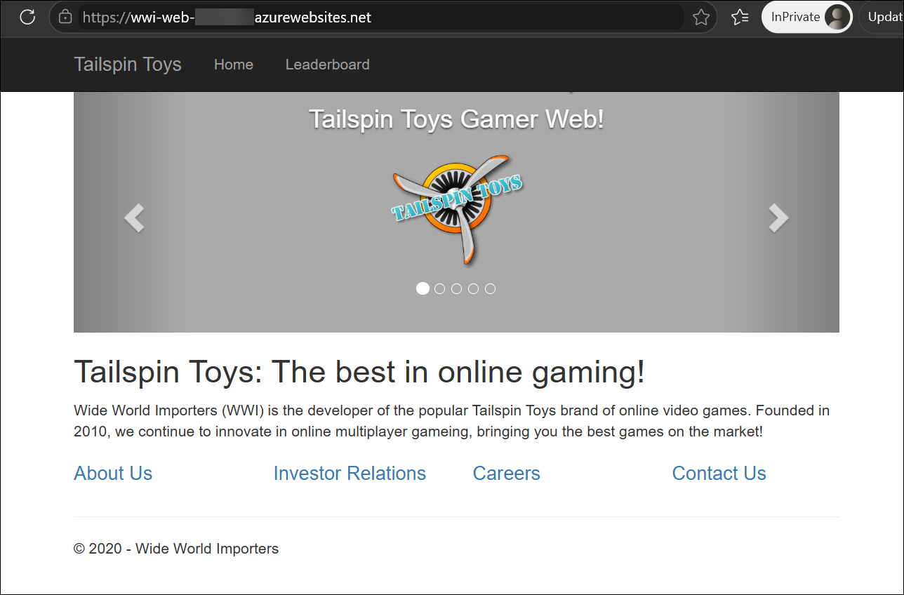

   >**Note:** The restart can take a minute. If you see an error, refresh a few times, or select **Restart** on the web app's toolbar.

## 🧾 Summary

In this exercise, you published the **<inject key="Database Name" enableCopy="false"/>** web application to Azure App Service, configured the SQL Managed Instance public endpoint, and updated the App Service connection strings to connect to the migrated database.

### You have successfully completed the exercise. Select Next >> to continue.
