# Exercise 5: Improve the security posture with Data Discovery & Classification and Microsoft Defender for SQL

### Duration: 30 Minutes

## 📖 Overview

In this exercise, you will use the built-in security features of Azure SQL Managed Instance to improve the security posture of the migrated database. You will classify sensitive data with **Data Discovery & Classification**, review database vulnerabilities with **Microsoft Defender for SQL**, and enable **Transparent Data Encryption (TDE)** to encrypt the database at rest.

You will first identify and classify sensitive data, then run a vulnerability assessment to identify security issues, and finally enable TDE and rescan the database to verify that the vulnerability has been resolved.

## 🎯 Objectives

- **Task 1:** Configure Data Discovery & Classification
- **Task 2:** Review the Microsoft Defender for SQL vulnerability assessment
- **Task 3:** Enable Transparent Data Encryption and rescan

### Task 1: Configure Data Discovery & Classification

In this task, you will review the classification recommendations for the migrated database, classify sensitive columns, and review the database classification report.

1. In the **Azure portal**, use the search bar to search for **`sqlmi--cus`**.

     
   
6. In the SQL Managed Instance page, expand **Data management (1)** from the left navigation menu. Select **Databases (2)** and in the database search and select **<inject key="Database Name" enableCopy="false"/>**. .

1. On the database blade, under **Security**, select **Data Discovery & Classification**.

    

1. In the **<inject key="Database Name" enableCopy="false"/>** ** database, select the **Classification** tab and expand the **columns with classification recommendations** section by selecting the expand arrow.

    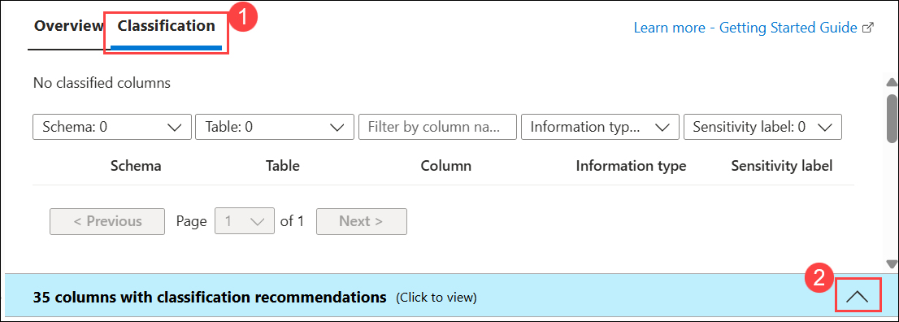
   
1. Review the classification recommendations displayed for the database.

1. Review the recommendation for **Sales - CreditCard - CardNumber**.

   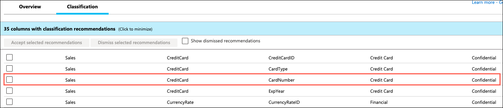

1. Select **Sales CreditCard - CardNumber** and click **+ Add classification**.

    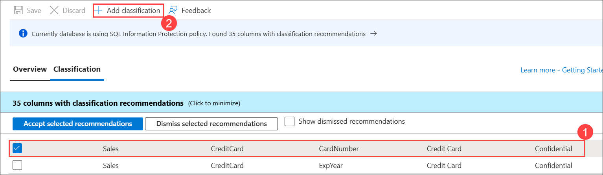

1. Enter the following, and **Add classification**:

   - **Schema name**: **Sales**
   - **Table name**: **CreditCard**
   - **Column name**: **CardNumber (nvarchar)**
   - **Information type**: **Credit Card**
   - **Sensitivity label**: **Highly Confidential**

      
     
1. Select **Save**.

    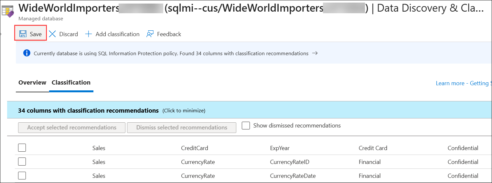
   
1. Review the **HumanResources - Employee** recommendations (NationalIDNumber, BirthDate) flagged **Confidential - GDPR**. Check **Select all**, select **Accept selected recommendations**, then **Save**.

    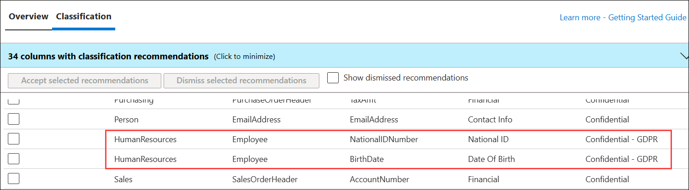

1. Select the **Select all** checkbox to select all available classification recommendations. Select **Accept selected recommendations** to accept the selected classification recommendations.

    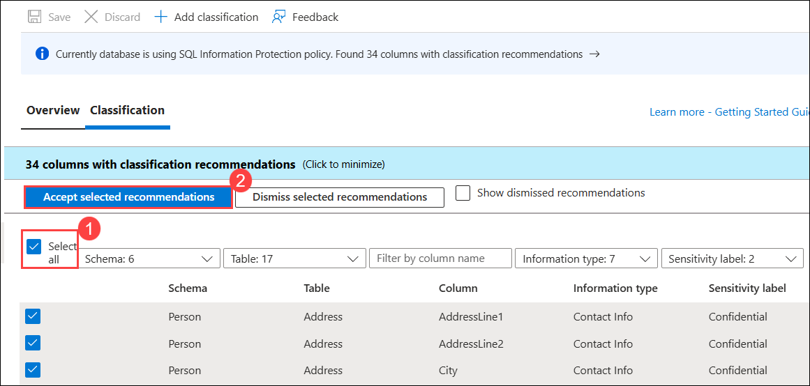

1. Select **Save** on the toolbar of the Data Classification window.

     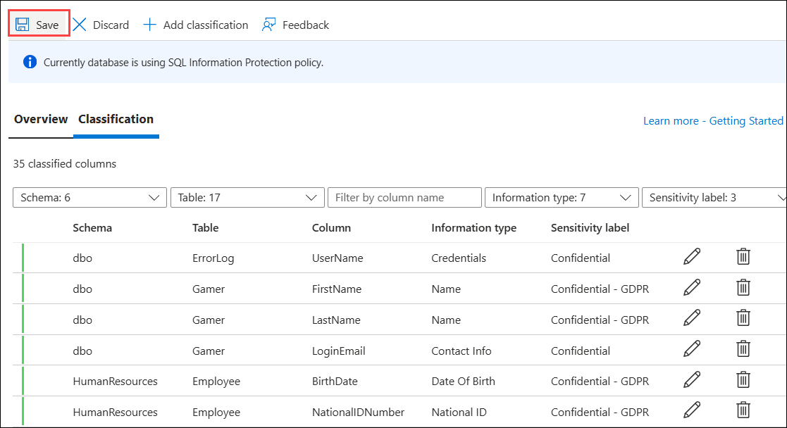

1. When the save completes, select the **Overview** tab on the Data Discovery & Classification blade to view a report with a full summary of the database classification state.

    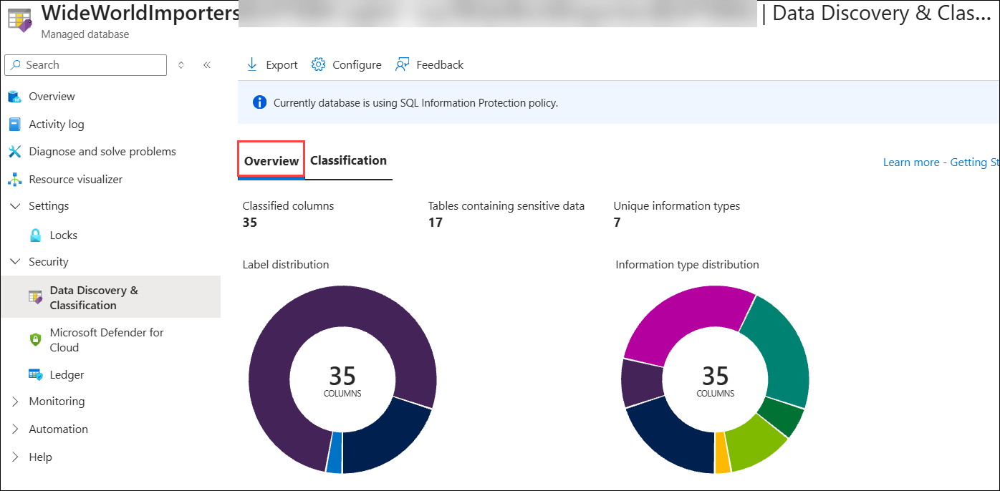
   
### Task 2: Review the Microsoft Defender for SQL vulnerability assessment

In this task, you will run the Microsoft Defender for SQL vulnerability assessment, review the findings, and identify the **Transparent Data Encryption (TDE)** vulnerability.

With the **express configuration** (default), scan results are stored by the service - no storage account needed.

1. On the database blade, under **Security**, select **Microsoft Defender for Cloud**. Confirm **Microsoft Defender for SQL** is **Enabled**.

   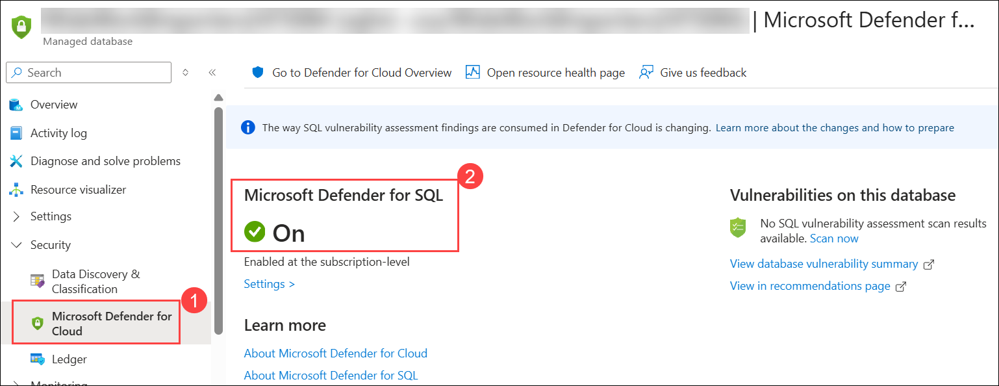

1. Scroll down and under **Vulnerabilities on this database**, select **View database vulnerability summary**.

    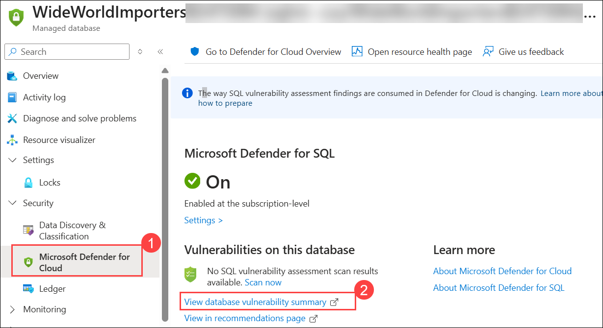
   
1. Select **Scan** on the toolbar and wait for it to complete.

   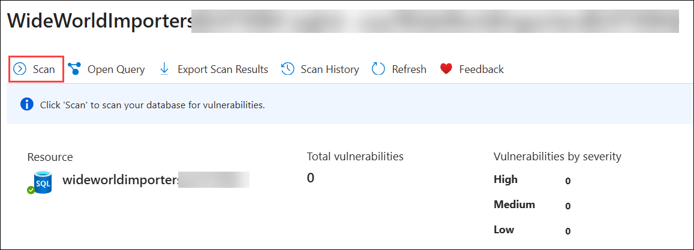

1. In the **Unhealthy** list, find the **Transparent data encryption** check (**VA1219**) and select it to view the details.

     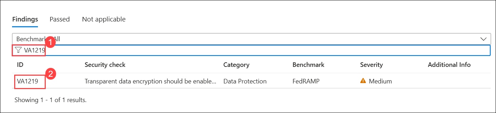

     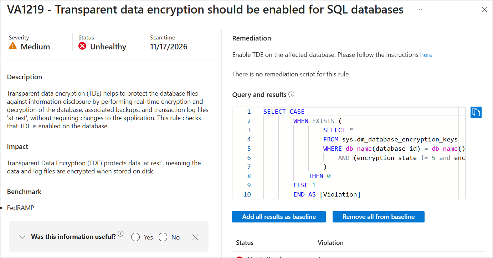
   
   > **Why is TDE off?** New databases on SQL MI are encrypted by default, but databases that arrive through a migration keep the source's encryption state. WideWorldImporters wasn't encrypted on SQL Server 2016, so it isn't on SQL MI.

### Task 3: Enable Transparent Data Encryption and rescan

In this task, you will enable **Transparent Data Encryption (TDE)** on the migrated database, verify that encryption is complete, and rerun the vulnerability assessment to confirm that the TDE vulnerability has been resolved.

1. On the **<inject key="Sqlvm Name" enableCopy="false"/>** VM, in SSMS on the **SQL MI** connection, run (replace **SUFFIX** with <inject key="Suffix" enableCopy="false"/>):

   ```sql
   USE master;
   GO
   ALTER DATABASE [WideWorldImportersSUFFIX] SET ENCRYPTION ON;
   GO
   ```

   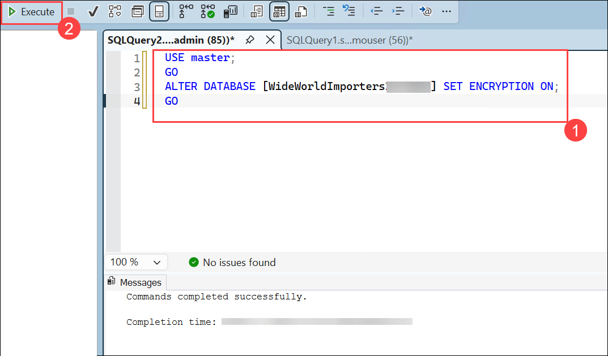

1. Check the encryption state:

    ```sql
    SELECT DB_NAME(database_id) AS database_name, encryption_state, encryptor_type, percent_complete
    FROM sys.dm_database_encryption_keys;
    ```
    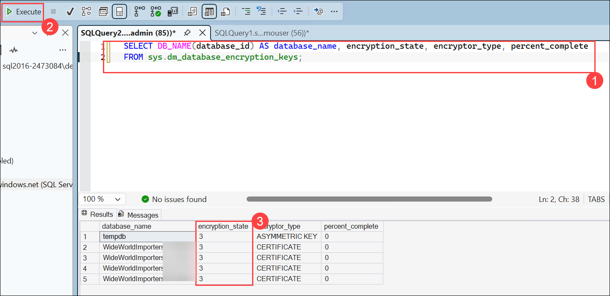
   
1. Confirm **encryption_state** is **3** (encrypted). If **2**, wait and re-run.

1. Return to the **Vulnerability Assessment** page and select **Scan** again.
  
1. When complete, search **VA1219** it's no longer in **Unhealthy**.

1. Select the **Passed** tab and confirm **VA1219** passed.

   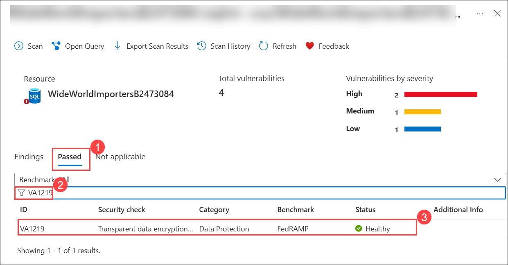

### 🧾 Summary

In this exercise, you classified sensitive data in the migrated database, reviewed the **Microsoft Defender for SQL** vulnerability assessment, enabled **Transparent Data Encryption (TDE)**, and rescanned the database to confirm that the TDE vulnerability was resolved.

#### You have successfully completed the exercise. Select Next >> to continue.
