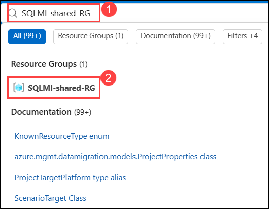
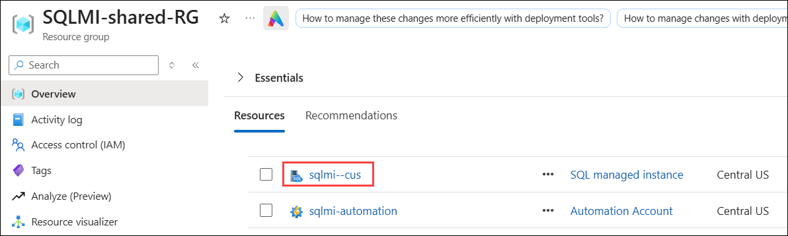
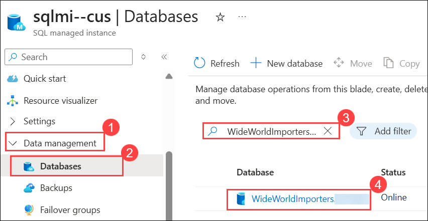
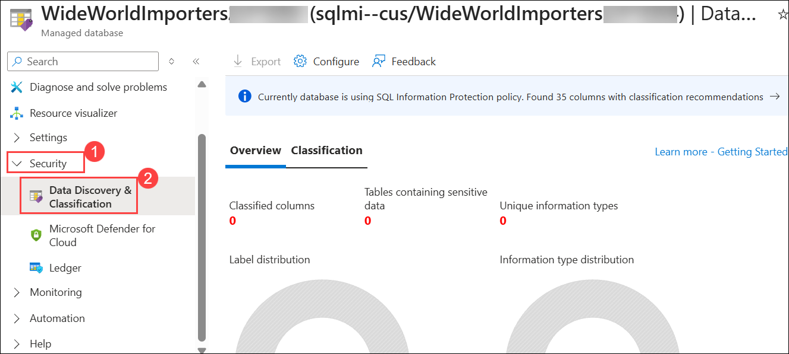
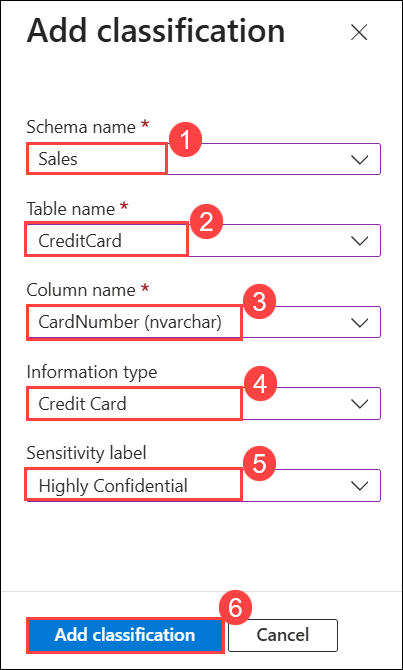

## Exercise 5: Improve the security posture with Data Discovery & Classification and Microsoft Defender for SQL

**Duration: 30 Minutes**

### Overview

In this exercise, you will use the built-in security features of Azure SQL Managed Instance on the migrated database. You will classify sensitive data with **Data Discovery & Classification**, review database vulnerabilities with **Microsoft Defender for SQL**, and enable **Transparent Data Encryption (TDE)** to encrypt the database at rest.

### Objectives

- **Task 1:** Configure Data Discovery & Classification
- **Task 2:** Review the Microsoft Defender for SQL vulnerability assessment
- **Task 3:** Enable Transparent Data Encryption and rescan

## Task 1: Configure Data Discovery & Classification

In this task, you will discover and classify sensitive columns in the migrated database and review the classification report.

1. In the **Azure portal**, use the search bar to search for **`SQLMI-shared-RG`**.

     
   
3. Under **Resource Groups**, select **`SQLMI-shared-RG`**.

     

4. In the **Resources** section, locate and select the SQL Managed Instance **`sqlmi--cus`**.

    
   
6. In the SQL Managed Instance page, expand **Data management (1)** from the left navigation menu. Select **Databases (2)** and in the database search and select  **`WideWorldImporters`**.

1. On the database blade, under **Security**, select **Data Discovery & Classification**.

    

1. In the **WideWorldImporters** database, select the **Classification** tab and expand the **columns with classification recommendations** section by selecting the expand arrow.

    
   
3. Review the classification recommendations displayed for the database.

1. Review the recommendation for **Sales - CreditCard - CardNumber**.

   

1. Select **Sales CreditCard - CardNumber** and click **+ Add classification**.

    

1. Enter the following, and **Add classification**:

   - **Schema name**: **Sales**
   - **Table name**: **CreditCard**
   - **Column name**: **CardNumber (nvarchar)**
   - **Information type**: **Credit Card**
   - **Sensitivity label**: **Highly Confidential**

      
     
1. Select **Save**.

    
   
1. Review the **HumanResources - Employee** recommendations (NationalIDNumber, BirthDate) flagged **Confidential - GDPR**. Check **Select all**, select **Accept selected recommendations**, then **Save**.

    

1. Select the **Select all** checkbox to select all available classification recommendations. Select **Accept selected recommendations** to accept the selected classification recommendations.

    

1. Select **Save** on the toolbar of the Data Classification window.

     

1. When the save completes, select the **Overview** tab on the Data Discovery & Classification blade to view a report with a full summary of the database classification state.

    
   
## Task 2: Review the Microsoft Defender for SQL vulnerability assessment

In this task, you will run the Microsoft Defender for SQL vulnerability assessment and review the findings, including that TDE is not enabled.

With the **express configuration** (default), scan results are stored by the service — no storage account needed.

1. On the database blade, under **Security**, select **Microsoft Defender for Cloud**. Confirm **Microsoft Defender for SQL** is **Enabled**.

1. Scroll down and select **View additional findings in Vulnerability Assessment**.

1. Select **Scan** on the toolbar and wait for it to complete.

1. In the **Unhealthy** list, find the **Transparent data encryption** check (**VA1219**) and select it to view the details.

   > **Why is TDE off?** New databases on SQL MI are encrypted by default, but databases that arrive through a migration keep the source's encryption state. WideWorldImporters wasn't encrypted on SQL Server 2016, so it isn't on SQL MI.

## Task 3: Enable Transparent Data Encryption and rescan

In this task, you will enable Transparent Data Encryption and rerun the vulnerability scan to confirm the finding is resolved.

1. On the **JumpBox** VM, in SSMS on the **SQL MI** connection, run (replace **SUFFIX**):

   ```sql
   USE master;
   GO
   ALTER DATABASE [WideWorldImportersSUFFIX] SET ENCRYPTION ON;
   GO
   ```

1. Check the encryption state:

    ```sql
    SELECT DB_NAME(database_id) AS database_name, encryption_state, encryptor_type, percent_complete
    FROM sys.dm_database_encryption_keys;
    ```

1. Confirm **encryption_state** is **3** (encrypted). If **2**, wait and re-run.

1. Return to the **Vulnerability Assessment** page and select **Scan** again.

1. When complete, search **VA1219** — it's no longer in **Unhealthy**. Select the **Healthy** tab and confirm **VA1219** passed.

## Summary

You classified sensitive data, used the Microsoft Defender for SQL vulnerability assessment to find TDE was off, enabled TDE, and confirmed the fix with a rescan.

### You have successfully completed the exercise. Now click on **Next >>** from the lower right corner to move on to the next exercise.
