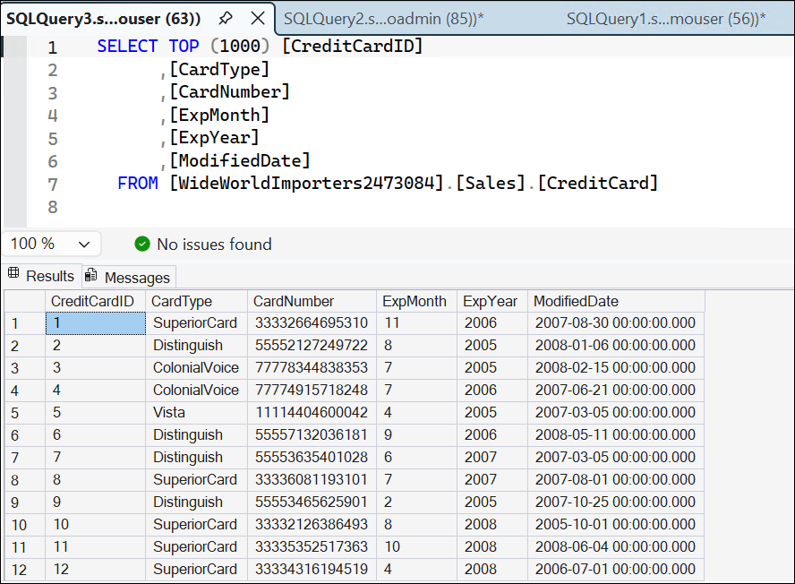
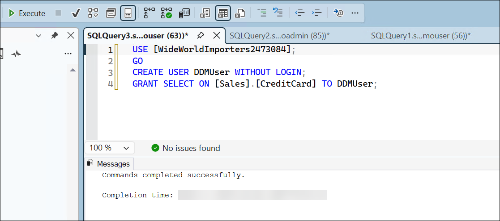
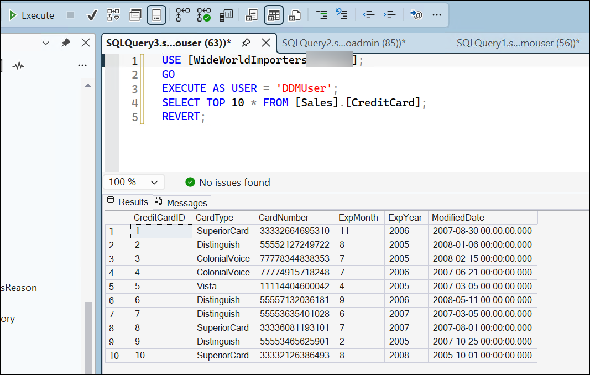
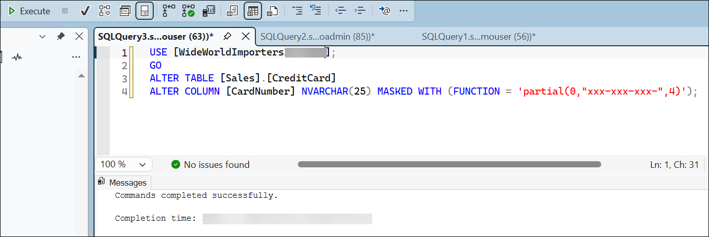
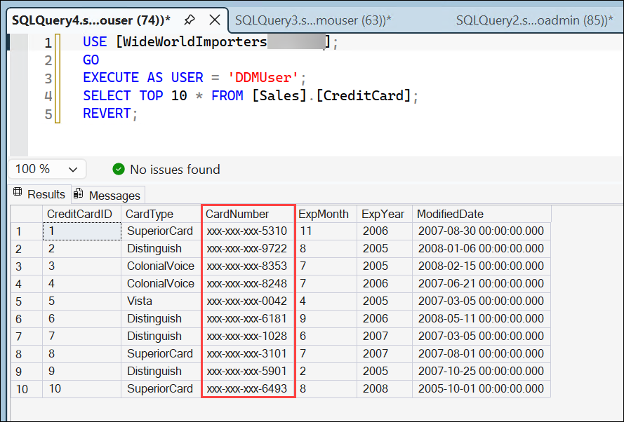
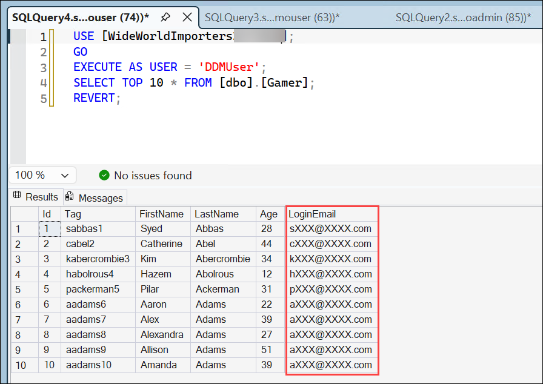

## Exercise 6: Enable Dynamic Data Masking and use read scale-out

**Duration: 30 Minutes**

### Overview

In this exercise, you will protect sensitive columns with **Dynamic Data Masking (DDM)**, which hides sensitive data in query results from users without privilege to see it, and then route the web app's read-only reporting queries to a secondary replica with **read scale-out**.

### Objectives

- **Task 1:** Enable DDM on credit card numbers
- **Task 2:** Apply DDM to email addresses
- **Task 3:** Route read-only queries to a secondary replica with read scale-out

## Task 1: Enable DDM on credit card numbers

In this task, you will apply a dynamic data mask to the credit card number column and confirm a non-privileged user sees only the last four digits.

1. In **SQL Server Management Studio (SSMS)**, expand **Databases**, expand **WideWorldImporters**, and then expand **Tables**.

   

1. Find **Sales.CreditCard**, right-click it, and select **Select Top 1000 Rows**.

    
   
1. Create a test user (replace **SUFFIX**):

   ```sql
   USE [WideWorldImportersSUFFIX];
   GO
   CREATE USER DDMUser WITHOUT LOGIN;
   GRANT SELECT ON [Sales].[CreditCard] TO DDMUser;
   ```

   
   
1. Run as the test user — card numbers still in plain text:

   ```sql
   USE [WideWorldImportersSUFFIX];
   GO
   EXECUTE AS USER = 'DDMUser';
   SELECT TOP 10 * FROM [Sales].[CreditCard];
   REVERT;
   ```

    
   
1. Add a mask to the `CardNumber` column:

   ```sql
   USE [WideWorldImportersSUFFIX];
   GO
   ALTER TABLE [Sales].[CreditCard]
   ALTER COLUMN [CardNumber] NVARCHAR(25) MASKED WITH (FUNCTION = 'partial(0,"xxx-xxx-xxx-",4)');
   ```

    

1. Run the test-user query again — only the last four digits show.

    

   
## Task 2: Apply DDM to email addresses

In this task, you will apply the built-in email mask to the login email column and confirm it is masked for a non-privileged user.

1. Grant access and mask `LoginEmail` in `dbo.Gamer` with the built-in `email()` function (replace **SUFFIX**):

   ```sql
   USE [WideWorldImportersSUFFIX];
   GO
   GRANT SELECT ON [dbo].[Gamer] TO DDMUser;
   GO
   ALTER TABLE [dbo].[Gamer]
   ALTER COLUMN [LoginEmail] NVARCHAR(250) MASKED WITH (FUNCTION = 'email()');
   ```

   
   
1. Run as the test user and look at `LoginEmail`:

   ```sql
   USE [WideWorldImportersSUFFIX];
   GO
   EXECUTE AS USER = 'DDMUser';
   SELECT TOP 10 * FROM [dbo].[Gamer];
   REVERT;
   ```
  
  
   > The `email()` function shows the first letter and replaces the rest with `XXX@XXXX.com`.

### Task 3: Route read-only reporting to a secondary replica with read scale-out

In this task, you enable **read scale-out** for the web app's read-only reporting queries and observe the result. Read scale-out sends read-only connections to a **readable secondary replica** instead of the primary — so reporting queries don't compete with the transactional workload — with a single connection-string setting and no code change.

1. Open the web application from the **Overview** page of **wwi-web-<inject key="Suffix" enableCopy="false"/>** (**Default domain**) and select **Leaderboard**. Note the status shown on the page — this is the `Updateability` of the database the app is connected to, and it currently shows **`READ_WRITE`** (the primary).

1. On the **wwi-web-<inject key="Suffix" enableCopy="false"/>** App Service, under **Settings**, select **Environment variables**, select the **Connection strings** tab, and select **Advanced edit**.

1. For **`WwiReadOnlyContext`**, add the following to the **end** of the connection string **Value**, and select **OK**:

   ```
   ApplicationIntent=ReadOnly;
   ```
    

    
   
1. Select **Apply**, then **Confirm** when told the app will restart.

1. Return to the web application and refresh the **Leaderboard** page. Observe the status it now shows:

    
   
   - On a **Business Critical** managed instance → the page shows **`READ_ONLY`** — the reporting queries are now served by a read-only secondary replica, leaving the primary free for the live workload.
   - On a **General Purpose** managed instance → the page remains **`READ_WRITE`** — see the note below.
  
   > **Note — read scale-out and service tiers:** Read scale-out uses the always-up secondary replicas that are built into the **Business Critical** service tier (the same replicas that provide its high-availability SLA), and it's available at **no extra cost** there. **General Purpose** has a single replica and no readable secondary, so the connection stays on the primary (`READ_WRITE`) even with `ApplicationIntent=ReadOnly`. To see read scale-out route reporting to a secondary replica live, the managed instance must be **Business Critical**.

> **Takeaway:** With one connection-string setting (`ApplicationIntent=ReadOnly`), a Business Critical managed instance offloads read-only reporting to a secondary replica, improving both reporting *and* transactional performance with no extra infrastructure.

## Summary

In this exercise, you masked sensitive columns with Dynamic Data Masking and learned how read scale-out routes read-only reporting queries to a secondary replica on the Business Critical tier.

## You have successfully completed the lab!

In this **Data Modernization** lab, you migrated an end-of-support SQL Server 2016 database to Azure SQL Managed Instance with current tools: you assessed the server with **Azure Arc**, migrated with both the **Managed Instance link** and **Azure DMS from Blob Storage**, connected the application through **regional VNet integration**, compared performance with **Query Store**, and secured and scaled the database with **Microsoft Defender for SQL**, **Data Discovery & Classification**, **TDE**, **Dynamic Data Masking** and **read scale-out**.
