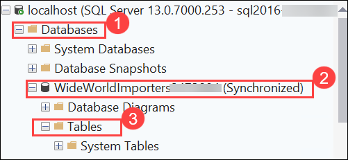
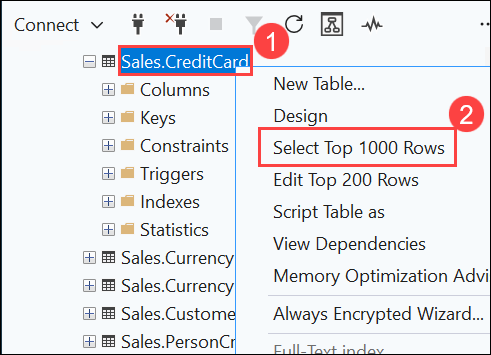
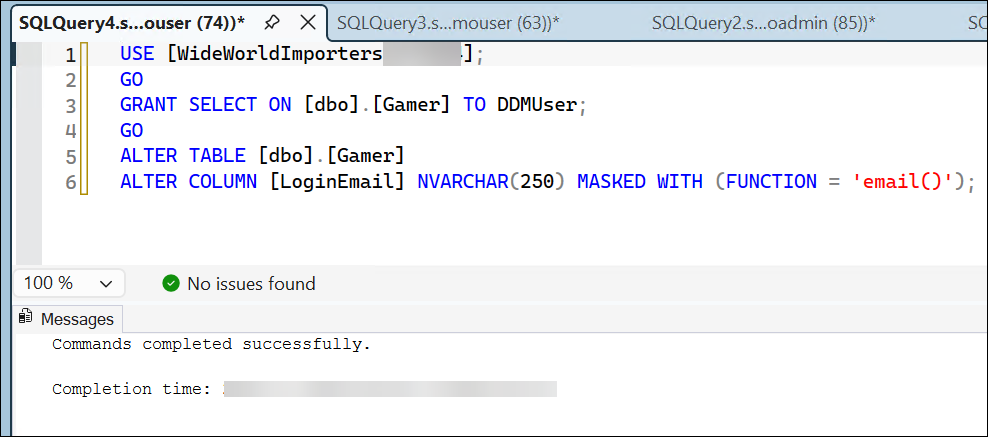
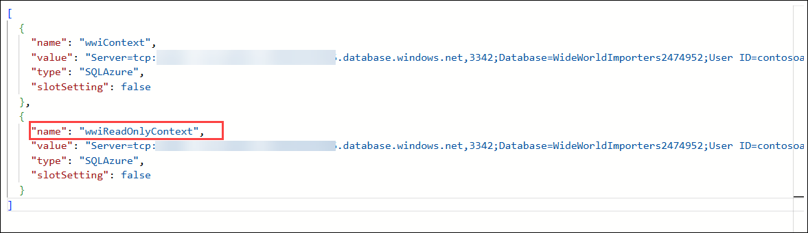
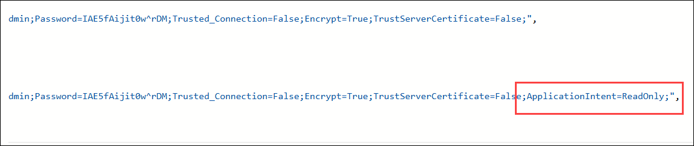
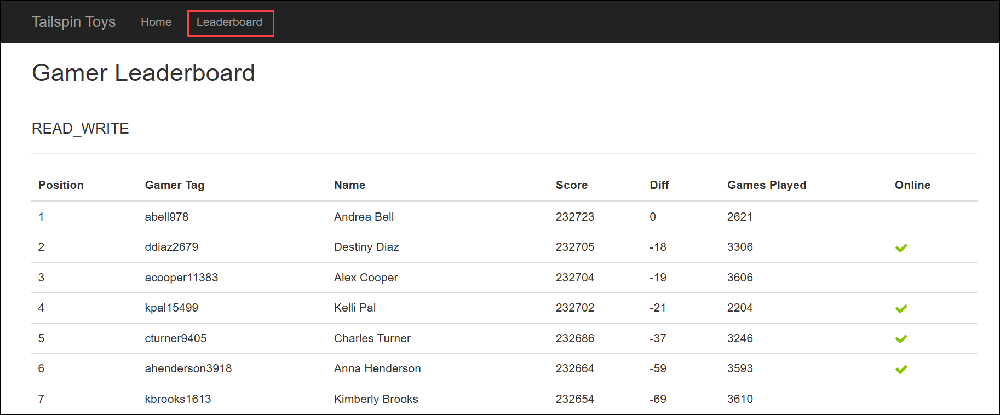

# Exercise 6: Secure Sensitive Data with Dynamic Data Masking

### Duration: 30 Minutes

## 📖 Overview

In this exercise, you will protect sensitive columns with **Dynamic Data Masking (DDM)**, which hides sensitive data in query results from users without privilege to see it, and then route the web app's read-only reporting queries to a secondary replica with **read scale-out**.

## 🎯 Objectives

- **Task 1:** Enable DDM on credit card numbers
- **Task 2:** Apply DDM to email addresses
- **Task 3:** Route read-only queries to a secondary replica with read scale-out

### Task 1: Enable DDM on credit card numbers

In this task, you will create a test user, apply a dynamic data mask to the credit card number column, and verify that the non-privileged user sees only the masked value.

1. In **SQL Server Management Studio (SSMS)**, expand **Databases**, expand **WideWorldImporters**, and then expand **Tables**.

   

1. Find **Sales.CreditCard**, right-click it, and select **Select Top 1000 Rows**.

    
   
1. Create a test user (replace **SUFFIX**):

   ```sql
   USE [WideWorldImportersSUFFIX];
   GO
   CREATE USER DDMUser WITHOUT LOGIN;
   GRANT SELECT ON [Sales].[CreditCard] TO DDMUser;
   ```

   
   
1. Run as the test user — card numbers still in plain text:

   ```sql
   USE [WideWorldImportersSUFFIX];
   GO
   EXECUTE AS USER = 'DDMUser';
   SELECT TOP 10 * FROM [Sales].[CreditCard];
   REVERT;
   ```

    
   
1. Add a mask to the `CardNumber` column:

   ```sql
   USE [WideWorldImportersSUFFIX];
   GO
   ALTER TABLE [Sales].[CreditCard]
   ALTER COLUMN [CardNumber] NVARCHAR(25) MASKED WITH (FUNCTION = 'partial(0,"xxx-xxx-xxx-",4)');
   ```

    

1. Run the test-user query again — only the last four digits show.

    

   

### Task 2: Apply DDM to email addresses

In this task, you will apply the built-in **email** data mask to the `LoginEmail` column and verify that the email address is masked for the non-privileged user.

1. Grant access and mask `LoginEmail` in `dbo.Gamer` with the built-in `email()` function (replace **SUFFIX**):

   ```sql
   USE [WideWorldImportersSUFFIX];
   GO
   GRANT SELECT ON [dbo].[Gamer] TO DDMUser;
   GO
   ALTER TABLE [dbo].[Gamer]
   ALTER COLUMN [LoginEmail] NVARCHAR(250) MASKED WITH (FUNCTION = 'email()');
   ```

   
   
1. Run as the test user and look at `LoginEmail`:

   ```sql
   USE [WideWorldImportersSUFFIX];
   GO
   EXECUTE AS USER = 'DDMUser';
   SELECT TOP 10 * FROM [dbo].[Gamer];
   REVERT;
   ```
  
  
   > The `email()` function shows the first letter and replaces the rest with `XXX@XXXX.com`.

### Task 3: Configure read scale-out for read-only reporting

In this task, you will learn how **read scale-out** can route read-only reporting queries to a readable secondary replica instead of the primary replica. You will configure the web application’s reporting connection with `ApplicationIntent=ReadOnly` and observe how the connection behaves in your environment.

> **Note:** Read scale-out is available when the SQL Managed Instance has a readable secondary replica, such as with the **Business Critical** service tier. If your SQL Managed Instance does not have a readable secondary replica, the connection will remain on the primary database and the application will continue to show `READ_WRITE`. This is expected behavior.


1. Open the web application from the **Overview** page of **wwi-web-<inject key="Suffix" enableCopy="false"/>** (**Default domain**) and select **Leaderboard**. Note the status displayed on the page. This is the `Updateability` of the database the app is connected to, and it currently shows **`READ_WRITE`** (the primary replica).

1. On the **wwi-web-<inject key="Suffix" enableCopy="false"/>** App Service, under **Settings**, select **Environment variables**, select the **Connection strings** tab, and select **Advanced edit**.

1. For **`WwiReadOnlyContext`**, add the following to the **end** of the connection string **Value**, and select **OK**:

   ```
   ApplicationIntent=ReadOnly;
   ```
    

    
   
1. Select **Apply**, then **Confirm** when told the app will restart.

1. Return to the web application and refresh the **Leaderboard** page. Observe the status it now shows:

    
   
     - If the managed instance **has a readable secondary replica** (Business Critical tier), the page shows **`READ_ONLY`** — the reporting query is now served by a read-only secondary replica, leaving the primary free for the transactional workload.
     - If the managed instance **does not have a readable secondary replica** (for example, General Purpose), the page remains **`READ_WRITE`** — the connection stays on the primary. This is expected behavior.

     > **Takeaway:** Read scale-out uses a single connection-string setting (`ApplicationIntent=ReadOnly`) to request a read-only connection. When a readable secondary replica is available, read-only reporting queries can be routed to the secondary replica, helping reduce the reporting workload on the primary.


### 🧾 Summary

In this exercise, you protected sensitive data using **Dynamic Data Masking** and configured the web application to use **read scale-out** for read-only reporting queries. You applied masking to credit card numbers and email addresses, configured `ApplicationIntent=ReadOnly`, and verified how the application behaves depending on whether a readable secondary replica is available.


#### You have successfully completed the lab!

In this **Migrating SQL Databases to Azure SQL Managed Instance with Azure Arc** lab, you migrated an end-of-support SQL Server 2016 database to **Azure SQL Managed Instance** using modern migration tools and approaches. You assessed the database with **Azure Arc**, migrated it using both the **Managed Instance link** and **Azure Database Migration Service (DMS) with Blob Storage**, connected the web application to the migrated database, and improved its security and data protection using **Microsoft Defender for SQL**, **Data Discovery & Classification**, **Transparent Data Encryption (TDE)**, and **Dynamic Data Masking**. You also explored **read scale-out** for read-only reporting and observed how the connection behaves based on the availability of a readable secondary replica.
