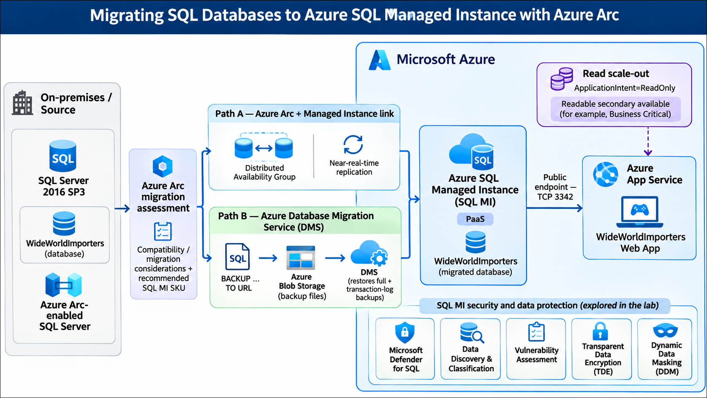
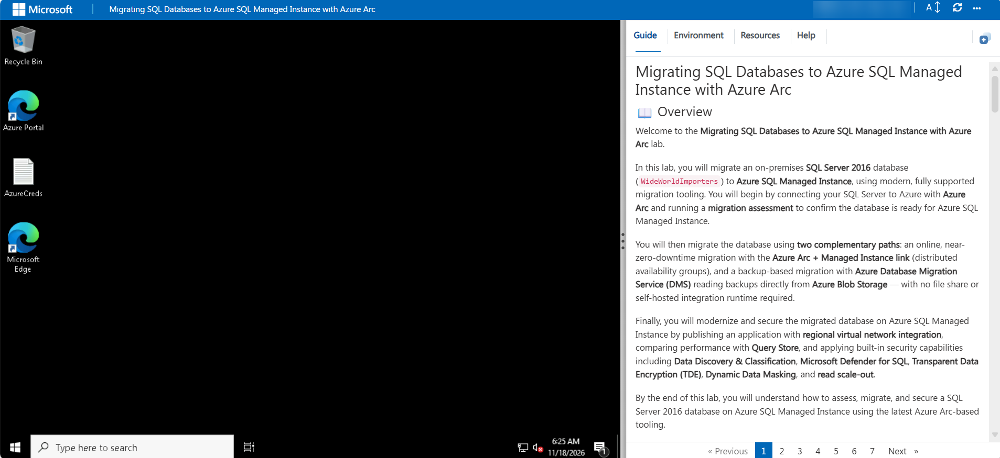
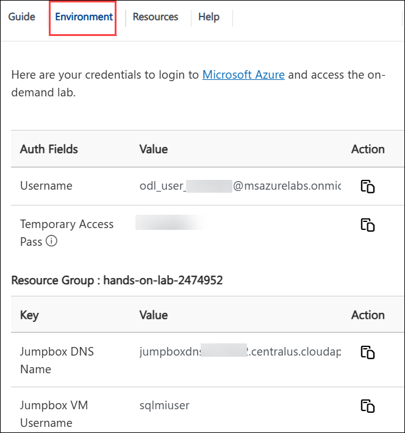
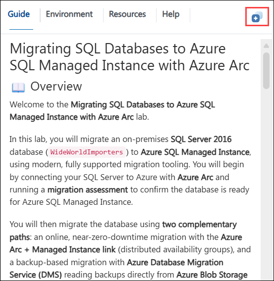
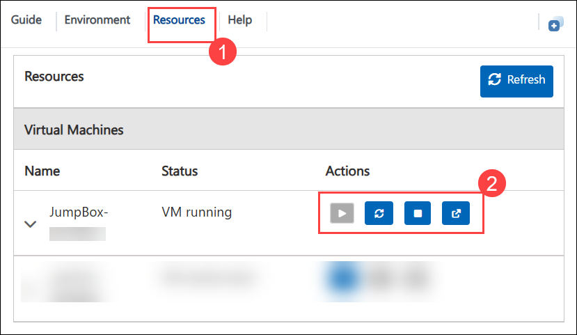
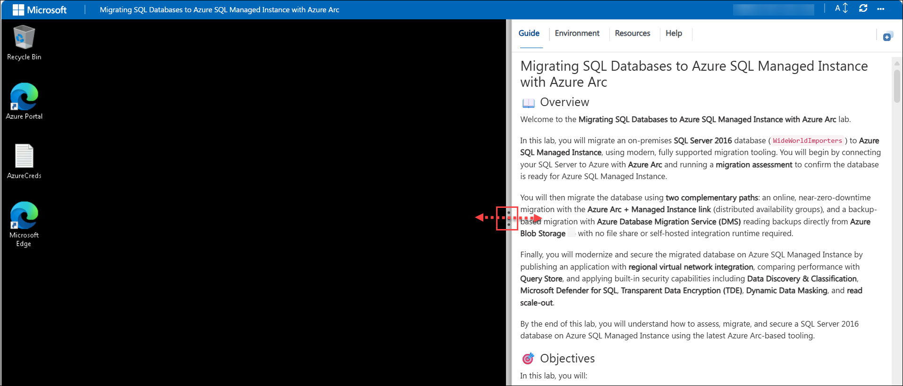

# Migrating SQL Databases to Azure SQL Managed Instance with Azure Arc

## 📖 Overview

Welcome to the **Migrating SQL Databases to Azure SQL Managed Instance with Azure Arc** lab.

In this lab, you will migrate an on-premises **SQL Server 2016** database (`WideWorldImporters`) to **Azure SQL Managed Instance**, using modern Azure migration tooling. You will begin by connecting your SQL Server to Azure with **Azure Arc** and running a **migration assessment** to evaluate the database's compatibility and migration readiness for Azure SQL Managed Instance.

You will then migrate the database using **two complementary paths**: an online migration with the **Azure Arc + Managed Instance link**, which uses distributed availability groups for near-real-time replication and enables minimal-downtime cutover, and a backup-based migration with **Azure Database Migration Service (DMS)** using backups stored directly in **Azure Blob Storage**. This DMS approach does not require a file share or self-hosted integration runtime.

Finally, you will connect the migrated database to an **Azure App Service** web application through the SQL Managed Instance **public endpoint** and explore built-in security and data protection capabilities, including **Data Discovery & Classification**, **Microsoft Defender for SQL**, **Transparent Data Encryption (TDE)**, **Dynamic Data Masking**, and **read scale-out**.

By the end of this lab, you will understand how to assess, migrate, connect, and secure a SQL Server 2016 database on Azure SQL Managed Instance using Azure migration and database management tools.

## 🎯 Objectives

In this lab, you will:

- Connect a SQL Server 2016 instance to Azure with **Azure Arc** and run a **migration assessment**

- Migrate the database with the **Azure Arc + Managed Instance link** (Path A — minimal downtime)

- Migrate the database with **Azure Database Migration Service** using backups stored in **Azure Blob Storage** (Path B)

- Publish the **WideWorldImporters** web application to Azure App Service and connect it to Azure SQL Managed Instance through the **public endpoint**

- Secure the database with **Data Discovery & Classification**, **Microsoft Defender for SQL**, and **Transparent Data Encryption**

- Apply **Dynamic Data Masking** and explore **read scale-out** for read-only reporting

## ⚙️ Prerequisites

Participants should have basic knowledge of the following:

- SQL Server administration fundamentals (databases, backups, recovery models)

- Azure fundamentals (resource groups, virtual networks, the Azure portal)

- Familiarity with **SQL Server Management Studio (SSMS)**

> **Note:** The lab environment is preconfigured with a SQL Server 2016 virtual machine, the source `WideWorldImporters` database, a shared Azure SQL Managed Instance, and the required networking and permissions.

## 🏗️ Architecture

## 🔍 Explanation of Components

- **SQL Server 2016 (Azure Arc-enabled):** The source database server. Azure Arc provides the connection to Azure for inventory, migration assessment, and the Managed Instance link migration.

- **Azure Arc:** Provides the **migration assessment** and **Managed Instance link** migration experience from the Azure portal.

- **Azure SQL Managed Instance:** The fully managed PaaS migration target, providing near 100% compatibility with the SQL Server database engine.

- **Azure Database Migration Service (DMS):** Performs the backup-based migration (Path B) by restoring full and transaction-log backups from **Azure Blob Storage** to the managed instance.

- **Azure Blob Storage:** Stores the database backup files written directly from SQL Server using `BACKUP ... TO URL`.

- **Azure App Service:** Hosts the **WideWorldImporters** web application and connects to the migrated database through the SQL Managed Instance public endpoint.

- **Built-in security and data protection:** **Microsoft Defender for SQL**, **Data Discovery & Classification**, **Transparent Data Encryption (TDE)**, and **Dynamic Data Masking** are used to assess, protect, and secure the migrated database.

- **Read scale-out:** The web application's reporting connection is configured with `ApplicationIntent=ReadOnly` to explore read-only workload routing when a readable secondary replica is available.

## 🚀 Getting Started with the lab
 
A preconfigured environment has been prepared for you to explore **Azure Arc** and **Azure SQL Managed Instance** and learn how to assess, migrate, connect, and secure a SQL Server 2016 database.
 
## Accessing Your Lab Environment
 
Once you're ready to dive in, your virtual machine and **Guide** will be right at your fingertips within your web browser.

## Virtual Machine & Lab Guide
 
Your virtual machine is your workhorse throughout the workshop. The lab guide is your roadmap to success.
 
## Exploring Your Lab Resources
 
To get a better understanding of your lab resources and credentials, navigate to the **Environment** tab.

  
 
## Utilizing the Split Window Feature
 
For convenience, you can open the lab guide in a separate window by selecting the **Split Window** button from the Top right corner.
 
   
 
## Managing Your Virtual Machine
 
Feel free to start, stop, or restart your virtual machine as needed from the **Resources** tab. Your experience is in your hands!
 
  

## Lab Guide Zoom In/Zoom Out
 
To adjust the zoom level for the environment page, click the **A↕ : 100%** icon located next to the timer in the lab environment.

   

## Resize the Virtual Machine View

Use the **slider (three vertical dots)** located between the **Virtual Machine** and the **Lab Guide** panes to adjust the display size, allowing you to customize the layout based on your preference.

   
 
## 📞 Support Contact
 
The **CloudLabs support team** is available 24/7, 365 days a year, via email and live chat to ensure seamless assistance at any time. We offer dedicated support channels tailored specifically for both learners and instructors, ensuring that all your needs are promptly and efficiently addressed.

Learner Support Contacts:

- Email Support: cloudlabs-support@spektrasystems.com

- Live Chat Support: https://cloudlabs.ai/labs-support

Now, click on **Next** from the lower right corner to move on to the next page.

   

### Happy Learning!!
