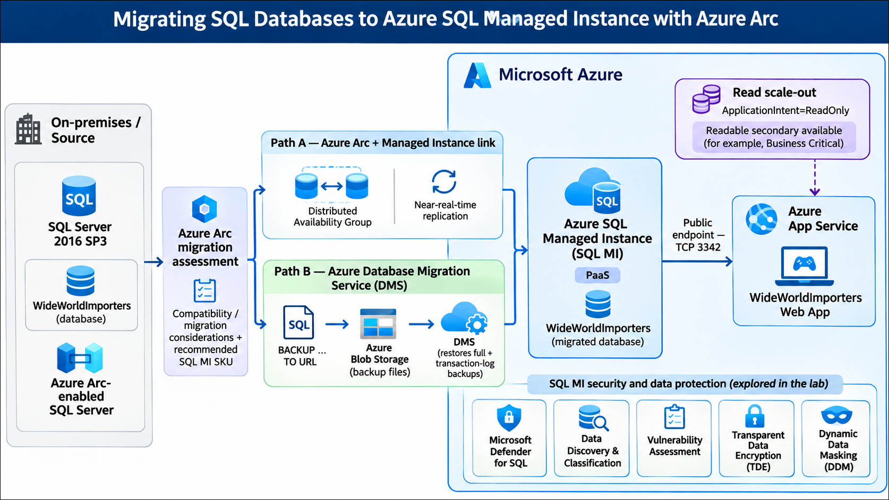

## Abstract and learning objectives

In this hands-on lab, you will implement a proof-of-concept (PoC) for migrating an on-premises **SQL Server 2016 SP3** database to **Azure SQL Managed Instance (SQL MI)**. You will assess the database with **Azure Arc** to identify feature compatibility and migration considerations, then migrate the `WideWorldImporters` database to Azure using two migration approaches: **Azure Arc with the Managed Instance link** and **Azure Database Migration Service (DMS) using backups stored in Azure Blob Storage**. You will then connect the web application to the migrated database and explore the security and data protection capabilities of SQL MI.

At the end of this hands-on lab, you will be better able to implement a cloud migration solution for business-critical applications and databases using Azure migration and database management tools.

## Overview

Wide World Importers (WWI) is the developer of the popular online video game franchise. Founded in 2010, the company has experienced exponential growth since adding online multiplayer gameplay to its games.

Adding online gameplay dramatically increased demand, which made the current on-premises setup hard to support. WWI maintains its gamer information database, `WideWorldImporters`, on an on-premises **SQL Server 2016** instance. Gamers use this system to update their profiles, view leaderboards, purchase game add-ons, and more. Because it drives revenue, it is a business-critical application that must stay highly available.

**SQL Server 2016 reached the end of Extended Support in July 2026.** WWI now needs to move this database to a supported, fully managed platform and would prefer a platform-as-a-service (PaaS) offering if possible. WWI uses the **Service Broker** feature of SQL Server for messaging within the `WideWorldImporters` database. This functionality supports several critical processes, and WWI cannot afford to lose it during migration. They also don't have the resources to rearchitect the solution to use an alternative message broker, which makes **Azure SQL Managed Instance** a suitable target because it provides near 100% compatibility with the SQL Server database engine.

## Solution architecture

Below is a diagram of the solution architecture you implement in this lab. Study it carefully to understand the overall solution as you work through the components.

 

The solution begins with an **Azure Arc migration assessment** of the on-premises SQL Server 2016 database. The assessment checks feature compatibility and migration considerations for Azure SQL Database and Azure SQL Managed Instance and provides a SKU recommendation for SQL MI. The goal is to migrate the `WideWorldImporters` database to an Azure PaaS offering with minimal application changes.

The database is then migrated to SQL MI using **two approaches**, so you can compare them:

- **Path A - Azure Arc + Managed Instance link.** The link creates a distributed availability group between the SQL Server instance and SQL MI and replicates the database continuously. Cutover can be completed with minimal downtime. For a SQL Server 2016 source, replication is one-way from SQL Server to SQL MI, and failback to SQL Server isn't supported.

- **Path B - Azure DMS from Azure Blob Storage.** SQL Server backs up directly to a blob container using `BACKUP ... TO URL`, and Azure Database Migration Service restores the full and transaction-log backups to SQL MI. This approach does not require an SMB file share or a self-hosted integration runtime.

The web app is deployed to an Azure App Service Web App using **Visual Studio 2022**. The app connects to the SQL Managed Instance through its **public endpoint** on port 3342. The web app's connection strings are then updated to point to the migrated SQL MI database.

Finally, you explore several SQL MI security and data protection capabilities. **Microsoft Defender for SQL** is enabled, **Data Discovery & Classification** is used to identify and classify sensitive data, and the Defender for SQL **vulnerability assessment** is used to identify security issues. You remediate the Transparent Data Encryption (TDE) finding by enabling TDE and verify the result with a rescan. You also use **Dynamic Data Masking (DDM)** to protect sensitive data from being exposed to non-privileged users.

Finally, you explore **read scale-out** by configuring the web application's reporting connection with `ApplicationIntent=ReadOnly`. When a readable secondary replica is available, such as with the **Business Critical** service tier, read-only reporting queries can be routed to the secondary replica. On service tiers without a readable secondary, the connection remains on the primary replica.
